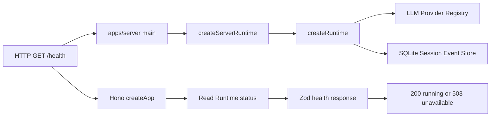
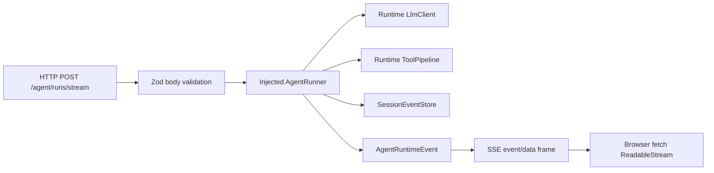
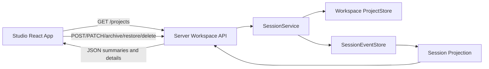
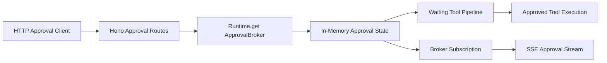

# Weave Foundation Architecture

Weave-maintained Skills ship as self-contained schema-2 instruction data. Server
assigns official discovery attribution only to code-owned exact GitHub source and
full manifest identities; operator index metadata grants no maintainership or
privilege. Studio mirrors that category but routes installable GitHub releases
through normal preview/import/review/activation. Distributed official IDs are
protected only in index admission, not globally reserved from installation. The
[official Skills design](../superpowers/specs/2026-11-22-official-skills-design.md)
records these cross-app contracts before implementation.

Declarative custom panels add governed closed JSON in Plugin, immutable current-only
binding and durable-prefix projection in Server, and independent HTTP validation
and native rendering in Studio. Marketplace stays in left navigation; stable
plugin tabs join the right panel system. Forms prepare editable command text for
explicit Send. Reads execute no plugin callbacks and retain no Generation pins;
Session lifecycle follows the observed prefix, with bounded retained projections
rather than a new store-level memory or deletion guarantee. The contracts are
recorded before code in [ADR 0010](../adr/0010-declarative-plugin-panels.md) and the
[panel design](../superpowers/specs/2026-11-22-plugin-panels-design.md).

The plugin ownership repair binds service consumer views to frozen kernel
identities and records only accepted governed contributions. Standard Session
writers reject foreign namespaces through both direct use and factory deps;
event readers expose metadata without registry mutation. Host service lifetime,
Session history and Tool Pipeline behavior remain independent. This prerequisite
for custom panels is specified before code in
[ADR 0009](../adr/0009-plugin-consumer-ownership.md) and the
[owner-boundary design](../superpowers/specs/2026-11-22-plugin-owner-boundary-design.md).

The repository-local Plugin developer CLI is an independent leaf consuming only
Plugin and Plugin-host. It scaffolds typed Tool/Command or no-entry Skills projects,
checks the actual SDK, builds single ESM payloads and packs verified directories.
It does not install dependencies, execute author configs or change trust. Source,
payload and output-container contracts are defined before implementation in
[ADR 0008](../adr/0008-plugin-developer-tooling.md) and the
[CLI design](../superpowers/specs/2026-11-22-plugin-developer-cli-design.md).

Declarative Skill packages extend installation with a strict schema-2 descriptor,
`host:declarative` and no executable entry. The host reads bounded text snapshots
and adapts them to the existing governed Skills seam; exact trust, independent
activation, Generation retention and the shared Tool Pipeline remain authoritative.
No authority format or marketplace version change is needed: reviewed full
manifest plus directory digest already bind the payload type. See the
[design and implementation plan](../superpowers/specs/2026-11-22-declarative-skill-packages-design.md)
and [ADR 0007](../adr/0007-declarative-skill-packages.md), recorded before code.

Skills provides protocol references, core Session facts, Runtime turn context and
governed plugin contributions in an end-to-end Server/Studio vertical slice.
The [Skills contract](../superpowers/specs/2026-11-22-skills-design.md) defines exact
source and bundle identity, lazy resources through the shared Tool Pipeline,
per-generation/per-turn pins and required audit. This is instruction data;
execution and approval stay under existing Runtime policy. The [usage guide](../learning/2026-11-22-skills.md) covers authoring, selection,
progressive resources, durable provenance and exact retries. The
[text-package guide](../learning/2026-11-22-declarative-skill-packages.md) covers
no-entry distribution; the developer CLI is the independent leaf described above,
and custom panels use the governed SDK described above. Current verified Codex, Harness and Kimi
references and official-content choices are recorded in the
[reference audit](../learning/2026-11-22-official-plugin-references.md).

Stage 6.5 index extension adopts multiple cached marketplace sources and a
repository-maintained directory with deterministic submission tooling. Server
owns HTTPS discovery and append-only source settings; Studio uses guarded HTTP.
Discovery never grants trust or executes code. Fixed GitHub releases continue
through the existing preview, immutable import and separate activation flow.
The approved cross-package contract and pinned Harness reference are in the
[indexes design](../superpowers/specs/2026-11-22-plugin-marketplace-indexes-design.md).

Stage 6.4 adds public GitHub acquisition at a complete commit and optional
subdirectory. `plugin-host` validates bounded Git commit/tree metadata and raw
blob content inside a callback-scoped private scratch directory. Server preserves
remote provenance and imports only bytes matching the preview; saved request
replay remains offline. Studio adds a GitHub source form and source-aware review
and history. Installation still creates an inert candidate and activation remains
a separate human decision. Acquisition cleanup drains before store ownership is
released. See the [GitHub design](../superpowers/specs/2026-11-22-github-plugin-acquisition-design.md)
and [usage and validation](../learning/2026-11-22-github-plugin-acquisition.md).

Stage 6.3 extends Studio's App-owned plugin catalog and management
gate with the existing managed installer API. It pairs the manual, MCP and
managed catalog observations, preserves confirmed authority heads, and keeps
exact undecided requests in App memory for explicit retry. Candidate import,
reviewed activation and rollback remain separate user decisions; saved
decisions and actual published versions have separate displays. Desktop adds
a purpose-validated native folder chooser and first binding for its default
plugin root. Custom directory overrides retain the existing Server path and
binding rules. See the
[Studio design](../superpowers/specs/2026-11-22-studio-plugin-installer-design.md)
and [implementation plan](../superpowers/plans/2026-11-22-studio-plugin-installer.md),
plus [usage and development-process validation](../learning/2026-11-22-studio-plugin-installer.md).

Stage 6.2d adds a loopback HTTP installer for already bundled local ESM
directories when Server startup owns the registered store. The installer
uses bounded, transient previews and publishes reviewed bytes before
recording a candidate. Import grants no trust or selection and preserves a
healthy Generation. Reviewed activation and rollback bind exact persisted
candidate identities. Managed JSON projects durable decisions, actual
members captured in the same ticket, and a cached catalog.

Real loopback tests with SQLite and filesystem readback verify namespace
ordering, pinned payloads, isolated setup and terminal publication failures,
and owned shutdown and release retry. A request disconnected before commit
can leave a reusable artifact without a durable decision. Application
continues after a postcommit disconnect, and replay after restart returns
the saved decision with application status unknown. The cached catalog
remains available after observed store ownership loss while Server is
reachable. Stage 6.3 adds the Studio and Desktop management surface. See
the [installer design](../superpowers/specs/2026-11-22-managed-plugin-installer-api-design.md)
and [implementation plan](../superpowers/plans/2026-11-22-managed-plugin-installer-api.md).

Stage 6.2c.2 integrates managed plugin authority and artifact ownership into
Server startup. With local ESM enabled, a registered store automatically resumes
at its bound root before source preparation or HTTP listen. An unregistered
store requires explicit `allow-unbound` for its first binding. Default
unregistered startup leaves the store unopened. Sticky IDs from installation
history reserve the namespace even with local ESM disabled.

One admin queue serializes reloads and manual, MCP and managed mutations.
Server adopts paired local and MCP snapshots together, quarantines IDs claimed
by both managed history and non-removed MCP declarations, and validates MCP
authority before bounded reads that verify selected, enabled and trusted
artifacts against their durable candidates. Generation publication checks the
exact managed identity, including its activation sequence, against current
selection, trust, namespace and lease. A Generation with managed members checks
the ownership latch and lease at the Session queue head. Ownership loss blocks
new turns if the current Generation has managed members, withdraws managed
eligibility and cancels unpublished work while preserving current and retired
Generation pins.

The private selection API records a durable decision and reports application
to a Generation separately. Replay returns the original decision and current
authority without runtime effects. Owned `stop()` and `pluginHost.dispose()`
share retryable shutdown phases. They drain dispatched artifact and admin work
before cancelling turns, keep Session persistence open through terminal writes,
and release the lease only after tracked plugin work settles. Failed startup
uses the same cleanup phases.

Normal owned startup loads eligible selected managed ESM plugins, including on
restart with binding options omitted. The existing `/plugins` and `/commands`
GETs project cached state. Published managed members appear as path-free
`kernel` entries, manual rows keep their discovery paths, and public failures
use safe messages while retaining raw causes privately. Managed desired and
retired state stay private in those existing endpoints. The discovery catalog
belongs to Stage 6.5. See the
[managed source design](../superpowers/specs/2026-11-21-managed-plugin-source-design.md)
and [Server plan](../superpowers/plans/2026-11-21-managed-plugin-source-server.md).

Stage 6.2c.1 adds package support for explicitly selected managed ESM plugins.
The artifact store returns the validated concrete entry. The shared local source
combines manual declarations with explicit selections, sticky ID reservations,
enabled exact trust and a completed manual scan. Managed preparation uses a
bounded verifier and synchronous authority checks before import, factory and
setup; its disposal waits for actual setup settlement. The Generation runner
can check admission at the actual Session queue head before pinning resources
or invoking Runtime. These callbacks carry no Server, HTTP or SQLite types, and
the standalone host keeps its manual contract. See the
[managed source design](../superpowers/specs/2026-11-21-managed-plugin-source-design.md)
and [package plan](../superpowers/plans/2026-11-21-managed-plugin-source-support.md).

Stage 6.2b adds a Server-private owned artifact-store factory. It binds an exact
authority UUID/path and artifact root through append-once metadata, then retains
an exclusive transaction on a separate rollback-journal SQLite connection. Main
authority transactions remain short. Guarded artifact calls share one existing
store queue, synchronously abort on observed ownership loss, and drain while the
lease remains held during normal quiescence. See the
[ownership design](../superpowers/specs/2026-11-21-plugin-store-ownership-design.md)
and [protocol and limits](../learning/2026-11-21-plugin-store-ownership.md).

Stage 6.2a adds Server-private plugin authority persistence on one SQLite
connection. Installation, existing trust and managed operation logs are appended
atomically; every successful fresh managed request, including no-op, has one
durable operation. Replay returns that original decision with current validated
authority, without applying it again. Managed results are fully constructed and
frozen before COMMIT; the legacy trust facade keeps mutable detached copies and
rejects writes for sticky managed IDs. See the
[authority design](../superpowers/specs/2026-11-21-plugin-authority-design.md) and
[usage and boundaries](../learning/2026-11-21-plugin-authority-database.md).

Stage 6.1 provides a bounded filesystem artifact store in `@weave/plugin-host`.
It copies already bundled directories without executing them, validates concrete
payload bytes and publishes hidden content-addressed paths. It never overwrites
or deletes published content, grants trust, changes selection or reloads a
Generation. Stage 6.2a adds the durable selection and reviewed activation
records used by the later Server composition. See
[ADR 0005](../adr/0005-plugin-installation-and-distribution.md) and the
[installation design](../superpowers/specs/2026-11-21-plugin-installation-design.md), plus
[artifact-store usage](../learning/2026-11-21-plugin-artifact-store.md). This is a
filesystem API, not an end-to-end installer or installation UI.

Stage 5.4 extends Studio's existing App-owned plugin catalog store with the MCP
HTTP catalog and a shared ESM/MCP write gate. The two catalogs are published
together only after their complete generation/admission projections agree;
bounded GET reconciliation never starts processes. Saving a launch configuration
and reviewing its canonical trust snapshot are separate actions. Explicit reload
rebuilds both extension sources, and immediate removal decisions can cancel all
current and retired turns. Studio remains an HTTP/SSE client with no runtime,
process, filesystem or secret access. See the
[MCP design §10.5](../superpowers/specs/2026-11-21-mcp-stdio-design.md) and
[Studio implementation plan](../superpowers/plans/2026-11-21-studio-mcp-management.md).

This document explains the first runnable Weave slice, the implemented
headless Agent Loop, the shared Tool Pipeline, and the Project/Session
persistence boundary. It is a learning and maintenance guide, not a
replacement for the package APIs or tests.

## The Request Path

The Server exposes a health check, a thin Approval control plane with REST and
SSE adapters, and a thin Agent POST + SSE adapter. The Agent Runner remains a
Runtime API used directly by tests, CLI, desktop callers, and the Server
composition root; Server only transports its transient events.



Agent execution follows a separate adapter path:



The first Studio surface makes the browser boundary explicit:

```mermaid
flowchart LR
    A[Studio React App] -->|POST JSON| B[Vite /agent proxy]
    B --> C[Server Agent HTTP adapter]
    C -->|AsyncIterable events| D[Runtime AgentRunner]
    D --> E[LlmClient]
    D --> F[ToolPipeline]
    D --> G[SessionEventStore]
    C -->|SSE transient events| A
    A -->|AbortController / disconnect| C
    C -->|iterator.return()| D
```

Project and Session management uses a separate request path:



`apps/studio` only consumes the HTTP/SSE contract. It does not import
`@weave/runtime`, `@weave/session`, or Node-only modules, and it does not invoke
tools or write Session events directly. The Vite `/agent` proxy is a local
development convenience; `/projects` and `/sessions` use the same local Server
target. The proxies do not change the package boundary. Server validates the
request, applies SessionService lifecycle rules, and transports data, while
Runtime remains the source of truth for Agent behavior.

When the browser cancels a request, the cancellation travels through the HTTP
response and Server request lifecycle to the current Agent iterator's
`return()`. Runtime then owns model/tool cancellation and the cancelled
Turn/Step persistence. The browser must not create a second cancellation state
machine.

The Studio slice is intentionally one request and one live stream. It has no
Run Registry, background ownership, replay, `Last-Event-ID`, or reconnection
protocol. A disconnected browser cannot use this endpoint to reconstruct
missed transient events; durable Session facts remain the recovery boundary.

The Server does not create a model client per request or invoke a tool
definition directly. `main.ts` starts the Runtime and injects one stable
Runner facade into `createApp()`. Server generations behind that facade own
their kernel, Tool Registry, plugin Providers, Tool Pipeline, Agent Runner,
prompt audit and plugin/command catalogs. Tests can inject a fake Runner
without a real provider or TCP socket.

`@weave/plugin-host` owns the generic generation controller; it knows only
requests with `sessionId`, an optional `signal`, and asynchronous event
iterables. The first `next()` queues a turn. When that Session's earlier turn
has finished producing, the next turn pins the current generation. Different
Sessions can run concurrently. An independent pump releases the pin and Session
queue when production ends, even if a consumer has not read its buffered
events. Returning an iterator aborts its execution and waits for cancellation
to settle before the Session can advance.

Server assembles a candidate with fresh registries, then publishes its runner
and catalogs together. Repeated `createServerAgentRunner` calls return the
existing facade; concurrent first calls share one initialization and its first
options, with retries allowed after failure. Configuration changes use explicit
assembly and publication. A failed candidate is disposed without replacing the
current generation. An old generation retires after its final running turn;
an immediate replacement also aborts turns in all retired generations.
Retirement errors do not undo a published replacement and are reported at final
host disposal. The controller can block new turns until a successful
replacement; later trust-management code uses that to honor durable revocation
when rebuilding fails.

Runtime owns the shared Approval Broker and Session Store. Legacy plugins
registered through `registerServerPlugins` run setup once and lend their
contributions to each generation; only final ServerHost disposal closes those
resources. Generation-owned kernel plugins dispose with their own generation.
Shutdown stops accepting HTTP connections and aborts/drains the facade before
closing stores, so cancellation can still persist terminal Session facts while
an SSE response or Approval is pending.

Approval control requests follow a separate path:



At startup, `apps/server/src/main.ts` validates the port with Zod, creates the
server Runtime, opens the Project Store and Session Event Store, starts its
services, and binds Hono to `127.0.0.1`. The default database path is resolved
by platform: macOS uses `~/Library/Application Support/Weave`, Windows uses
`%APPDATA%/Weave`, and Linux uses `$XDG_DATA_HOME/weave` or
`~/.local/share/weave`. Explicit `databaseFile` and `dataDirectory` options
remain available, followed by `WEAVE_DATABASE_FILE` and `WEAVE_DATA_DIR`.
Tests can still inject In-Memory stores. A request enters
`apps/server/src/app.ts`, reads the Runtime status, validates the response
shape, and returns `200` only when the Runtime is running; otherwise it returns
`503`.

The desktop composition root is `apps/desktop`. Electron Main calls
`startServer(0, { databaseFile, dataDirectory, studioOrigin, providerSecretCodec })`, so the operating system
chooses an available local port and the Server can allow the exact Studio
origin through CORS. The Renderer never opens SQLite or reads an API Key. Its
Workspace, Provider, and Agent clients use the same `runtimeApiUrl()` helper in
browser and desktop modes: the browser uses Vite-relative paths, while the
desktop Preload supplies the local Server base URL.

On macOS the desktop window hides the system title bar
(`titleBarStyle: 'hidden'` with inset traffic lights); other platforms keep the
native frame. Main passes `--weave-window-chrome=hidden-inset|native` to the
Preload, which exposes only that value as `window.weaveDesktop.windowChrome`.
Studio writes it to `<html data-window-chrome>`, and CSS widens the navigation
column for the traffic lights and marks header areas as window drag regions
while their controls, menus, and dialogs stay `no-drag`.

The desktop shell also hosts a user-driven terminal. `registerTerminalHost`
owns pty sessions behind `weave:terminal:*` IPC: `create` (invoke) validates the
sender origin against the Studio origin and the request with Zod, picks the
platform shell, resolves the working directory to the Project folder (falling
back to the home directory), and spawns a pty; `input`/`resize`/`dispose` act on
a session by id; `data`/`exit` are sent only to the owning renderer. The pty is
driven by the user, not the Agent, so it does not pass through Agent Approval;
the boundary is the trusted-origin check plus per-renderer output. `node-pty`
loads lazily through `createRequire` and only when a terminal is actually
spawned, and the host accepts an injected spawner so tests never load the native
module. It is a native module, so `@electron/rebuild` rebuilds it for Electron's
ABI via the desktop `rebuild` script; CI never runs that step or loads the
binary. Studio's `TerminalPanel` renders xterm.js (dynamically imported, so the
main bundle and non-desktop/browser mode do not load it) and forwards keystrokes
and output over the Preload `window.weaveDesktop.terminal` bridge.

The old `apps/server/.weave/` directory is not automatically deleted or
migrated. It is a legacy local runtime artifact; migration requires a separate
backup, confirmation, copy, and rollback flow.

The persistence path is:

```text
Studio
  -> Project/Session HTTP API
  -> Server SessionService
  -> Workspace ProjectStore + SessionEventStore + Provider Settings Store
  -> SQLite (Desktop userData/weave.sqlite)
```

Project metadata and Session events remain separate. The Project Store keeps
Project rows and Project/Session references. The Session Event Store keeps
append-only Session facts. `projectSession()` rebuilds the current title,
messages, archive time, and deletion tombstone from those facts. The Server
returns summaries for the project tree and loads full messages only for the
selected Session.

The path is intentionally small:

```ts
const runtime = createServerRuntime();
await runtime.start();
const app = createApp(runtime);
```

`createApp` receives the Runtime interface rather than constructing services
itself. That keeps the HTTP handler thin and makes the health behavior testable
without opening a network port.

The implemented Agent Loop is a separate Runtime path:

```text
Session Projection
  -> Agent Runner
  -> LlmClient.stream()
  -> Tool Pipeline (when the model requests a tool)
  -> next model step
  -> AgentRuntimeEvent
  -> SessionEventStore.append()
```

`createAgentRunner({ llm, sessionStore })` validates an
`AgentRunRequest`, creates a missing `session.created` event, projects the
stored Session events, and appends the current user message plus a `Turn` and
`model` `Step`. It then builds an `LlmRequest` from the projected messages and
streams the model response. Text and reasoning deltas are yielded as transient
`AgentRuntimeEvent` values.

When `toolRegistry` and `toolPipeline` are supplied together, the Runner also
passes model-visible tool definitions to every request. A `tool-call-start`
plus its argument deltas becomes a complete `ToolCall`. After a
`finish.reason = 'tool-call'`, the Runner persists the assistant tool-call
message, completes the model Step, and executes each call in order through the
shared Tool Pipeline. Each call gets a `tool` Step, a durable
`tool-call.created` event, and then a `tool-result.created` event plus a
`role: 'tool'` message. The projected messages are then sent to the next model
step. The default limit is fifty model steps (`maxSteps`; the Server reads
`WEAVE_AGENT_MAX_STEPS`). Reaching it does not fail the turn: the Runner
appends `turn.completed` with `status: completed` and `reason:
agent-step-limit`, and yields `completed` with the same `reason`, so completed
tool results stay in the Session and the user can ask the Agent to continue.

`AgentRunRequest.permissionMode` is `workspace` (default) or `read-only`. In
read-only runs the Runner sends only tools declared `readOnly: true` and passes
the mode to the Tool Pipeline, which rejects any other tool with the
recoverable `tool-not-permitted` before an Approval is created.

After a valid text terminal `finish`, the Runner appends the complete assistant
message (when non-empty), the completed Step, and the completed Turn in one
batch, then yields `completed`.

Tool failures are split into two groups. A recoverable `ToolExecutionError`
(`tool-not-found`, `tool-not-permitted`, `tool-invalid-json`,
`tool-invalid-arguments`, `tool-execution-failed`, `tool-timeout`,
`tool-result-serialization-failed`, `tool-approval-rejected`,
`tool-approval-expired`) persists a failed Tool
Result, a `role: 'tool'` message describing the error, and a failed tool Step,
emits `tool-result` with `status: 'failed'`, and then continues with the next
model step so the model can correct the call or explain the outcome. The
description names the tool, the error code, and the tool's own error message;
it never contains arguments or file content. Cancellation,
`tool-approval-cancelled`, `tool-approval-required`, and errors that are not a
`ToolExecutionError` still persist failed or cancelled Step/Turn events and
rethrow the original error.

The Runner uses `projectSession()` for recovery rather than extracting
messages directly from raw events. An existing Session is continued without
adding another `session.created`; its projected messages, followed by the new
user message, become the next LLM request.

Within one `AgentRunner` instance, executions for the same Session use a
small in-memory queue. This keeps the Session read, initialization append,
model context construction, stream, and terminal append for one run together,
so concurrent calls cannot duplicate `session.created` or mix messages. The
current `SessionEventStore` contract has no CAS or lease operation, so separate
Runner instances and processes are not coordinated; that belongs to a future
Session concurrency slice.

Runtime events are not durable Session events. Deltas are for live consumers
and are never appended individually. Durable events describe the completed
assistant message and lifecycle state used for recovery, timelines, and
projection. Reasoning that the provider exposes is stored as a `reasoning`
content part on the completed assistant message, so Studio can restore the
process block after a refresh or Session switch. Tool calls and tool results
remain durable Session facts and are reconstructed into the same assistant
message's process view. A reasoning-only response still completes the Step and
Turn without creating an empty assistant message.

The Session projection also preserves the `occurredAt` value for each
`message.created` event. The Server exposes those timestamps alongside the
projected messages so clients can render message times from durable facts
instead of replacing every timestamp with a client-side "just now" label.

Token usage is a durable fact of each model step. The OpenAI-compatible adapter
requests `stream_options.include_usage` and maps cache hits and reasoning
tokens into `TokenUsage`; the Runner records `provider` and `model` on the
model `step.started` event and the provider-reported `usage` on its
`step.completed` event, and emits a transient `usage` event for live views.
The projection keeps Turn and Step timing, attributes each message to the Turn
that was running, and `GET /sessions/:id` returns per-Turn summaries
(`turns`) with usage summed over model steps. Studio shows them under each
reply and in the session overview panel; unreported counters stay absent
rather than reading as zero.

The model stream must contain exactly one `finish`, and it must be last.
Missing, repeated, or followed-by-more-output finishes produce
`agent-stream-protocol`. A Tool Call without the matching start event, a
duplicate start, or a tool finish without a complete call produces
`agent-tool-call-invalid`. If a model requests a tool without both
`toolRegistry` and `toolPipeline`, the Runner returns
`agent-tool-call-unsupported`. After `finish`, any event, including a tool
event, produces `agent-stream-protocol`.

Model and Store errors retain their original types. Once the lifecycle has
started, a model/protocol/tool failure appends failed Step/Turn events and is
then rethrown. An aborted request appends cancelled Step/Turn events and
rethrows the original cancellation/provider error. An async iterator `return()`
during in-flight execution treats consumer early-stop as cancellation, aborts
the internal signal, waits for execution to settle, and persists the cancelled
terminal state. If execution has already completed, `return()` closes the
iterator and discards queued transient events without appending cancellation.
If terminal persistence also fails, the original and persistence errors are
exposed in an `AggregateError`.

The Runtime now also exposes a shared Tool Registry and Tool Pipeline:

```text
Agent Runner
  -> Tool Registry
  -> Tool Pipeline
  -> Tool Result
```

The Registry owns stable tool names, model-facing descriptions, and executable
definitions. The Pipeline owns JSON parsing, Zod argument validation,
cooperative cancellation, timeout classification, result serialization, and
UTF-8 byte limits. Callers must submit a normalized Tool Call to the Pipeline;
they must not invoke a registered tool's `execute` function directly.

The Pipeline deliberately does not provide file access, Shell execution,
Workspace/Sandbox boundaries, Session persistence, HTTP, or SSE. It does,
however, provide the shared Approval gate for tools that explicitly declare
one. A tool being registered means only that it can pass through this common
lifecycle; it does not grant access to the host filesystem or network. Resource
access remains behind separate Workspace and future Sandbox boundaries.

Approval is modeled as Runtime-owned transient live-control state:

```text
Tool Pipeline
  -> Approval Broker
    -> pending decision
      -> approved / rejected / cancelled / expired
  -> Tool Execute
```

The Pipeline validates tool input first, creates an Approval request from the
tool's redacted summary, and invokes `execute` only after an `approved`
decision. A protected tool without a configured Broker fails closed with
`tool-approval-required`; it is never silently executed. Rejection, caller
cancellation, and expiry happen before the tool implementation and therefore
must not produce the tool's side effect.

The Broker is currently an in-memory single-process service. It retains
terminal snapshots for inspection, but it does not provide restart recovery,
cross-process coordination, identity or role permissions, or durable audit
events. Those concerns belong to a later Server/Studio control plane and must
not be simulated by the first Runtime slice.

The first Workspace boundary is a lexical `WorkspacePolicy` in
`@weave/runtime`, followed by protected UTF-8 file tools:

```text
Tool Pipeline
  -> Workspace Path Policy
    -> Workspace File Tools
        -> Approval gate
          -> future Sandbox
```

The policy requires an absolute Workspace root, accepts relative input paths,
normalizes them with `node:path`, and rejects null bytes, absolute input paths,
and paths that resolve outside the root. It returns normalized absolute and
relative paths but performs no filesystem I/O. The file tools repeat the
boundary at execution time: they resolve the real Workspace root and target,
reject symlink targets outside the root, check file type and byte limits, and
only then call `readFile` or `writeFile`.

`createWorkspaceFileTools()` exposes `read_file`, `edit_file` and `write_file`
as ordinary `ToolDefinition` values; `createWorkspaceSearchTools()` adds the
read-only `list_dir`, `glob` and `grep`, and `createCommandTool()` adds
`run_command`. They are registered in the shared `ToolRegistry` and must be
called through `ToolPipeline`, so JSON parsing, Zod validation, Approval,
cancellation, timeout classification, and result serialization remain
consistent with every other Runtime tool. The design is in
`docs/superpowers/specs/2026-11-18-agent-coding-tools-design.md`.

- `read_file` (read-only) returns small files unchanged and larger files in
  pages of up to 2000 lines and about 28 KB / 6,000 estimated tokens, ending
  with a note that gives the next `offset`, so a page is never cut silently.
  Binary files are rejected with `workspace-file-binary`.
- `list_dir`, `glob` and `grep` (read-only) list files with
  `git ls-files --cached --others --exclude-standard` in a Git repository and
  with a built-in ignore list elsewhere; they never follow symlinks, and
  `grep` never reads `.env` files. `grep` runs in a worker thread so a
  pathological regular expression is terminated instead of blocking the
  Server's event loop.
- `edit_file` replaces exact text (unique unless `replaceAll`), and its medium
  `workspace.edit_file` Approval summary carries a unified diff capped at 200
  lines. It re-reads and re-matches after approval, so a file changed while the
  request was pending fails instead of being overwritten.
- `write_file` declares a high-risk `workspace.write_file` Approval whose
  summary carries path, size, line count, overwrite state, the size of the file
  it replaces, and the directories it will create, never the content.
- `run_command` declares a high-risk `shell.run_command` Approval for every
  call. It runs `$SHELL -c` (PowerShell on Windows) in a directory inside the
  Workspace with stdin closed, merges and trims output to its first 4 KB and
  last 24 KB, stops the whole process group on timeout or cancellation, and
  removes `WEAVE_*` and credential-like variables from the environment.

`ToolApprovalRequirement.summarize(input, context)` may be asynchronous and
receives the execution context, so protected tools can validate their input and
build the summary from the filesystem before the Approval exists; an error
there fails the call without asking the user. When the Pipeline truncates any
result at its byte cap it appends a notice, so the model knows the content is
incomplete.

The tools accept either a fixed `workspace` policy or a `resolveWorkspace`
function that receives the `ToolExecutionContext` and returns the policy for
that call's Session. The Server uses the resolver form: after trusted plugins
are registered, `createServerAgentRunner(runtime, { resolveWorkspaceRoot })`
registers the Workspace tools in the order `list_dir`, `glob`, `grep`,
`read_file`, `edit_file`, `write_file`, `run_command`, and the resolver maps
the Session to its Project's
`folderPath`. A Session whose Project has no folder fails the call with
`workspace-file-unavailable`, which the Runner returns to the model as a
recoverable failure. `POST /projects` only accepts a `folderPath` that is an
existing absolute directory. The Server Tool Pipeline uses a ten-minute
timeout that also bounds the wait for Approval, so an unanswered request
expires instead of blocking the turn. Studio subscribes to
`GET /approvals/stream` and shows pending requests as cards above the
composer; a card expands to the complete request (the full command, the edit
diff, the write details, or the raw summary of other tools) in a scrollable
block. The Broker remains the only Approval state. An existing Project's
folder can be set, replaced, or cleared through `PATCH /projects/:projectId`
(`ProjectStore.updateProjectFolder()`), which applies the same validation. The
same route renames a Project when the body carries `name`
(`ProjectStore.renameProject()`); the body needs at least one field, and the
folder is validated before anything is written. `folderName` does not change on
rename because it describes the folder on disk, not the display name.

`AgentRunnerOptions.instructions({ sessionId, permissionMode, turnId })` returns system
instructions that the Runner resolves once per run and prepends to every model
request as a `system` message. The Runner never appends them to the Session, so
they always describe current state. The one exception is what plugins add: the
Server records each plugin-contributed section by hash (`prompt.section-content`
and `prompt.sections-applied`) before the turn's first model request, and a turn
fails without calling the model if that record cannot be written (design §20). The Server's default instructions name the
Agent, list the tools available in the run's permission mode and how to use
them, describe the host (OS, shell, date) and the Session's Project folder and
Git branch (or that no folder is set), and include the first 32 KB of the
Project's root `AGENTS.md`. Only facts that rarely change are included, so the
request prefix stays stable for provider prompt caching.

Approval does not replace Workspace policy or filesystem validation. The file
tool still resolves the real root and target after approval, so a stale or
unsafe path cannot become valid merely because a caller approved it. There is
still residual TOCTOU risk between metadata checks and the final filesystem
call; this is not yet a complete Sandbox.

`write_file` creates missing parent directories only after resolving the
deepest existing ancestor inside the root. New writes use the exclusive `wx`
flag; an existing regular file is replaced only when the caller explicitly
supplies `overwrite: true`. This combines a product level guard against
accidental replacement with the filesystem's exclusive create operation. The
implementation still has residual TOCTOU risk between metadata checks and the
final filesystem call, so it is not yet a complete Sandbox or Approval
boundary; `run_command` in particular runs outside any sandbox and relies on
per-command Approval. A dangling symlink is rejected conservatively because
its final target cannot be proven to remain inside the Workspace.

The Server exposes Approval REST routes for polling and decisions:
`GET /approvals`, `GET /approvals/:approvalId`, and POST routes for approve,
reject, and cancel. It also exposes `GET /approvals/stream`, which sends an
initial `approval.snapshot` followed by `approval.created` and
`approval.resolved` events. These handlers validate HTTP input with Zod,
delegate to the Runtime-owned Broker, and return stable error codes. They do
not execute tools, write Session events, or keep a second approval state.

The Broker subscription is deliberately a transient, single-process contract.
The SSE adapter removes its listener when the request aborts, the stream is
cancelled, or writing fails. The snapshot is a connection initialization view,
not a durable event; disconnected clients cannot replay missed events through
this interface. Agent execution uses the same transient-event principle
through `POST /agent/runs/stream`: the adapter maps each
`AgentRuntimeEvent.type` to the SSE `event` field and serializes the complete
event as JSON in `data`. A cancelled stream invokes the current AsyncIterator's
`return()` and removes the request listener; it does not create a second
cancellation state machine.

## Layer Boundaries

### Product references

On 2026-11-22 the marketplace index extension additionally checked Harness master
`d98f5d68519215da48f3002da2cb9c9d2068d81d`. Its
[static index guide](https://github.com/deepseek-ai/deepseek-harness/blob/d98f5d68519215da48f3002da2cb9c9d2068d81d/docs/user/guide/plugin-market.zh.md)
and [generator](https://github.com/deepseek-ai/deepseek-harness/blob/d98f5d68519215da48f3002da2cb9c9d2068d81d/apps/plugin-market-generator/README.zh.md)
support independently hosted discovery. Weave adopts multiple index sources and
fixed installation targets, and adds its own checked-in default community
directory and GitHub PR workflow. It keeps inert import and separate activation,
and does not adopt pnpm execution or imply publisher certification. The
[indexes contract](../superpowers/specs/2026-11-22-plugin-marketplace-indexes-design.md)
records the Server/Studio and developer-tool boundaries.

Stage 6.5's [marketplace contract](../superpowers/specs/2026-11-22-plugin-marketplace-design.md)
adds a read-only Server static discovery index and a dedicated Studio page in the
left navigation. Catalog discovery uses the existing reviewed GitHub importer;
it has no trust or execution authority. The right panel remains for runtime
activity and governed custom plugin panels. Marketplace
navigation preserves App-owned management state, chat and live panel instances.

Weave benchmarks Codex, Kiro and DeepSeek Harness across product behavior,
architecture and verification. References inform explicit decisions within
Weave's own Session, Agent, Tool Pipeline and Plugin boundaries; they do not
replace those boundaries or imply another project's security guarantees.

| Reference                                                                                                                                                                                                                                                                                | Principles to learn from                                                                                  | Current Weave decision                                                                                                       |
| ---------------------------------------------------------------------------------------------------------------------------------------------------------------------------------------------------------------------------------------------------------------------------------------- | --------------------------------------------------------------------------------------------------------- | ---------------------------------------------------------------------------------------------------------------------------- |
| [Codex MCP runtime](https://github.com/openai/codex/blob/bfe3c825702e9235a631a1db58f291bed7a44cfe/codex-rs/codex-mcp/README.md) and [binding tests](https://github.com/openai/codex/blob/bfe3c825702e9235a631a1db58f291bed7a44cfe/codex-rs/codex-mcp/src/binding_tests.rs)               | Bind prepared execution to the actual connection and policy; keep approval in the common execution path   | Pin each turn to its generation; no fallback to a new same-name tool or separate MCP approval path                           |
| [Kiro MCP configuration](https://kiro.dev/docs/mcp/configuration/), [security](https://kiro.dev/docs/mcp/security/) and [requirements-first specs](https://kiro.dev/docs/specs/feature-specs/requirements-first/)                                                                        | Clear configuration meaning and activation boundaries; trace requirements through design, tasks and tests | Normalize launch configuration, distinguish launch trust from tool approval, derive behavior tests from lifecycle invariants |
| [DeepSeek Harness architecture](https://github.com/deepseek-ai/deepseek-harness/blob/2e39e70496aa02986ca6a820c5d497e816b69d7e/docs/architecture.md) and [HMR](https://github.com/deepseek-ai/deepseek-harness/blob/2e39e70496aa02986ca6a820c5d497e816b69d7e/packages/boot/hmr/README.md) | Reclaim registrations, separate durable facts from live events, and serialize extension mutations         | One Server coordinator, prepare before commit, preserve old pinned generations and release resources after their final turn  |

These references were checked on 2026-11-21; source links pin the inspected
revisions where available. Harness here means `deepseek-ai/deepseek-harness`
(`@deepseek-ai/dsh`, based on Cordis). Its HMR documents describe different
recovery guarantees for different failure paths; the earlier third-party audit
mentioned in ADR 0003 is not a fresh audit of the current implementation.

On 2026-11-22, Stage 6.4 additionally inspected Harness's `plugin-market`,
`plugin-market-index` and `plugin-manager` at the same pinned revision. Weave adopts
discovery/installation separation and repository/full-commit/subdirectory identity,
while retaining prebundled immutable artifacts and independent human activation.
The [GitHub acquisition design](../superpowers/specs/2026-11-22-github-plugin-acquisition-design.md)
defines the plugin-host acquisition callback, Server provenance/API extension and
Studio review contract before their implementation. No Runtime contract changes
or additional package dependencies are required.

### Stage 5 contracts

Stage 5 local stdio MCP Tools are implemented and verified through Studio.
[ADR 0004](../adr/0004-mcp-stdio-tools.md) and the
[stdio design](../superpowers/specs/2026-11-21-mcp-stdio-design.md) define the
contracts established before implementation: an independent `@weave/mcp-client` leaf package,
a `plugin-builtins` ToolDefinition adapter, and one Server coordinator for the
complete ESM + MCP generation. `plugin-host` remains independent of Runtime and
MCP; Studio remains HTTP-only. The existing standalone PluginHost facade stays
available, while Server administration uses the sole coordinator.

Local stdio processes run with normal OS user privileges. Launch configuration
trust is separate from ESM directory-content trust, and neither a filtered
environment nor tool approval provides an OS sandbox. All MCP tools use the
shared Pipeline with explicit high-risk approval metadata. Stages 5.1a–5.3 are
merged; the verified Studio implementation is delivered through
[PR #82](https://github.com/GitHubxxx17/Weave/pull/82), which records its CI and
merge status. The Stage 4 sections below describe the ESM foundation; Stage 5
adds joint ESM/MCP generation management and the shared Studio catalog.

```text
                         ┌── @weave/llm ──┐
@weave/protocol ──────────┤                ├── @weave/runtime -> @weave/plugin -> @weave/server -> @weave/desktop
 stable contracts         └ @weave/session┘      lifecycle        trusted ext.     HTTP adapter     Electron host
                            durable facts
@weave/workspace (Project metadata, no internal deps) ───────────────────────────> @weave/server
@weave/plugin ── @weave/plugin-builtins (wraps the libraries as kernel plugins) ──> @weave/server
@weave/plugin ── @weave/plugin-host (finds, trusts and loads local plugins) ──────> @weave/server
@weave/studio (browser, no @weave/* imports) ── HTTP/SSE ──> @weave/server
```

### Why `protocol` Does Not Execute Behavior

`@weave/protocol` owns Zod schemas and TypeScript types for messages, tool
calls, LLM requests, stream events, and classified errors. It describes values
that can cross a package boundary. It does not open a network connection,
start a service, run a tool, or decide when an agent step should happen.

Keeping behavior out of this layer prevents a shared contract package from
silently becoming a runtime dependency with side effects.

### Why Session Is a Separate Package

`@weave/session` owns durable Session events, Store implementations, and pure
Projection logic. It depends on `@weave/protocol` for the message contract, but
does not depend on Runtime, Hono, React, or a Provider SDK. The package exposes
the `SessionEventStore` interface; Runtime consumes that interface instead of
knowing which persistence implementation was selected.

The Store is append-only: it assigns each event an ID, an increasing sequence
within its Session, and an ISO timestamp. These Store-owned fields always win:
`append()` reads only `type` and `payload` from a caller's event, so a caller
cannot override the sequence, event id, or timestamp and leave a Session that
can never project again. The In-Memory implementation gives Agent and
Projection tests a deterministic store; the SQLite implementation proves local
persistence without adding a database dependency.

The Store does not enforce Agent business order. `projectSession()` validates
that the event list starts with `session.created`, that sequences are
continuous, and that Turn and Step references exist. Keeping storage and
interpretation separate allows future snapshots and alternate read models
without changing the database boundary.

### Why Provider Types Stay in `llm`

`@weave/llm` owns `LlmClient`, the SSE parser, error normalization, the Mock
Provider, and the OpenAI-compatible adapter. Provider wire fields such as
`choices`, `delta`, and `reasoning_content` are translated there into the
protocol's `StreamEvent` values:

```ts
const client = createOpenAiCompatibleClient({
  baseUrl: 'https://provider.example/v1',
  apiKey: 'test-key',
});
```

Neither `protocol` nor `runtime` needs to know how a provider names a field or
encodes an SSE frame. This lets another provider adapter change without
leaking provider-specific types into the Runtime contract.

Provider failures do not become `StreamEvent` values. LLM clients reject with a
normalized `LlmError`; successful streams must receive the provider's terminal
`[DONE]` marker, while a response body that reaches EOF first is a protocol
failure. A provider that returns HTTP 200 but reports an error inside a stream
frame (`data: {"error":{...}}`) is classified from that error body rather than
rejected as an opaque protocol failure, so a rate limit or context overflow
keeps its stable code and retry hint.

The adapter also strips `reasoning` content from history messages before
sending them: providers regenerate reasoning each call, DeepSeek-style APIs
reject echoed `reasoning_content`, and resending it only wastes input tokens
and teaches the model to answer inside its reasoning. Besides the total
`timeoutMs`, the adapter accepts an `idleTimeoutMs` that resets on every chunk,
so the Server can bound a stalled stream (default two minutes) without cutting
off a long but healthy response. When a model step fails before emitting any
delta with a retryable `LlmError`, the Agent Runner retries it with exponential
backoff (up to twice); once a delta has reached the consumer it does not retry,
to avoid duplicate output.

### Provider Registry and Server Routing

The first Server composition root now supports more than one LLM Provider
without moving vendor details into Runtime:

```text
WEAVE_LLM_PROVIDERS
        |
        v
Server Zod configuration
        |
        v
LlmProviderRegistry
   |                 |
mock LlmClient   OpenAI-compatible LlmClient
        |
        v
AgentRunner(provider, model)
        |
        v
HTTP/SSE -> Studio
```

`LlmProviderRegistry` stores a private `LlmClient` together with a public
descriptor. The descriptor contains only `id`, `label`, `type`, and an
optional `defaultModel`. The client can capture the Server-side API Key, but
`registry.list()` cannot expose that client or its configuration.

The Server reads `WEAVE_LLM_PROVIDERS` as a Zod-validated JSON array. It always
registers the deterministic `mock` Provider, then creates an
OpenAI-compatible client for each configured entry. Environment and Settings
Providers share a Runtime-owned source. Each generation adds a private plugin
Provider table and reads a combined view; candidate assembly cannot change the
current catalog. Settings writes change only the shared source and reject ids
owned by current plugins. A Settings create reserves its id at ServerHost across
the asynchronous persistence and registration; publication rejects reserved ids
as well as source collisions. Retiring an old generation cannot remove a
replacement generation's Providers. The Settings API reads the current combined catalog, keeping Studio aligned with
the clients Runtime can resolve.

Persisted Settings records also claim their ids when their API Key is cleared
and no client is registered. The Manager synchronizes these claims on refresh,
create and deletion, independently of temporary write reservations. Assembly
and publication reject claimed ids, so a plugin cannot take an id that Settings
still owns or become mislabeled as an editable Settings Provider. Removing the
record releases its claim.

The built-in `mock` uses `createToolCommandMockLlmClient()`: it replays a fixed
demo answer, but a user message with `/tool <name> <json>` lines becomes one
tool call per line (arguments passed through verbatim), and a request that ends
with tool results gets a one-line-per-result summary. Tool and Approval flows
can therefore be exercised end to end without a real model; the tools still run
through the shared Tool Pipeline. The design is in
`docs/superpowers/specs/2026-11-19-mock-tool-commands-design.md`.

When an Agent request contains `provider: "deepseek"`, Runtime resolves that
id and its frozen descriptor before the first Session Store await. That turn
keeps the client, sampling defaults and context window through every model and
tool step. A subsequent turn reads the latest settings. An unknown id returns the
stable `agent-provider-unavailable` error and does not create a misleading
partial Turn. Runtime still accepts the older single `llm` option for callers
that do not need a Registry; Server uses Registry mode.

Studio calls `GET /settings/providers` and validates the response with its own
Zod schema. It uses the selected descriptor's default model when the user
changes Provider, then sends `provider` and `model` in
`POST /agent/runs/stream`. Browser mode only reads `.env` configuration.
Desktop mode can submit a new API Key through the loopback settings API; the
Server immediately encrypts it with the injected Electron `safeStorage` Codec
before writing SQLite. The Settings view never receives an existing secret and
only displays `hasApiKey`.

The complete Desktop Provider path is:

```text
Studio form
  -> POST/PATCH /settings/providers
  -> Server Zod boundary
  -> ProviderSettingsManager
  -> Electron safeStorage Codec
  -> Provider Settings Store
  -> shared LlmProviderRegistry
  -> Agent Runner
```

The Manager keeps the same Registry object used by the Agent Runner. Saving a
Provider therefore affects later runs without rebuilding Runtime. It tracks the
ids it owns, so deleting or refreshing settings cannot remove a Provider
registered by a trusted plugin.

### Plugin Manifest and controlled registration

Weave's first Plugin phase adds a trusted in-process extension boundary:

```text
Plugin Manifest
  -> Plugin Context
  -> Plugin Registry
  -> Tool Registry / LlmProviderRegistry
  -> Tool Pipeline / Agent Runner
```

`@weave/plugin` owns the Manifest schema, API version check, capability
declaration, staged registration, conflict checks, immutable snapshots, and
plugin lifecycle. It does not execute model requests or tools. The Server
composition root explicitly creates a Plugin Registry and registers trusted
plugins before creating the Agent Runner.

The Plugin Context only exposes `registerTool()` and `registerProvider()`.
It does not expose Runtime, Session Store, Workspace roots, Approval internals,
Hono, or Node host APIs. A plugin Tool is still invoked through
`ToolRegistry -> ToolPipeline -> Approval / Workspace`, and a plugin Provider
is still resolved through `LlmProviderRegistry`. Plugin snapshots contain
names and public metadata only; Provider clients and API Keys remain private
to the host process.

Registration uses a staged commit:

```text
setup(context)
  -> validate and collect registrations
  -> check plugin/API/name conflicts
  -> commit all Tool/Provider registrations
  -> publish PluginSnapshot
```

This prevents a failed setup or a known naming conflict from leaving a partial
plugin registration. The current host registries do not support ownership-aware
removal, so Plugin disposal releases lifecycle hooks and snapshots but does not
hot-unload already registered Tools or Providers.

The current phase trusts the plugin code because it runs inside the Server
process. Manifest validation is not a sandbox. Future GitHub installation will
be a separate chain:

```text
Plugin Catalog
  -> Plugin Installer
  -> Installed Plugin Store
  -> Plugin Registry
```

Git sources must lock the repository URL, exact Commit, and Monorepo package
path. A future untrusted plugin mode requires an independent process,
permission proxy, resource limits, and an RPC protocol; it cannot be provided
by TypeScript types alone.

### Why Runtime Does Not Depend on HTTP

`@weave/runtime` owns service registration, startup, shutdown, status, and
service lookup. It accepts an `AbortSignal` and configuration through
`RuntimeContext`, but it does not know whether a caller is Hono, a CLI, a
desktop process, or a test. It may later assemble a Session Store through its
public interface, but it does not know SQLite table details. HTTP framework
imports, React imports, and Node HTTP server imports belong in `apps/server`;
ESLint enforces this boundary.

Each startup attempt receives a fresh `AbortController`. If service creation
fails, that attempt's signal is aborted before cleanup, and a later retry gets
a new non-aborted signal. An explicit stop remains terminal. Session Stores are
registered through `createSessionEventStoreService()`: Runtime creates them from
an injected factory and calls `close()` during reverse-order cleanup. This keeps
storage selection in Server, CLI, desktop, or test composition roots.

### Why the First Round Uses a Mock Provider

The first request path needs a real service assembly point, but it should not
depend on an API key, provider uptime, or network behavior. The Mock Provider
proves the `LlmClient` contract and makes lifecycle and server tests
deterministic. The Server always registers `mock`; OpenAI-compatible Providers
from `WEAVE_LLM_PROVIDERS` or Desktop settings are registered beside it and
become the default selection when configured.

### Why Tests Use an In-Memory Session Store

`apps/server/src/main.ts` opens a SQLite Session Event Store and Project Store
by default, so a normal Server start persists Projects and Sessions. Health
and HTTP adapter tests inject In-Memory stores instead, so they prove that
Session persistence participates in Runtime startup and shutdown without
depending on a database file. The In-Memory implementation is a composition
choice for tests, not a limitation of the Runtime contract.

### Why the Server Binds to `127.0.0.1`

The first server is a local control plane. Binding to the loopback address
keeps the development endpoint off the network by default and makes the
security intent explicit. A later deployment surface can choose a different
binding as part of a deliberate operational configuration.

### Why Agent HTTP Uses POST + SSE

`POST /agent/runs/stream` is the smallest browser-facing adapter for the
current Runtime contract. The request needs a JSON body containing the Session,
user message, provider, and model, so `fetch()` is a better fit than
`EventSource`, whose standard contract is a GET subscription without a JSON
body. The response is still a normal SSE stream, so text deltas, reasoning,
Tool Calls, tool results, completion, and errors can arrive incrementally.

The adapter does not introduce a Run Registry, `runId`, Last-Event-ID, replay,
or a separate durable run state. Those features are necessary for background
tasks and page refresh recovery, but adding them now would duplicate transient
Runtime state before Weave has a recovery contract for it. A later registry can
subscribe to the same Runner events without changing the Runtime Agent Loop.

## AI Editing Checklist

Before changing a Foundation boundary, inspect:

1. `AGENTS.md` for repository invariants and verification commands.
2. `docs/architecture/foundation.md` for the current request path.
3. `docs/adr/0001-foundation-vertical-slice.md` for the architectural reason.
4. `docs/superpowers/specs/2026-11-14-weave-foundation-design.md` for the
   first-round contract and explicit exclusions.
5. The importing and imported package `package.json` files for declared
   workspace dependencies.
6. The package's public `src/index.ts`, tests, and `eslint.config.js` before
   changing an exported contract or dependency.

After a cross-package change, run the static import scans and the complete
`pnpm check` flow. Keep tests in the package or app `test/` directory and do
not add a provider key or network dependency to a test.

## Interview Explanation

The direction is easiest to explain as a one-way dependency gradient:

- `protocol` is the vocabulary.
- `llm` translates provider I/O into that vocabulary.
- `session` stores durable facts and projects them into read models.
- `runtime` assembles services and owns lifecycle.
- `server` adapts HTTP requests to the Runtime.

The lower layer knows less about application delivery than the layer above it.
That makes the Runtime reusable from a CLI or desktop surface, keeps provider
churn inside `llm`, and gives the Server a thin control-plane role. The
direction is enforced both by package manifests and by ESLint so an accidental
import fails near the source of the mistake.

## Local Plugin Host orchestration (Stage 4.4a)

`@weave/plugin-host` owns disk discovery, the folded append-only trust decisions,
setup deadlines and deterministic local-plugin reload attempts. Server injects
an already-published host-only baseline and a publication port backed by its
existing generation controller. There is one stable Runner and Session queue.
The host does not import Runtime, transport types or SQLite.

All administrative operations share a serial queue. Durable disable/revoke
blocks admission immediately after append, and its optional immediate mode
cancels active turns independently of a successful replacement. Rebuild failure
retains the current resources while keeping admission blocked. Disk/trust state
and current generation membership are reported separately. Setup wrappers own
partial cleanup and deadlines; every discarded assembly uses fresh factory
instances on retry. Full contracts and cooperative cancellation limits are in
the local-plugin design section 8.6. Server persistence/routes remain Stage 4.4b.

## Server local-plugin composition (Stage 4.4b)

The Stage 4 baseline injects its stable generation controller and guarded publisher
into PluginHost, opens an append-only SQLite trust event store alongside the
other shared stores, and projects desired local state separately from retained
active membership. Thin plugin management routes share one JSON/loopback/origin
guard and expose no model tool. Desktop supplies its user data directory so
local plugins use the same data root. Both discovery and the kernel use the
Server package product version. PluginHost drains before ServerHost and stores
close. The wire/config/persistence contracts are in local-plugin design §10.5.
Embedded configured kernel plugins use factories to create independent instances
for every candidate generation; a retiring generation never disposes an instance
borrowed by its replacement. Legacy registered plugins retain ServerHost ownership.

## Unified extension composition (Stage 5.1a)

The owner-approved migration extracts a `LocalPluginSourceController` from the
standalone host. The existing loader's `LocalPluginSource` data alias remains
available. A source discovers and validates desired authority, prepares fresh
instances, and rechecks identities; it owns neither a Generation controller nor
current membership. Its synchronous authority observer lets the owner block
new admission immediately after durable revocation, before another await.

Server becomes the sole owner of one extension coordinator, including when
local ESM discovery is disabled. Every source mutation and full candidate
assembly shares its administrative queue. Candidate membership and all source
stamps are revalidated before a synchronous `commit`; an invalid commit throws
without taking candidate ownership. The successful return commits the current
pointer, then the coordinator commits its membership/admission projection in
the same synchronous section. Slow retirement cannot undo or misreport that
publication. The legacy Promise `replace`/`publish` APIs remain compatible.

The returned retirement promise waits for cleanup eligible at commit time;
an old generation still pinned by a running turn is released by that final
turn instead of delaying the management response. Closing synchronously blocks
admission and aborts candidates and all active generations before waiting for
cleanup, and durable stores close last. `GET /plugins` gains a compatible
top-level generation/admission projection even without local plugin discovery.
This is the 5.1a contract; the following Stage 5 changes add the MCP client,
tool adapter, Server management and Studio interface.

## Studio local-plugin management (Stage 4.5)

Studio consumes the cached plugin HTTP projection through one App-lifetime browser
store. Startup, restored tabs and plugin-panel activation only read; explicit
reload rebuilds the complete ESM/MCP generation. Review dialogs capture
the displayed digest, and every rejected decision reconciles cached durable
state before reporting its error. Desired disk state and current generation
membership remain separate. MCP stop, revoke and remove dialogs always offer
the immediate cancellation choice for all current and retired turns. See local-plugin design §11.4 for the
shared cache, exact-digest and keyboard/focus contracts.
When an administrative cancellation closes SSE before its terminal event is
delivered, Studio reconciles the current run with one existing Session GET and
uses the durable terminal fact; it does not infer a successful or cancelled turn
from EOF. Both sides of this asynchronous read check run identity so a previous
request cannot overwrite a later turn.

### Stage 5.1b MCP 客户端边界

`@weave/mcp-client` 是不依赖任何 Weave 包的独立叶子，负责本地 stdio 协议、
冻结工具目录、受限 JSON Schema 校验、调用取消与有界关闭。仅
`plugin-builtins` 和 Server 可以消费它；Runtime、plugin-host 和 Studio 不依赖
客户端或 SDK。客户端不决定启动信任，不接触 SQLite、Session 或 HTTP。

公共 `connectMcp` 接收已获授权并解析完环境引用的 command/argv/cwd/env、
AbortSignal 和同步 stale/closed 通知；返回连接的冻结工具、输入校验、工具调用
及幂等关闭。第三方错误不透传原始异常。客户端使用固定官方 SDK2.4.0，
受限 schema 通过其公开 AJV provider 校验，不增加第二份 AJV；SDK transport
关闭补丁及其独立宿主退出回归在包 README 说明。完整策略和预算见
[Stage 5 设计](../superpowers/specs/2026-11-21-mcp-stdio-design.md)。

### Stage 5.2 MCP 工具适配边界

plugin-builtins 接受 Server 授权后准备的 McpConnection，合成为 host:mcp 的
封闭 KernelPlugin。setup 只贡献工具；连接的进程与 dispose 仍归 source/Generation。
MCP 工具使用现有 Zod 输入校验、Approval Broker、策略 Hook 与 Tool Pipeline；
错误通过带稳定 code 的直接 cause 被 Runner 写为 failed，模型能继续修正参数。
Studio 审批卡按已有 toolCallId 定位现有参数详情，不形成第二套审批或结果流。

### Stage 5.3 MCP 管理边界

Server 的 MCP source 维护配置授权缓存及逐连接健康账本，和 ESM 来源共用唯一
ExtensionCoordinator。配置与信任保存于独立 append-only MCP authority log；
连接/stale/EOF 是瞬态状态，不进入 durable facts。同步发布前复验资源存活，
旧代资源随最后回合释放，关闭失败保留 allocation 配额和归属。HTTP仅调用管理
窄接口，Studio可从 /mcp 与 /plugins 的同一 generation 判断配置和实际运行状态。
