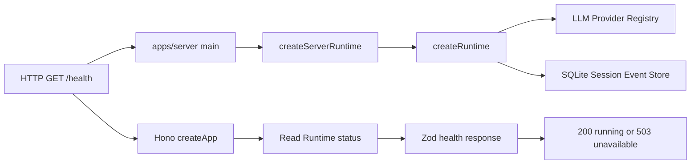
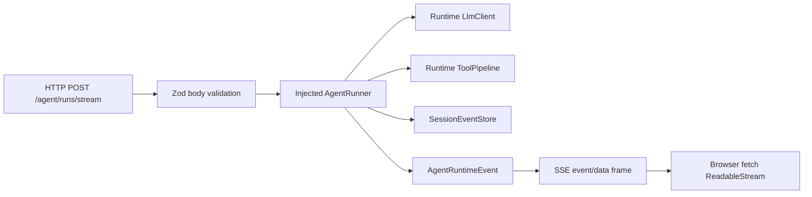
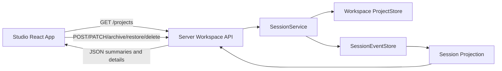
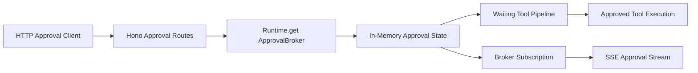

# Weave Foundation Architecture

This document explains the first runnable Weave slice, the implemented
headless Agent Loop, the shared Tool Pipeline, and the Project/Session
persistence boundary. It is a learning and maintenance guide, not a
replacement for the package APIs or tests.

## The Request Path

The Server exposes a health check, a thin Approval control plane with REST and
SSE adapters, and a thin Agent POST + SSE adapter. The Agent Runner remains a
Runtime API used directly by tests, CLI, desktop callers, and the Server
composition root; Server only transports its transient events.



Agent execution follows a separate adapter path:



The first Studio surface makes the browser boundary explicit:

```mermaid
flowchart LR
    A[Studio React App] -->|POST JSON| B[Vite /agent proxy]
    B --> C[Server Agent HTTP adapter]
    C -->|AsyncIterable events| D[Runtime AgentRunner]
    D --> E[LlmClient]
    D --> F[ToolPipeline]
    D --> G[SessionEventStore]
    C -->|SSE transient events| A
    A -->|AbortController / disconnect| C
    C -->|iterator.return()| D
```

Project and Session management uses a separate request path:



`apps/studio` only consumes the HTTP/SSE contract. It does not import
`@weave/runtime`, `@weave/session`, or Node-only modules, and it does not invoke
tools or write Session events directly. The Vite `/agent` proxy is a local
development convenience; `/projects` and `/sessions` use the same local Server
target. The proxies do not change the package boundary. Server validates the
request, applies SessionService lifecycle rules, and transports data, while
Runtime remains the source of truth for Agent behavior.

When the browser cancels a request, the cancellation travels through the HTTP
response and Server request lifecycle to the current Agent iterator's
`return()`. Runtime then owns model/tool cancellation and the cancelled
Turn/Step persistence. The browser must not create a second cancellation state
machine.

The Studio slice is intentionally one request and one live stream. It has no
Run Registry, background ownership, replay, `Last-Event-ID`, or reconnection
protocol. A disconnected browser cannot use this endpoint to reconstruct
missed transient events; durable Session facts remain the recovery boundary.

The Server does not create a model client per request or invoke a tool
definition directly. `main.ts` starts the Runtime, resolves its LLM and
Session Store services, creates one `AgentRunner` in the composition root, and
injects it into `createApp()`. Tests can inject a fake Runner without a real
provider or TCP socket.

Approval control requests follow a separate path:



At startup, `apps/server/src/main.ts` validates the port with Zod, creates the
server Runtime, opens the Project Store and Session Event Store, starts its
services, and binds Hono to `127.0.0.1`. The default database path is resolved
by platform: macOS uses `~/Library/Application Support/Weave`, Windows uses
`%APPDATA%/Weave`, and Linux uses `$XDG_DATA_HOME/weave` or
`~/.local/share/weave`. Explicit `databaseFile` and `dataDirectory` options
remain available, followed by `WEAVE_DATABASE_FILE` and `WEAVE_DATA_DIR`.
Tests can still inject In-Memory stores. A request enters
`apps/server/src/app.ts`, reads the Runtime status, validates the response
shape, and returns `200` only when the Runtime is running; otherwise it returns
`503`.

The desktop composition root is `apps/desktop`. Electron Main calls
`startServer(0, { databaseFile, studioOrigin, providerSecretCodec })`, so the operating system
chooses an available local port and the Server can allow the exact Studio
origin through CORS. The Renderer never opens SQLite or reads an API Key. Its
Workspace, Provider, and Agent clients use the same `runtimeApiUrl()` helper in
browser and desktop modes: the browser uses Vite-relative paths, while the
desktop Preload supplies the local Server base URL.

The old `apps/server/.weave/` directory is not automatically deleted or
migrated. It is a legacy local runtime artifact; migration requires a separate
backup, confirmation, copy, and rollback flow.

The persistence path is:

```text
Studio
  -> Project/Session HTTP API
  -> Server SessionService
  -> Workspace ProjectStore + SessionEventStore + Provider Settings Store
  -> SQLite (Desktop userData/weave.sqlite)
```

Project metadata and Session events remain separate. The Project Store keeps
Project rows and Project/Session references. The Session Event Store keeps
append-only Session facts. `projectSession()` rebuilds the current title,
messages, archive time, and deletion tombstone from those facts. The Server
returns summaries for the project tree and loads full messages only for the
selected Session.

The path is intentionally small:

```ts
const runtime = createServerRuntime();
await runtime.start();
const app = createApp(runtime);
```

`createApp` receives the Runtime interface rather than constructing services
itself. That keeps the HTTP handler thin and makes the health behavior testable
without opening a network port.

The implemented Agent Loop is a separate Runtime path:

```text
Session Projection
  -> Agent Runner
  -> LlmClient.stream()
  -> Tool Pipeline (when the model requests a tool)
  -> next model step
  -> AgentRuntimeEvent
  -> SessionEventStore.append()
```

`createAgentRunner({ llm, sessionStore })` validates an
`AgentRunRequest`, creates a missing `session.created` event, projects the
stored Session events, and appends the current user message plus a `Turn` and
`model` `Step`. It then builds an `LlmRequest` from the projected messages and
streams the model response. Text and reasoning deltas are yielded as transient
`AgentRuntimeEvent` values.

When `toolRegistry` and `toolPipeline` are supplied together, the Runner also
passes model-visible tool definitions to every request. A `tool-call-start`
plus its argument deltas becomes a complete `ToolCall`. After a
`finish.reason = 'tool-call'`, the Runner persists the assistant tool-call
message, completes the model Step, and executes each call in order through the
shared Tool Pipeline. Each call gets a `tool` Step, a durable
`tool-call.created` event, and then a `tool-result.created` event plus a
`role: 'tool'` message. The projected messages are then sent to the next model
step. The default limit is eight model steps; `maxSteps` protects against an
unbounded model/tool cycle.

After a valid text terminal `finish`, the Runner appends the complete assistant
message (when non-empty), the completed Step, and the completed Turn in one
batch, then yields `completed`.

Tool failures are split into two groups. A recoverable `ToolExecutionError`
(`tool-not-found`, `tool-invalid-json`, `tool-invalid-arguments`,
`tool-execution-failed`, `tool-timeout`, `tool-result-serialization-failed`,
`tool-approval-rejected`, `tool-approval-expired`) persists a failed Tool
Result, a `role: 'tool'` message describing the error, and a failed tool Step,
emits `tool-result` with `status: 'failed'`, and then continues with the next
model step so the model can correct the call or explain the outcome. The
description names the tool, the error code, and the tool's own error message;
it never contains arguments or file content. Cancellation,
`tool-approval-cancelled`, `tool-approval-required`, and errors that are not a
`ToolExecutionError` still persist failed or cancelled Step/Turn events and
rethrow the original error.

The Runner uses `projectSession()` for recovery rather than extracting
messages directly from raw events. An existing Session is continued without
adding another `session.created`; its projected messages, followed by the new
user message, become the next LLM request.

Within one `AgentRunner` instance, executions for the same Session use a
small in-memory queue. This keeps the Session read, initialization append,
model context construction, stream, and terminal append for one run together,
so concurrent calls cannot duplicate `session.created` or mix messages. The
current `SessionEventStore` contract has no CAS or lease operation, so separate
Runner instances and processes are not coordinated; that belongs to a future
Session concurrency slice.

Runtime events are not durable Session events. Deltas are for live consumers
and are never appended individually. Durable events describe the completed
assistant message and lifecycle state used for recovery, timelines, and
projection. Reasoning that the provider exposes is stored as a `reasoning`
content part on the completed assistant message, so Studio can restore the
process block after a refresh or Session switch. Tool calls and tool results
remain durable Session facts and are reconstructed into the same assistant
message's process view. A reasoning-only response still completes the Step and
Turn without creating an empty assistant message.

The Session projection also preserves the `occurredAt` value for each
`message.created` event. The Server exposes those timestamps alongside the
projected messages so clients can render message times from durable facts
instead of replacing every timestamp with a client-side "just now" label.

Token usage is a durable fact of each model step. The OpenAI-compatible adapter
requests `stream_options.include_usage` and maps cache hits and reasoning
tokens into `TokenUsage`; the Runner records `provider` and `model` on the
model `step.started` event and the provider-reported `usage` on its
`step.completed` event, and emits a transient `usage` event for live views.
The projection keeps Turn and Step timing, attributes each message to the Turn
that was running, and `GET /sessions/:id` returns per-Turn summaries
(`turns`) with usage summed over model steps. Studio shows them under each
reply and in the session overview panel; unreported counters stay absent
rather than reading as zero.

The model stream must contain exactly one `finish`, and it must be last.
Missing, repeated, or followed-by-more-output finishes produce
`agent-stream-protocol`. A Tool Call without the matching start event, a
duplicate start, or a tool finish without a complete call produces
`agent-tool-call-invalid`. If a model requests a tool without both
`toolRegistry` and `toolPipeline`, the Runner returns
`agent-tool-call-unsupported`. After `finish`, any event, including a tool
event, produces `agent-stream-protocol`.

Model and Store errors retain their original types. Once the lifecycle has
started, a model/protocol/tool failure appends failed Step/Turn events and is
then rethrown. An aborted request appends cancelled Step/Turn events and
rethrows the original cancellation/provider error. An async iterator `return()`
during in-flight execution treats consumer early-stop as cancellation, aborts
the internal signal, waits for execution to settle, and persists the cancelled
terminal state. If execution has already completed, `return()` closes the
iterator and discards queued transient events without appending cancellation.
If terminal persistence also fails, the original and persistence errors are
exposed in an `AggregateError`.

The Runtime now also exposes a shared Tool Registry and Tool Pipeline:

```text
Agent Runner
  -> Tool Registry
  -> Tool Pipeline
  -> Tool Result
```

The Registry owns stable tool names, model-facing descriptions, and executable
definitions. The Pipeline owns JSON parsing, Zod argument validation,
cooperative cancellation, timeout classification, result serialization, and
UTF-8 byte limits. Callers must submit a normalized Tool Call to the Pipeline;
they must not invoke a registered tool's `execute` function directly.

The Pipeline deliberately does not provide file access, Shell execution,
Workspace/Sandbox boundaries, Session persistence, HTTP, or SSE. It does,
however, provide the shared Approval gate for tools that explicitly declare
one. A tool being registered means only that it can pass through this common
lifecycle; it does not grant access to the host filesystem or network. Resource
access remains behind separate Workspace and future Sandbox boundaries.

Approval is modeled as Runtime-owned transient live-control state:

```text
Tool Pipeline
  -> Approval Broker
    -> pending decision
      -> approved / rejected / cancelled / expired
  -> Tool Execute
```

The Pipeline validates tool input first, creates an Approval request from the
tool's redacted summary, and invokes `execute` only after an `approved`
decision. A protected tool without a configured Broker fails closed with
`tool-approval-required`; it is never silently executed. Rejection, caller
cancellation, and expiry happen before the tool implementation and therefore
must not produce the tool's side effect.

The Broker is currently an in-memory single-process service. It retains
terminal snapshots for inspection, but it does not provide restart recovery,
cross-process coordination, identity or role permissions, or durable audit
events. Those concerns belong to a later Server/Studio control plane and must
not be simulated by the first Runtime slice.

The first Workspace boundary is a lexical `WorkspacePolicy` in
`@weave/runtime`, followed by protected UTF-8 file tools:

```text
Tool Pipeline
  -> Workspace Path Policy
    -> Workspace File Tools
        -> Approval gate
          -> future Sandbox
```

The policy requires an absolute Workspace root, accepts relative input paths,
normalizes them with `node:path`, and rejects null bytes, absolute input paths,
and paths that resolve outside the root. It returns normalized absolute and
relative paths but performs no filesystem I/O. The file tools repeat the
boundary at execution time: they resolve the real Workspace root and target,
reject symlink targets outside the root, check file type and byte limits, and
only then call `readFile` or `writeFile`.

`createWorkspaceFileTools()` exposes `read_file` and `write_file` as ordinary
`ToolDefinition` values. They are registered in the shared `ToolRegistry` and
must be called through `ToolPipeline`, so JSON parsing, Zod validation,
Approval, cancellation, timeout classification, and result serialization
remain consistent with every other Runtime tool. `read_file` is not protected
in this phase. `write_file` declares a high-risk `workspace.write_file`
Approval requirement whose summary includes only path, byte count, and
overwrite state, never the complete content.

The tools accept either a fixed `workspace` policy or a `resolveWorkspace`
function that receives the `ToolExecutionContext` and returns the policy for
that call's Session. The Server uses the resolver form: after trusted plugins
are registered, `createServerAgentRunner(runtime, { resolveWorkspaceRoot })`
registers both tools, and the resolver maps the Session to its Project's
`folderPath`. A Session whose Project has no folder fails the call with
`workspace-file-unavailable`, which the Runner returns to the model as a
recoverable failure. `POST /projects` only accepts a `folderPath` that is an
existing absolute directory. The Server Tool Pipeline uses a ten-minute
timeout that also bounds the wait for Approval, so an unanswered request
expires instead of blocking the turn. Studio subscribes to
`GET /approvals/stream` and shows pending requests as cards above the
composer; the Broker remains the only Approval state. An existing Project's
folder can be set, replaced, or cleared through `PATCH /projects/:projectId`
(`ProjectStore.updateProjectFolder()`), which applies the same validation.

`AgentRunnerOptions.instructions({ sessionId })` returns system instructions
that the Runner resolves once per run and prepends to every model request as a
`system` message. They are never appended to the Session, so they always
describe current state. The Server's default instructions name the Agent, list
the registered tools, and state the Session's Project folder (or that none is
set), so the model neither denies having tools nor passes absolute paths.

Approval does not replace Workspace policy or filesystem validation. The file
tool still resolves the real root and target after approval, so a stale or
unsafe path cannot become valid merely because a caller approved it. There is
still residual TOCTOU risk between metadata checks and the final filesystem
call; this is not yet a complete Sandbox.

The file tools deliberately do not create parent directories. New writes use
the exclusive `wx` flag by default; an existing regular file is replaced only
when the caller explicitly supplies `overwrite: true`. This combines a product
level guard against accidental replacement with the filesystem's exclusive
create operation. The implementation still has residual TOCTOU risk between
metadata checks and the final filesystem call, so it is not yet a complete
Sandbox or Approval boundary. A dangling symlink is rejected conservatively
because its final target cannot be proven to remain inside the Workspace.

The Server exposes Approval REST routes for polling and decisions:
`GET /approvals`, `GET /approvals/:approvalId`, and POST routes for approve,
reject, and cancel. It also exposes `GET /approvals/stream`, which sends an
initial `approval.snapshot` followed by `approval.created` and
`approval.resolved` events. These handlers validate HTTP input with Zod,
delegate to the Runtime-owned Broker, and return stable error codes. They do
not execute tools, write Session events, or keep a second approval state.

The Broker subscription is deliberately a transient, single-process contract.
The SSE adapter removes its listener when the request aborts, the stream is
cancelled, or writing fails. The snapshot is a connection initialization view,
not a durable event; disconnected clients cannot replay missed events through
this interface. Agent execution uses the same transient-event principle
through `POST /agent/runs/stream`: the adapter maps each
`AgentRuntimeEvent.type` to the SSE `event` field and serializes the complete
event as JSON in `data`. A cancelled stream invokes the current AsyncIterator's
`return()` and removes the request listener; it does not create a second
cancellation state machine.

## Layer Boundaries

```text
                         ┌── @weave/llm ──┐
@weave/protocol ──────────┤                ├── @weave/runtime -> @weave/plugin -> @weave/server -> @weave/desktop
 stable contracts         └ @weave/session┘      lifecycle        trusted ext.     HTTP adapter     Electron host
                            durable facts
@weave/workspace (Project metadata, no internal deps) ───────────────────────────> @weave/server
@weave/studio (browser, no @weave/* imports) ── HTTP/SSE ──> @weave/server
```

### Why `protocol` Does Not Execute Behavior

`@weave/protocol` owns Zod schemas and TypeScript types for messages, tool
calls, LLM requests, stream events, and classified errors. It describes values
that can cross a package boundary. It does not open a network connection,
start a service, run a tool, or decide when an agent step should happen.

Keeping behavior out of this layer prevents a shared contract package from
silently becoming a runtime dependency with side effects.

### Why Session Is a Separate Package

`@weave/session` owns durable Session events, Store implementations, and pure
Projection logic. It depends on `@weave/protocol` for the message contract, but
does not depend on Runtime, Hono, React, or a Provider SDK. The package exposes
the `SessionEventStore` interface; Runtime consumes that interface instead of
knowing which persistence implementation was selected.

The Store is append-only: it assigns each event an ID, an increasing sequence
within its Session, and an ISO timestamp. The In-Memory implementation gives
Agent and Projection tests a deterministic store; the SQLite implementation
proves local persistence without adding a database dependency.

The Store does not enforce Agent business order. `projectSession()` validates
that the event list starts with `session.created`, that sequences are
continuous, and that Turn and Step references exist. Keeping storage and
interpretation separate allows future snapshots and alternate read models
without changing the database boundary.

### Why Provider Types Stay in `llm`

`@weave/llm` owns `LlmClient`, the SSE parser, error normalization, the Mock
Provider, and the OpenAI-compatible adapter. Provider wire fields such as
`choices`, `delta`, and `reasoning_content` are translated there into the
protocol's `StreamEvent` values:

```ts
const client = createOpenAiCompatibleClient({
  baseUrl: 'https://provider.example/v1',
  apiKey: 'test-key',
});
```

Neither `protocol` nor `runtime` needs to know how a provider names a field or
encodes an SSE frame. This lets another provider adapter change without
leaking provider-specific types into the Runtime contract.

Provider failures do not become `StreamEvent` values. LLM clients reject with a
normalized `LlmError`; successful streams must receive the provider's terminal
`[DONE]` marker, while a response body that reaches EOF first is a protocol
failure.

### Provider Registry and Server Routing

The first Server composition root now supports more than one LLM Provider
without moving vendor details into Runtime:

```text
WEAVE_LLM_PROVIDERS
        |
        v
Server Zod configuration
        |
        v
LlmProviderRegistry
   |                 |
mock LlmClient   OpenAI-compatible LlmClient
        |
        v
AgentRunner(provider, model)
        |
        v
HTTP/SSE -> Studio
```

`LlmProviderRegistry` stores a private `LlmClient` together with a public
descriptor. The descriptor contains only `id`, `label`, `type`, and an
optional `defaultModel`. The client can capture the Server-side API Key, but
`registry.list()` cannot expose that client or its configuration.

The Server reads `WEAVE_LLM_PROVIDERS` as a Zod-validated JSON array. It always
registers the deterministic `mock` Provider, then creates an
OpenAI-compatible client for each configured entry. The same Registry is used
by both the Agent Runner and `GET /settings/providers`; this keeps the list in
Studio aligned with the clients Runtime can actually resolve.

When an Agent request contains `provider: "deepseek"`, Runtime resolves that
id before it appends the first running Turn event. An unknown id returns the
stable `agent-provider-unavailable` error and does not create a misleading
partial Turn. Runtime still accepts the older single `llm` option for callers
that do not need a Registry; Server uses Registry mode.

Studio calls `GET /settings/providers` and validates the response with its own
Zod schema. It uses the selected descriptor's default model when the user
changes Provider, then sends `provider` and `model` in
`POST /agent/runs/stream`. Browser mode only reads `.env` configuration.
Desktop mode can submit a new API Key through the loopback settings API; the
Server immediately encrypts it with the injected Electron `safeStorage` Codec
before writing SQLite. The Settings view never receives an existing secret and
only displays `hasApiKey`.

The complete Desktop Provider path is:

```text
Studio form
  -> POST/PATCH /settings/providers
  -> Server Zod boundary
  -> ProviderSettingsManager
  -> Electron safeStorage Codec
  -> Provider Settings Store
  -> shared LlmProviderRegistry
  -> Agent Runner
```

The Manager keeps the same Registry object used by the Agent Runner. Saving a
Provider therefore affects later runs without rebuilding Runtime. It tracks the
ids it owns, so deleting or refreshing settings cannot remove a Provider
registered by a trusted plugin.

### Plugin Manifest and controlled registration

Weave's first Plugin phase adds a trusted in-process extension boundary:

```text
Plugin Manifest
  -> Plugin Context
  -> Plugin Registry
  -> Tool Registry / LlmProviderRegistry
  -> Tool Pipeline / Agent Runner
```

`@weave/plugin` owns the Manifest schema, API version check, capability
declaration, staged registration, conflict checks, immutable snapshots, and
plugin lifecycle. It does not execute model requests or tools. The Server
composition root explicitly creates a Plugin Registry and registers trusted
plugins before creating the Agent Runner.

The Plugin Context only exposes `registerTool()` and `registerProvider()`.
It does not expose Runtime, Session Store, Workspace roots, Approval internals,
Hono, or Node host APIs. A plugin Tool is still invoked through
`ToolRegistry -> ToolPipeline -> Approval / Workspace`, and a plugin Provider
is still resolved through `LlmProviderRegistry`. Plugin snapshots contain
names and public metadata only; Provider clients and API Keys remain private
to the host process.

Registration uses a staged commit:

```text
setup(context)
  -> validate and collect registrations
  -> check plugin/API/name conflicts
  -> commit all Tool/Provider registrations
  -> publish PluginSnapshot
```

This prevents a failed setup or a known naming conflict from leaving a partial
plugin registration. The current host registries do not support ownership-aware
removal, so Plugin disposal releases lifecycle hooks and snapshots but does not
hot-unload already registered Tools or Providers.

The current phase trusts the plugin code because it runs inside the Server
process. Manifest validation is not a sandbox. Future GitHub installation will
be a separate chain:

```text
Plugin Catalog
  -> Plugin Installer
  -> Installed Plugin Store
  -> Plugin Registry
```

Git sources must lock the repository URL, exact Commit, and Monorepo package
path. A future untrusted plugin mode requires an independent process,
permission proxy, resource limits, and an RPC protocol; it cannot be provided
by TypeScript types alone.

### Why Runtime Does Not Depend on HTTP

`@weave/runtime` owns service registration, startup, shutdown, status, and
service lookup. It accepts an `AbortSignal` and configuration through
`RuntimeContext`, but it does not know whether a caller is Hono, a CLI, a
desktop process, or a test. It may later assemble a Session Store through its
public interface, but it does not know SQLite table details. HTTP framework
imports, React imports, and Node HTTP server imports belong in `apps/server`;
ESLint enforces this boundary.

Each startup attempt receives a fresh `AbortController`. If service creation
fails, that attempt's signal is aborted before cleanup, and a later retry gets
a new non-aborted signal. An explicit stop remains terminal. Session Stores are
registered through `createSessionEventStoreService()`: Runtime creates them from
an injected factory and calls `close()` during reverse-order cleanup. This keeps
storage selection in Server, CLI, desktop, or test composition roots.

### Why the First Round Uses a Mock Provider

The first request path needs a real service assembly point, but it should not
depend on an API key, provider uptime, or network behavior. The Mock Provider
proves the `LlmClient` contract and makes lifecycle and server tests
deterministic. The Server always registers `mock`; OpenAI-compatible Providers
from `WEAVE_LLM_PROVIDERS` or Desktop settings are registered beside it and
become the default selection when configured.

### Why Tests Use an In-Memory Session Store

`apps/server/src/main.ts` opens a SQLite Session Event Store and Project Store
by default, so a normal Server start persists Projects and Sessions. Health
and HTTP adapter tests inject In-Memory stores instead, so they prove that
Session persistence participates in Runtime startup and shutdown without
depending on a database file. The In-Memory implementation is a composition
choice for tests, not a limitation of the Runtime contract.

### Why the Server Binds to `127.0.0.1`

The first server is a local control plane. Binding to the loopback address
keeps the development endpoint off the network by default and makes the
security intent explicit. A later deployment surface can choose a different
binding as part of a deliberate operational configuration.

### Why Agent HTTP Uses POST + SSE

`POST /agent/runs/stream` is the smallest browser-facing adapter for the
current Runtime contract. The request needs a JSON body containing the Session,
user message, provider, and model, so `fetch()` is a better fit than
`EventSource`, whose standard contract is a GET subscription without a JSON
body. The response is still a normal SSE stream, so text deltas, reasoning,
Tool Calls, tool results, completion, and errors can arrive incrementally.

The adapter does not introduce a Run Registry, `runId`, Last-Event-ID, replay,
or a separate durable run state. Those features are necessary for background
tasks and page refresh recovery, but adding them now would duplicate transient
Runtime state before Weave has a recovery contract for it. A later registry can
subscribe to the same Runner events without changing the Runtime Agent Loop.

## AI Editing Checklist

Before changing a Foundation boundary, inspect:

1. `AGENTS.md` for repository invariants and verification commands.
2. `docs/architecture/foundation.md` for the current request path.
3. `docs/adr/0001-foundation-vertical-slice.md` for the architectural reason.
4. `docs/superpowers/specs/2026-11-14-weave-foundation-design.md` for the
   first-round contract and explicit exclusions.
5. The importing and imported package `package.json` files for declared
   workspace dependencies.
6. The package's public `src/index.ts`, tests, and `eslint.config.js` before
   changing an exported contract or dependency.

After a cross-package change, run the static import scans and the complete
`pnpm check` flow. Keep tests in the package or app `test/` directory and do
not add a provider key or network dependency to a test.

## Interview Explanation

The direction is easiest to explain as a one-way dependency gradient:

- `protocol` is the vocabulary.
- `llm` translates provider I/O into that vocabulary.
- `session` stores durable facts and projects them into read models.
- `runtime` assembles services and owns lifecycle.
- `server` adapts HTTP requests to the Runtime.

The lower layer knows less about application delivery than the layer above it.
That makes the Runtime reusable from a CLI or desktop surface, keeps provider
churn inside `llm`, and gives the Server a thin control-plane role. The
direction is enforced both by package manifests and by ESLint so an accidental
import fails near the source of the mistake.
