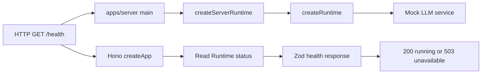

# Weave Foundation Architecture

This document explains the first runnable Weave slice. It is a learning and
maintenance guide, not a replacement for the package APIs or tests.

## The Request Path

The first round exposes a health check that proves Runtime assembly and HTTP
control-plane wiring without pretending that the Agent Loop already exists.



At startup, `apps/server/src/main.ts` validates the port with Zod, creates the
server Runtime, starts its services, and binds Hono to `127.0.0.1`. The
Runtime currently assembles one Mock LLM service. A request enters
`apps/server/src/app.ts`, reads the Runtime status, validates the response
shape, and returns `200` only when the Runtime is running; otherwise it returns
`503`.

The path is intentionally small:

```ts
const runtime = createServerRuntime();
await runtime.start();
const app = createApp(runtime);
```

`createApp` receives the Runtime interface rather than constructing services
itself. That keeps the HTTP handler thin and makes the health behavior testable
without opening a network port.

## Layer Boundaries

```text
@weave/protocol  ->  @weave/llm  ->  @weave/runtime  ->  @weave/server
 stable contracts     provider I/O     lifecycle         HTTP adapter
```

### Why `protocol` Does Not Execute Behavior

`@weave/protocol` owns Zod schemas and TypeScript types for messages, tool
calls, LLM requests, stream events, and classified errors. It describes values
that can cross a package boundary. It does not open a network connection,
start a service, run a tool, or decide when an agent step should happen.

Keeping behavior out of this layer prevents a shared contract package from
silently becoming a runtime dependency with side effects.

### Why Provider Types Stay in `llm`

`@weave/llm` owns `LlmClient`, the SSE parser, error normalization, the Mock
Provider, and the OpenAI-compatible adapter. Provider wire fields such as
`choices`, `delta`, and `reasoning_content` are translated there into the
protocol's `StreamEvent` values:

```ts
const client = createOpenAiCompatibleClient({
  baseUrl: 'https://provider.example/v1',
  apiKey: 'test-key',
});
```

Neither `protocol` nor `runtime` needs to know how a provider names a field or
encodes an SSE frame. This lets another provider adapter change without
leaking provider-specific types into the Runtime contract.

Provider failures do not become `StreamEvent` values. LLM clients reject with a
normalized `LlmError`; successful streams must receive the provider's terminal
`[DONE]` marker, while a response body that reaches EOF first is a protocol
failure.

### Why Runtime Does Not Depend on HTTP

`@weave/runtime` owns service registration, startup, shutdown, status, and
service lookup. It accepts an `AbortSignal` and configuration through
`RuntimeContext`, but it does not know whether a caller is Hono, a CLI, a
desktop process, or a test. HTTP framework imports, React imports, and Node HTTP
server imports belong in `apps/server`; ESLint enforces this boundary.

Each startup attempt receives a fresh `AbortController`. If service creation
fails, that attempt's signal is aborted before cleanup, and a later retry gets
a new non-aborted signal. An explicit stop remains terminal.

### Why the First Round Uses a Mock Provider

The first request path needs a real service assembly point, but it should not
depend on an API key, provider uptime, or network behavior. The Mock Provider
proves the `LlmClient` contract and makes lifecycle and server tests
deterministic. The OpenAI-compatible adapter is already isolated behind the
same interface, but it is not used by the default server startup.

### Why the Server Binds to `127.0.0.1`

The first server is a local control plane. Binding to the loopback address
keeps the development endpoint off the network by default and makes the
security intent explicit. A later deployment surface can choose a different
binding as part of a deliberate operational configuration.

### Why There Is No `/run`

`/run` would imply an Agent Loop, Session/Turn event model, Tool Pipeline,
workspace and approval boundaries, cancellation semantics, and durable event
handling. None of those contracts are stable in this Foundation slice. A
health endpoint is enough to prove startup and status wiring without inventing
an HTTP API that later layers would have to preserve.

## AI Editing Checklist

Before changing a Foundation boundary, inspect:

1. `AGENTS.md` for repository invariants and verification commands.
2. `docs/architecture/foundation.md` for the current request path.
3. `docs/adr/0001-foundation-vertical-slice.md` for the architectural reason.
4. `docs/superpowers/specs/2026-11-14-weave-foundation-design.md` for the
   first-round contract and explicit exclusions.
5. The importing and imported package `package.json` files for declared
   workspace dependencies.
6. The package's public `src/index.ts`, tests, and `eslint.config.js` before
   changing an exported contract or dependency.

After a cross-package change, run the static import scans and the complete
`pnpm check` flow. Keep tests in the package or app `test/` directory and do
not add a provider key or network dependency to a test.

## Interview Explanation

The direction is easiest to explain as a one-way dependency gradient:

- `protocol` is the vocabulary.
- `llm` translates provider I/O into that vocabulary.
- `runtime` assembles services and owns lifecycle.
- `server` adapts HTTP requests to the Runtime.

The lower layer knows less about application delivery than the layer above it.
That makes the Runtime reusable from a CLI or desktop surface, keeps provider
churn inside `llm`, and gives the Server a thin control-plane role. The
direction is enforced both by package manifests and by ESLint so an accidental
import fails near the source of the mistake.
