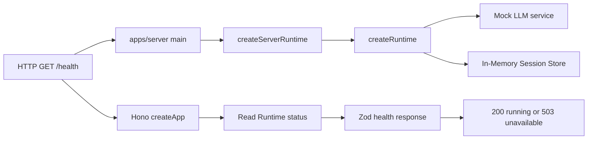

# Weave Foundation Architecture

This document explains the first runnable Weave slice, the implemented
headless Agent Loop, and the shared Tool Pipeline. It is a learning and
maintenance guide, not a replacement for the package APIs or tests.

## The Request Path

The Server still exposes only a health check. The Agent Runner is a Runtime
API used directly by tests, CLI, or desktop callers; it is not exposed through
an HTTP `/run` endpoint yet.



At startup, `apps/server/src/main.ts` validates the port with Zod, creates the
server Runtime, starts its services, and binds Hono to `127.0.0.1`. The
Runtime assembles a Mock LLM service and an In-Memory Session Event Store. A request enters
`apps/server/src/app.ts`, reads the Runtime status, validates the response
shape, and returns `200` only when the Runtime is running; otherwise it returns
`503`.

The path is intentionally small:

```ts
const runtime = createServerRuntime();
await runtime.start();
const app = createApp(runtime);
```

`createApp` receives the Runtime interface rather than constructing services
itself. That keeps the HTTP handler thin and makes the health behavior testable
without opening a network port.

The implemented Agent Loop is a separate Runtime path:

```text
Session Projection
  -> Agent Runner
  -> LlmClient.stream()
  -> AgentRuntimeEvent
  -> complete assistant message
  -> SessionEventStore.append()
```

`createAgentRunner({ llm, sessionStore })` validates an
`AgentRunRequest`, creates a missing `session.created` event, projects the
stored Session events, and appends the current user message plus a `Turn` and
`model` `Step`. It then builds an `LlmRequest` from the projected messages and
streams the model response. Text and reasoning deltas are yielded as transient
`AgentRuntimeEvent` values. After one valid terminal `finish`, the Runner
appends the complete text-only assistant message (when non-empty), the
completed Step, and the completed Turn in one batch, then yields `completed`.

The Runner uses `projectSession()` for recovery rather than extracting
messages directly from raw events. An existing Session is continued without
adding another `session.created`; its projected messages, followed by the new
user message, become the next LLM request.

Within one `AgentRunner` instance, executions for the same Session use a
small in-memory queue. This keeps the Session read, initialization append,
model context construction, stream, and terminal append for one run together,
so concurrent calls cannot duplicate `session.created` or mix messages. The
current `SessionEventStore` contract has no CAS or lease operation, so separate
Runner instances and processes are not coordinated; that belongs to a future
Session concurrency slice.

Runtime events are not durable Session events. Deltas are for live consumers
and are never appended individually. Durable events describe the completed
assistant message and lifecycle state used for recovery, timelines, and
projection. Reasoning is streamed but is not persisted because the current
Session Message schema has no reasoning field. A reasoning-only response still
completes the Step and Turn without creating an empty assistant message.

The model stream must contain exactly one `finish`, and it must be last.
Missing, repeated, or followed-by-more-output finishes produce
`agent-stream-protocol`. Before `finish`, `tool-call-start` and
`tool-call-delta` produce `agent-tool-call-unsupported`, as does
`finish.reason = 'tool-call'`; the current Agent Runner still does not invoke
the Tool Pipeline because multi-step tool turns and Session tool events are
outside this slice. After `finish`, any event, including a tool event, produces
`agent-stream-protocol`.

Model and Store errors retain their original types. Once the lifecycle has
started, a model/protocol/tool failure appends failed Step/Turn events and is
then rethrown. An aborted request appends cancelled Step/Turn events and
rethrows the original cancellation/provider error. An async iterator `return()`
during in-flight execution treats consumer early-stop as cancellation, aborts
the internal signal, waits for execution to settle, and persists the cancelled
terminal state. If execution has already completed, `return()` closes the
iterator and discards queued transient events without appending cancellation.
If terminal persistence also fails, the original and persistence errors are
exposed in an `AggregateError`.

The Runtime now also exposes a shared Tool Registry and Tool Pipeline:

```text
Agent Runner
  -> Tool Registry
  -> Tool Pipeline
  -> Tool Result
```

The Registry owns stable tool names, model-facing descriptions, and executable
definitions. The Pipeline owns JSON parsing, Zod argument validation,
cooperative cancellation, timeout classification, result serialization, and
UTF-8 byte limits. Callers must submit a normalized Tool Call to the Pipeline;
they must not invoke a registered tool's `execute` function directly.

The Pipeline deliberately does not provide file access, Shell execution,
Workspace/Sandbox boundaries, Approval, Session persistence, HTTP, or SSE. A
tool being registered means only that it can pass through this common lifecycle;
it does not grant access to the host filesystem or network. Those capabilities
will be added behind separate security boundaries.

The first Workspace boundary is a lexical `WorkspacePolicy` in
`@weave/runtime`, followed by protected UTF-8 file tools:

```text
Tool Pipeline
  -> Workspace Path Policy
    -> Workspace File Tools
      -> future Approval/Sandbox
```

The policy requires an absolute Workspace root, accepts relative input paths,
normalizes them with `node:path`, and rejects null bytes, absolute input paths,
and paths that resolve outside the root. It returns normalized absolute and
relative paths but performs no filesystem I/O. The file tools repeat the
boundary at execution time: they resolve the real Workspace root and target,
reject symlink targets outside the root, check file type and byte limits, and
only then call `readFile` or `writeFile`.

`createWorkspaceFileTools()` exposes `read_file` and `write_file` as ordinary
`ToolDefinition` values. They are registered in the shared `ToolRegistry` and
must be called through `ToolPipeline`, so JSON parsing, Zod validation,
cancellation, timeout classification, and result serialization remain
consistent with every other Runtime tool.

The file tools deliberately do not create parent directories. New writes use
the exclusive `wx` flag by default; an existing regular file is replaced only
when the caller explicitly supplies `overwrite: true`. This combines a product
level guard against accidental replacement with the filesystem's exclusive
create operation. The implementation still has residual TOCTOU risk between
metadata checks and the final filesystem call, so it is not yet a complete
Sandbox or Approval boundary. A dangling symlink is rejected conservatively
because its final target cannot be proven to remain inside the Workspace.

HTTP and SSE are future adapters that will consume `AgentRuntimeEvent`; they
must not reimplement the Agent Loop. The current Server contract remains
`GET /health` only.

## Layer Boundaries

```text
                         ┌── @weave/llm ──┐
@weave/protocol ──────────┤                ├── @weave/runtime -> @weave/server
 stable contracts         └ @weave/session┘      lifecycle       HTTP adapter
                            durable facts
```

### Why `protocol` Does Not Execute Behavior

`@weave/protocol` owns Zod schemas and TypeScript types for messages, tool
calls, LLM requests, stream events, and classified errors. It describes values
that can cross a package boundary. It does not open a network connection,
start a service, run a tool, or decide when an agent step should happen.

Keeping behavior out of this layer prevents a shared contract package from
silently becoming a runtime dependency with side effects.

### Why Session Is a Separate Package

`@weave/session` owns durable Session events, Store implementations, and pure
Projection logic. It depends on `@weave/protocol` for the message contract, but
does not depend on Runtime, Hono, React, or a Provider SDK. The package exposes
the `SessionEventStore` interface; Runtime consumes that interface instead of
knowing which persistence implementation was selected.

The Store is append-only: it assigns each event an ID, an increasing sequence
within its Session, and an ISO timestamp. The In-Memory implementation gives
Agent and Projection tests a deterministic store; the SQLite implementation
proves local persistence without adding a database dependency.

The Store does not enforce Agent business order. `projectSession()` validates
that the event list starts with `session.created`, that sequences are
continuous, and that Turn and Step references exist. Keeping storage and
interpretation separate allows future snapshots and alternate read models
without changing the database boundary.

### Why Provider Types Stay in `llm`

`@weave/llm` owns `LlmClient`, the SSE parser, error normalization, the Mock
Provider, and the OpenAI-compatible adapter. Provider wire fields such as
`choices`, `delta`, and `reasoning_content` are translated there into the
protocol's `StreamEvent` values:

```ts
const client = createOpenAiCompatibleClient({
  baseUrl: 'https://provider.example/v1',
  apiKey: 'test-key',
});
```

Neither `protocol` nor `runtime` needs to know how a provider names a field or
encodes an SSE frame. This lets another provider adapter change without
leaking provider-specific types into the Runtime contract.

Provider failures do not become `StreamEvent` values. LLM clients reject with a
normalized `LlmError`; successful streams must receive the provider's terminal
`[DONE]` marker, while a response body that reaches EOF first is a protocol
failure.

### Why Runtime Does Not Depend on HTTP

`@weave/runtime` owns service registration, startup, shutdown, status, and
service lookup. It accepts an `AbortSignal` and configuration through
`RuntimeContext`, but it does not know whether a caller is Hono, a CLI, a
desktop process, or a test. It may later assemble a Session Store through its
public interface, but it does not know SQLite table details. HTTP framework
imports, React imports, and Node HTTP server imports belong in `apps/server`;
ESLint enforces this boundary.

Each startup attempt receives a fresh `AbortController`. If service creation
fails, that attempt's signal is aborted before cleanup, and a later retry gets
a new non-aborted signal. An explicit stop remains terminal. Session Stores are
registered through `createSessionEventStoreService()`: Runtime creates them from
an injected factory and calls `close()` during reverse-order cleanup. This keeps
storage selection in Server, CLI, desktop, or test composition roots.

### Why the First Round Uses a Mock Provider

The first request path needs a real service assembly point, but it should not
depend on an API key, provider uptime, or network behavior. The Mock Provider
proves the `LlmClient` contract and makes lifecycle and server tests
deterministic. The OpenAI-compatible adapter is already isolated behind the
same interface, but it is not used by the default server startup.

### Why the Default Server Uses an In-Memory Session Store

The server now proves that Session persistence participates in Runtime startup
and shutdown without making health tests depend on a database file. The
In-Memory implementation is a composition choice, not a limitation of the
Runtime contract. A caller that needs local durability can pass
`createSqliteSessionEventStore` to the same Runtime service adapter.

### Why the Server Binds to `127.0.0.1`

The first server is a local control plane. Binding to the loopback address
keeps the development endpoint off the network by default and makes the
security intent explicit. A later deployment surface can choose a different
binding as part of a deliberate operational configuration.

### Why There Is No HTTP `/run`

The Agent Loop now exists behind `createAgentRunner()`, but `/run` would still
be an HTTP adapter contract with request streaming, response framing,
cancellation, and eventual SSE policy. Keeping it out of Server preserves a
thin control plane. A later HTTP/SSE adapter can consume the Runtime's
`AgentRuntimeEvent` values without duplicating Session recovery or model-loop
behavior.

## AI Editing Checklist

Before changing a Foundation boundary, inspect:

1. `AGENTS.md` for repository invariants and verification commands.
2. `docs/architecture/foundation.md` for the current request path.
3. `docs/adr/0001-foundation-vertical-slice.md` for the architectural reason.
4. `docs/superpowers/specs/2026-11-14-weave-foundation-design.md` for the
   first-round contract and explicit exclusions.
5. The importing and imported package `package.json` files for declared
   workspace dependencies.
6. The package's public `src/index.ts`, tests, and `eslint.config.js` before
   changing an exported contract or dependency.

After a cross-package change, run the static import scans and the complete
`pnpm check` flow. Keep tests in the package or app `test/` directory and do
not add a provider key or network dependency to a test.

## Interview Explanation

The direction is easiest to explain as a one-way dependency gradient:

- `protocol` is the vocabulary.
- `llm` translates provider I/O into that vocabulary.
- `session` stores durable facts and projects them into read models.
- `runtime` assembles services and owns lifecycle.
- `server` adapts HTTP requests to the Runtime.

The lower layer knows less about application delivery than the layer above it.
That makes the Runtime reusable from a CLI or desktop surface, keeps provider
churn inside `llm`, and gives the Server a thin control-plane role. The
direction is enforced both by package manifests and by ESLint so an accidental
import fails near the source of the mistake.
