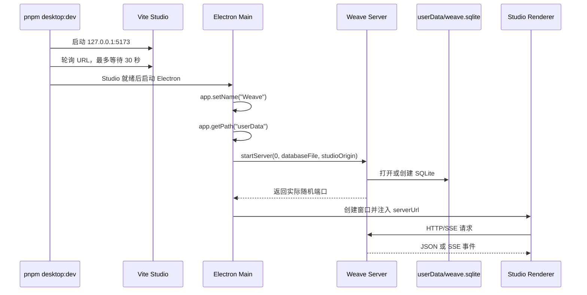

# Weave 桌面端基础壳学习笔记

这篇文档解释 Weave 为什么要增加 Electron Desktop，以及桌面端如何把
Studio、Server、Runtime 和 SQLite 组合起来。重点是理解边界和请求链路，
不要求先记住 Electron 的全部 API。

## 1. 先看问题

浏览器开发模式下，Studio 由 Vite 提供页面，Server 是另一个 Node 进程。
如果 Server 使用当前工作目录保存 SQLite，用户从 `apps/server` 启动时就会
生成 `apps/server/.weave/weave.sqlite`。这个位置会让数据和源代码混在一起，
从不同目录启动还可能得到多份数据库，桌面应用升级和插件配置也没有稳定的
数据根目录。

桌面端需要一个由应用管理的生命周期和数据目录。于是本轮让 Electron 主进程
负责启动本地 Server，并把 SQLite 放到 Electron 的 `userData` 目录。

旧的 `apps/server/.weave/` 不会自动删除或迁移。自动迁移需要备份、确认、
复制校验和失败回滚，应该作为独立功能设计。

## 2. 五个角色各自负责什么

### Electron Main Process

Main Process 是桌面应用的组合根。它可以访问 Electron API、Node.js 和
操作系统路径，负责读取 `app.getPath('userData')`、组合
`<userData>/weave.sqlite`、调用 `startServer(0, ...)`、创建 BrowserWindow，
并在窗口关闭时停止 Server。

它负责“把已有模块组装起来”，不应该重新实现 Agent Loop、Tool Pipeline
或 Session 业务。

### Preload

Preload 位于 Main 和 Renderer 之间，是一条受控桥接。当前只暴露：

```ts
{
  isDesktop: true,
  serverUrl: 'http://127.0.0.1:<random-port>',
}
```

Preload 不暴露 `process`、`fs`、SQLite、`ipcRenderer` 或任意命令执行接口。
这样 Studio 页面可以知道请求发到哪里，但不能直接读取电脑文件或 API Key。

### Studio Renderer

Renderer 是 React 页面运行的地方。它只使用 Workspace、Provider 和 Agent
HTTP/SSE 客户端。浏览器模式使用 `/projects` 这样的相对路径，桌面模式读取
`window.weaveDesktop.serverUrl` 后拼成完整的本地 URL，两种模式共用同一套
业务 API 客户端。

Renderer 不直接访问 SQLite，也不负责启动或停止 Server。

### Server

Server 是 HTTP 控制面和 Runtime 的适配层，负责校验请求、暴露 Project、
Session、Provider、Agent 和 Approval API，组装 Runtime、Session Store、
Provider Registry 和 Tool Pipeline，并绑定 `127.0.0.1`。

Server 不知道自己是被浏览器、Electron 还是测试启动的。桌面端只是通过公开
的 `startServer()` 接口传入组合参数。

### SQLite

SQLite 存放 Project、Session 事件和投影数据，是持久化事实的存储层，不应该
直接暴露给 Renderer。桌面端默认位置是：

```text
macOS:   ~/Library/Application Support/Weave/weave.sqlite
Windows: %APPDATA%/Weave/weave.sqlite
Linux:   $XDG_DATA_HOME/weave/weave.sqlite
         或 ~/.local/share/weave/weave.sqlite
```

## 3. 启动链路



`pnpm desktop:dev` 不额外启动独立 Server。这样本地只存在一个由 Electron
拥有生命周期的 Server，关闭窗口后不会留下无主进程。

## 4. 一次 Agent 请求如何走

```text
用户
  -> Studio Renderer
  -> runtimeApiUrl('/agent/runs/stream')
  -> 本地 Server HTTP/SSE
  -> Runtime AgentRunner
  -> LlmClient / Provider
  -> Tool Pipeline（必要时经过 Approval）
  -> SSE 返回文本、思考、工具事件
  -> Session Event Store 写入 durable events
  -> SQLite
```

Renderer 只负责展示事件，Runtime 负责 Agent 行为，Session Store 负责持久化，
Server 负责 HTTP/SSE 适配，避免把业务逻辑散落在页面组件里。

## 5. 为什么 API Key 不经过 Renderer

API Key 是 Server 进程的配置，不是页面状态。Provider Registry 在 Server
启动时从环境变量创建 Provider，Renderer 只能请求 Provider 元数据，例如
Provider id、名称和可用模型。

如果把 API Key 放进 Preload 或 Renderer，页面脚本、浏览器扩展或调试工具都
可能读取它，页面状态和日志也可能意外保留它。因此请求链路是：

```text
Renderer 选择 providerId/model
  -> Server 根据 Registry 找到 Provider
  -> Server 在本地进程使用 API Key 调用模型
```

本地 `.env` 只用于开发验证，不能提交到 Git。桌面应用后续增加设置界面时，
密钥存储和读取也应该放在主进程或 Server 边界，并使用系统密钥存储，而不是
写入 Renderer 的 localStorage。

## 6. 为什么要有 CORS

浏览器模式下，Vite 把 `/projects` 和 `/agent` 代理到固定的 Server 端口，
所以页面看起来像是在访问同一个 origin。

桌面模式下，Studio 仍加载在 `http://127.0.0.1:5173`，Server 为了避免端口
冲突监听系统分配的随机端口，例如 `46321`。这两个地址属于不同 origin，
Renderer 直接请求 Server 时必须经过 CORS。

Weave 只允许 Desktop 传入的 Studio origin，响应中不会使用
`Access-Control-Allow-Origin: *`。Desktop 也只接受 loopback Studio URL，
并阻止窗口跳转到其他 origin。这样 CORS 是一个明确的本地边界，而不是关闭
浏览器安全策略。

## 7. 关闭链路

```text
用户关闭窗口
  -> Electron before-quit / window-all-closed
  -> 调用 Server.stop()
  -> 关闭 HTTP Server
  -> dispose Plugins
  -> stop Runtime
  -> close Project Store
  -> Electron 退出
```

`stop()` 是幂等的。即使某一步清理失败，也会继续执行后续清理，并保留第一
个错误用于日志，避免 Server 已经停止但 SQLite 或 Runtime 资源仍被遗留。

## 8. 如何验证

浏览器模式：

```bash
pnpm dev
```

桌面模式：

```bash
pnpm desktop:dev
```

代码验证：

```bash
pnpm check
pnpm --filter @weave/desktop test
pnpm --filter @weave/server test
```

手动验证桌面端时检查四件事：

1. Electron 窗口能加载 Studio；
2. Project、Session 和 Agent 请求能返回；
3. SQLite 位于系统应用数据目录；
4. 关闭窗口后 `5173` 和随机 Server 端口都释放。

Desktop 的主进程测试使用 Electron mock，不要求测试进程创建真实窗口。它
验证 Server 参数、Preload 配置、导航策略和启动失败提示；真实窗口和生命
周期再通过 `pnpm desktop:dev` 做一次人工验收。
