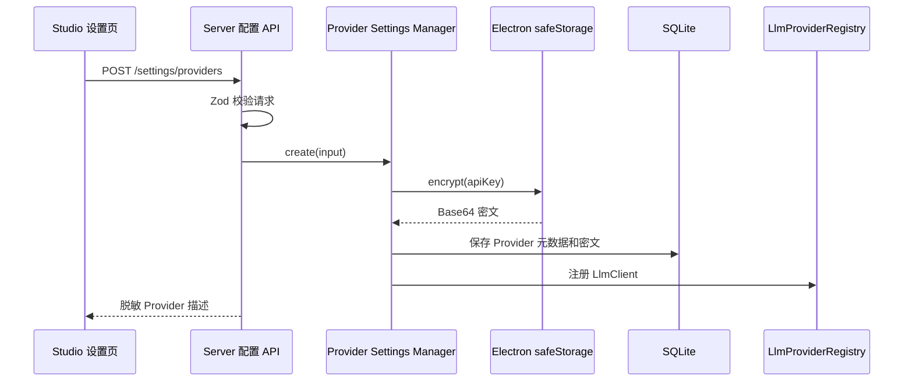
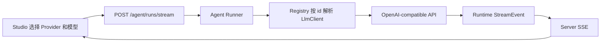

# Weave Provider 设置：从桌面配置到安全模型调用

**日期：** 2026-11-17
**对应功能分支：** `feat/provider-settings`
**学习目标：** 理解为什么 Desktop 应用需要独立的 Provider 配置边界，以及 API Key 如何从设置表单安全地进入运行时。

<callout emoji="bulb" background-color="light-blue" border-color="blue">
这一轮的核心不是把 API Key 放进一个设置页面，而是建立一条完整边界：Studio 负责表单和交互，Server 负责校验和配置编排，Electron 负责系统密钥存储，Runtime 只看到可以调用的 LlmClient。
</callout>

## 1. 为什么 `.env` 不够

`.env` 适合开发者启动服务时提供初始配置，但不适合直接作为桌面产品的配置中心：

1. 用户需要手动编辑文件，产品体验不完整；
2. 修改后通常要重启进程；
3. 多个 Provider 的增删改和默认项不好维护；
4. API Key 会以明文出现在本地文件中；
5. 应用无法清楚区分“配置存在”和“当前可以调用”。

Weave 保留两种运行模式：

| 模式           | 配置来源                               | 设置页能力                   |
| -------------- | -------------------------------------- | ---------------------------- |
| 浏览器开发模式 | 根目录 `.env` 的 `WEAVE_LLM_PROVIDERS` | 只读                         |
| Desktop 模式   | 应用 SQLite + Electron `safeStorage`   | 可新增、编辑、删除、设置默认 |

浏览器模式的只读限制很重要。普通网页可以调用本机 HTTP 服务，但它不应该被当成安全密钥管理器。只有 Desktop Main 进程可以访问 Electron 的系统密钥能力。

## 2. 四个关键概念

### Provider

Provider 表示一个模型服务配置，例如 DeepSeek、OpenAI、Moonshot 或 SiliconFlow。它包含接口地址和默认模型，但在公开描述中不包含 API Key。

### LlmClient

`LlmClient` 是 Runtime 调用模型的统一接口。不同厂商的网络响应由 `@weave/llm` 转换为统一的 `StreamEvent`。

### Registry

`LlmProviderRegistry` 是运行时的路由表：

```text
Provider id -> 私有 LlmClient
Provider id -> 脱敏 Provider 描述
```

Agent 请求只提交 `provider` 和 `model`。Runtime 通过 Provider id 找到私有客户端，Studio 不需要接触客户端内部的 API Key。

### Provider Settings Manager

Manager 连接持久化配置和运行时 Registry。它负责校验输入、调用 Secret Codec 加解密密钥、创建或替换 LlmClient、维护默认 Provider，并且只删除自己管理的 Provider。

## 3. 保存和发送流程

### 保存 API Key



真实 API Key 只在保存请求和 Server 的短暂内存中出现。响应只返回 `hasApiKey: true`，不会把密钥重新传回浏览器。

### 发送消息



Agent 请求中只有 `provider` 和 `model`，不包含 API Key。API Key 已经被封装在 Server 进程内的 `LlmClient` 中。

## 4. 为什么要有 `ProviderSecretCodec`

Server 不应该直接依赖 Electron。这样做会让 Server 测试依赖桌面环境，也会破坏 Server 在浏览器开发模式中的可运行性。

```ts
interface ProviderSecretCodec {
  isAvailable(): boolean;
  encrypt(value: string): string;
  decrypt(value: string): string;
}
```

Server 只依赖这个接口，Desktop Main 注入基于 Electron `safeStorage` 的实现，测试注入 fake codec。

```text
Desktop Main
  -> createElectronProviderSecretCodec()
  -> startServer({ providerSecretCodec })
```

Base64 只是密文的存储编码，不是加密算法。真正的保护来自操作系统提供的 `safeStorage`。当系统密钥存储不可用时，Weave 拒绝保存，不回退到明文。

## 5. SQLite 和重启恢复

Provider Settings Store 保存配置元数据和密文：

```sql
CREATE TABLE provider_settings (
  id TEXT PRIMARY KEY,
  label TEXT NOT NULL,
  type TEXT NOT NULL,
  base_url TEXT NOT NULL,
  encrypted_api_key TEXT,
  default_model TEXT NOT NULL,
  is_default INTEGER NOT NULL DEFAULT 0,
  created_at TEXT NOT NULL,
  updated_at TEXT NOT NULL
);
```

`encrypted_api_key` 为 `NULL` 表示用户清除了密钥。Provider 仍保留在设置列表中，但不会注册到 Registry，也不能被设为默认。

Project、Session 和 Provider 共用 Desktop 的 `userData/weave.sqlite`。重启后 Server 读取配置，解密可恢复的密钥，重新注册可调用 Provider。

如果某个密钥损坏或无法解密，Weave 会保留设置记录，跳过该 Provider 并回退到 Mock。用户可以重新编辑并保存密钥恢复它。

## 6. 为什么保存后不用重启

Agent Runner 使用的是同一个 Registry 对象。Manager 修改对象内部的 Provider：

```text
同一个 Registry
  -> register(deepseek)
  -> replace(deepseek)
  -> remove(deepseek)
```

保存配置后，后续 Agent Run 使用新客户端，不需要重建 Runtime、Session 服务或插件状态。已经开始的运行不会被配置修改强行中断。

## 7. Studio 设置页的安全交互

新增 Provider 时 API Key 必填。编辑已有 Provider 时，输入框默认是空的：

```text
空白 -> 保留旧密钥
clearApiKey: true -> 清除旧密钥
```

页面只保存当前表单的临时输入。保存成功后，Provider 只有 `hasApiKey: true`，没有 `apiKey`、`encryptedApiKey` 或 Authorization Header。

## 8. 错误边界

Server 使用稳定错误码表达失败阶段：

| 错误码                                 | 含义                         |
| -------------------------------------- | ---------------------------- |
| `provider-settings-invalid`            | 表单字段不合法               |
| `provider-settings-duplicate`          | Provider ID 已存在           |
| `provider-settings-protected`          | 系统或插件 Provider 不可修改 |
| `provider-settings-secret-unavailable` | 系统密钥存储不可用           |
| `provider-settings-secret-invalid`     | 已保存密钥无法解密           |
| `provider-settings-provider-invalid`   | Provider 客户端创建失败      |
| `provider-settings-storage`            | 本地 SQLite 操作失败         |

错误消息不能包含 API Key、Authorization Header 或上游响应中的敏感字段。

## 9. 面试回答模板

> Weave 把 Provider 配置拆成 Studio、Server、Desktop Main 和 Runtime 四层。Studio 只负责表单和脱敏状态，Server 负责 Zod 校验、SQLite Store 和 Provider Settings Manager，Desktop Main 注入基于 Electron safeStorage 的 Secret Codec，Runtime 只依赖不包含厂商细节的 LlmProviderRegistry。保存配置后，Manager 在同一个 Registry 中动态注册或替换 LlmClient，因此后续对话不需要重启 Runtime。浏览器模式保持 `.env` 只读，避免普通网页承担本地密钥管理职责。

## 10. 下一步

当前版本支持在 Desktop 设置页配置多个 OpenAI-compatible Provider，并在后续对话中使用。后续可以继续做“测试连接”、模型列表发现、`.env` 显式迁移和插件独立 Provider 配置页。
