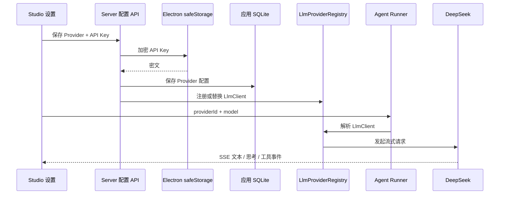

# Provider Settings Implementation Plan

> **For agentic workers:** REQUIRED SUB-SKILL: Use superpowers:subagent-driven-development (recommended) or superpowers:executing-plans to implement this plan task-by-task. Steps use checkbox (`- [ ]`) syntax for tracking.

**Goal:** 在 Weave Desktop 中增加可持久化的 AI Provider 配置面板，让用户可以安全管理多个 OpenAI-compatible Provider、API Key、默认模型和默认 Provider，并让配置立即影响后续 Agent 请求。

**Architecture:** Desktop 的 Electron Main 使用 `safeStorage` 创建密钥编解码器，并把它和同一个应用 SQLite 文件注入 Server。Server 使用独立的 Provider Settings Store 保存配置，使用 Provider Settings Manager 将脱敏配置和可调用的 `LlmClient` 同步到同一个 `LlmProviderRegistry`；Studio 只通过本地 HTTP API 读取脱敏元数据和提交表单，浏览器模式继续使用 `.env` 只读配置。

**Tech Stack:** TypeScript、ESM、Node `node:sqlite`、Zod、Hono、Electron `safeStorage`、React、Vitest、现有 Turborepo/Pnpm 工作区。

**Spec:** `docs/superpowers/specs/2026-11-17-provider-settings-design.md`

## Global Constraints

- Desktop 设置页可以管理多个 Provider；浏览器模式只能读取 `.env` 配置。
- API Key 只能以加密密文落盘，不能出现在 HTTP 响应、Session、SSE、日志和错误消息中。
- `safeStorage` 不可用时拒绝保存，不允许明文回退。
- `mock` Provider 始终存在且不可修改、不可删除。
- 受信任插件 Provider 不属于 Provider Settings Manager，不能被设置刷新和删除逻辑移除。
- 没有 API Key 的 Provider 可以留在设置列表中，但不得注册到可调用的 Provider Registry。
- 所有外部请求输入使用 Zod 校验；HTTP Handler 只负责校验、调用服务和映射响应。
- Provider 配置更新后不重建 Runtime 或 Agent Runner，后续请求使用同一个 Registry 中的新客户端。
- 测试放在对应 package 或 app 的 `test/` 目录，不放在 `src/`。
- 跨 package 依赖必须在导入方的 `package.json` 中声明；`runtime` 不得依赖 Electron、Hono 或 Node HTTP 模块。
- 不新增依赖；优先使用 Node `node:sqlite`、Electron `safeStorage` 和现有 Zod。
- 每个任务完成一个独立可验证结果后提交，提交信息使用中文 Conventional Commits。
- 不把运行生成的 `apps/server/.weave/`、`dist/` 或 `.turbo/` 加入提交。

## File Map

### Server Provider Settings

- Create: `apps/server/src/provider-settings-types.ts`：内部持久化行、脱敏 DTO、请求 Schema、错误码和服务接口。
- Create: `apps/server/src/provider-settings-store.ts`：基于 `node:sqlite` 的 Provider 配置表和 CRUD。
- Create: `apps/server/src/provider-secret-codec.ts`：Server 侧最小 Secret Codec 接口和错误边界。
- Create: `apps/server/src/provider-settings-manager.ts`：配置恢复、密钥解密、客户端创建、Registry 同步和默认 Provider 管理。
- Create: `apps/server/test/provider-settings-store.test.ts`：SQLite Store 契约测试。
- Create: `apps/server/test/provider-settings-manager.test.ts`：Manager、密钥脱敏、Registry 更新和插件保护测试。

### LLM Registry

- Modify: `packages/llm/src/provider-registry.ts`：增加受控的 Provider 移除/替换能力，并保持公开描述和私有客户端分离。
- Modify: `packages/llm/src/index.ts`：导出新增接口类型。
- Modify: `packages/llm/test/provider-registry.test.ts`：增加动态更新和受保护注册行为测试。

### Server HTTP and Composition

- Modify: `apps/server/src/llm-providers.ts`：复用 Provider 配置到客户端的工厂逻辑，并保留环境变量 Provider 行为。
- Modify: `apps/server/src/provider-api.ts`：增加只读和可写 Provider API，保持响应不含密钥。
- Modify: `apps/server/src/app.ts`：传入 Provider Settings API 依赖。
- Modify: `apps/server/src/runtime.ts`：保留同一个 Registry 给 Agent Runner，必要时暴露读取接口。
- Modify: `apps/server/src/main.ts`：Desktop 模式注入 Store、Secret Codec 和 Manager，浏览器模式维持只读。
- Modify: `apps/server/test/provider-api.test.ts`：配置 API、错误映射和密钥脱敏测试。
- Modify: `apps/server/test/health.test.ts`：确认浏览器模式启动不需要可写配置依赖。

### Desktop Secret Boundary

- Create: `apps/desktop/src/provider-secret-codec.ts`：使用 Electron `safeStorage` 的实现。
- Modify: `apps/desktop/src/main.ts`：创建 Codec，并传递给 `startServer()`。
- Create: `apps/desktop/test/provider-secret-codec.test.ts`：Mock safeStorage 的可用/不可用/解密错误测试。
- Modify: `apps/desktop/test/main.test.ts`：确认 Server 收到 Codec，Renderer 不获得 Codec。

### Studio API and Settings UI

- Modify: `apps/studio/src/features/providers/provider-types.ts`：增加可写 Provider DTO、表单类型和配置能力字段。
- Modify: `apps/studio/src/features/providers/provider-api.ts`：增加创建、编辑、删除、设置默认和错误映射。
- Modify: `apps/studio/src/app/App.tsx`：增加 Provider 设置表单、保存状态和列表操作。
- Modify: `apps/studio/src/app/app.css`：为表单、密钥状态、按钮和错误提示增加样式。
- Modify: `apps/studio/test/provider-api.test.ts`：增加 API 请求体、脱敏响应和错误测试。
- Modify: `apps/studio/test/App.test.tsx`：增加 Desktop 可写、浏览器只读和编辑保留密钥测试。

### Documentation

- Create: `docs/learning/2026-11-17-provider-settings.md`：面向学习的 Provider 设置、密钥边界、动态 Registry 和面试说明。
- Modify: `docs/architecture/foundation.md`：补充 Desktop Provider 配置和 Secret Codec 边界。
- Modify: `README.md`：补充 Desktop 配置入口、浏览器模式 `.env` 和验收命令。
- Modify: `docs/superpowers/specs/2026-11-17-provider-settings-design.md`：仅在实现发现契约需要修正时同步，不能让实现和设计分叉。

---

### Task 1: 完成 Provider 配置契约与 SQLite Store

**Files:**

- Create: `apps/server/src/provider-settings-types.ts`
- Create: `apps/server/src/provider-settings-store.ts`
- Create: `apps/server/test/provider-settings-store.test.ts`

**Interfaces:**

- Produces `ProviderSettingsRecord`：

```ts
export interface ProviderSettingsRecord {
  readonly id: string;
  readonly label: string;
  readonly type: 'openai-compatible';
  readonly baseUrl: string;
  readonly encryptedApiKey: string | null;
  readonly defaultModel: string;
  readonly createdAt: string;
  readonly updatedAt: string;
}
```

- Produces `ProviderSettingsStore`：

```ts
export interface ProviderSettingsStore {
  list(): Promise<readonly ProviderSettingsRecord[]>;
  get(id: string): Promise<ProviderSettingsRecord | undefined>;
  create(record: ProviderSettingsRecord): Promise<void>;
  update(record: ProviderSettingsRecord): Promise<void>;
  delete(id: string): Promise<void>;
  close(): Promise<void>;
}
```

- Produces `createSqliteProviderSettingsStore({ filename })`.

- Produces request schemas for `POST`, `PATCH`, and default-provider operations. The
  `PATCH` schema must distinguish omitted `apiKey`, empty `apiKey`, and
  `clearApiKey: true`.

- [ ] **Step 1: Write failing Store tests**

Add tests for:

```ts
it('creates the provider_settings table idempotently and persists a record', async () => {
  const store = createSqliteProviderSettingsStore({ filename });
  const record = createRecord({ encryptedApiKey: 'encrypted-secret' });

  await store.create(record);
  await store.close();

  const reopened = createSqliteProviderSettingsStore({ filename });
  await expect(reopened.get(record.id)).resolves.toEqual(record);
  await reopened.close();
});

it('keeps a cleared API key as null without returning plaintext fields', async () => {
  const store = createSqliteProviderSettingsStore({ filename });
  const record = createRecord({ encryptedApiKey: null });

  await store.create(record);

  await expect(store.get(record.id)).resolves.toMatchObject({
    id: record.id,
    encryptedApiKey: null,
  });
  await store.close();
});

it('updates and deletes records while repeated close remains safe', async () => {
  const store = createSqliteProviderSettingsStore({ filename });
  const record = createRecord({ encryptedApiKey: 'first' });

  await store.create(record);
  await store.update({ ...record, label: 'Changed', encryptedApiKey: null });
  await expect(store.get(record.id)).resolves.toMatchObject({ label: 'Changed' });
  await store.delete(record.id);
  await expect(store.get(record.id)).resolves.toBeUndefined();
  await store.close();
  await store.close();
});
```

- [ ] **Step 2: Run the focused test to verify it fails**

Run:

```bash
pnpm exec vitest run apps/server/test/provider-settings-store.test.ts --config vitest.config.ts
```

Expected: FAIL because the Store module and factory do not exist.

- [ ] **Step 3: Implement the minimal Store**

Create the table exactly once with:

```sql
CREATE TABLE IF NOT EXISTS provider_settings (
  id TEXT PRIMARY KEY,
  label TEXT NOT NULL,
  type TEXT NOT NULL,
  base_url TEXT NOT NULL,
  encrypted_api_key TEXT,
  default_model TEXT NOT NULL,
  created_at TEXT NOT NULL,
  updated_at TEXT NOT NULL
);
```

Use `DatabaseSync`, Zod parsing at construction and before writing, explicit
`BEGIN IMMEDIATE` transactions for update/delete, and `ProviderSettingsStoreError`
with stable codes:

```ts
type ProviderSettingsStoreErrorCode =
  | 'provider-settings-storage'
  | 'provider-settings-invalid'
  | 'provider-settings-closed'
  | 'provider-settings-protocol'
  | 'provider-settings-not-found';
```

The Store must never decrypt or log `encryptedApiKey`; it only persists opaque
strings. A missing key is represented by SQL `NULL`.

- [ ] **Step 4: Run the focused test to verify it passes**

Run the same Vitest command. Expected: all Store tests PASS.

- [ ] **Step 5: Commit**

```bash
git add apps/server/src/provider-settings-types.ts apps/server/src/provider-settings-store.ts apps/server/test/provider-settings-store.test.ts
git commit -m "feat: 增加 Provider 配置存储"
```

### Task 2: Add dynamic Provider Registry operations

**Files:**

- Modify: `packages/llm/src/provider-registry.ts`
- Modify: `packages/llm/src/index.ts`
- Modify: `packages/llm/test/provider-registry.test.ts`

**Interfaces:**

- Extend `LlmProviderRegistry` with:

```ts
remove(providerId: string): boolean;
replace(provider: LlmProviderRegistration): void;
```

- `replace()` must fail when the id does not exist, preventing accidental creation
  through an edit-only operation. The Manager can use `register()` for a new id.

- [ ] **Step 1: Write failing Registry tests**

Add tests:

```ts
it('replaces a client while preserving the registry object and public descriptor', () => {
  const first = createFakeClient('first');
  const second = createFakeClient('second');
  const registry = createLlmProviderRegistry([createRegistration('alpha', first)]);

  registry.replace({ ...createRegistration('alpha', second), defaultModel: 'new-model' });

  expect(registry.get('alpha')).toBe(second);
  expect(registry.getDescriptor('alpha')).toEqual({
    id: 'alpha',
    label: 'alpha',
    type: 'openai-compatible',
    defaultModel: 'new-model',
  });
});

it('removes only the requested Provider', () => {
  const registry = createLlmProviderRegistry([
    createRegistration('alpha', createFakeClient('alpha')),
    createRegistration('beta', createFakeClient('beta')),
  ]);

  expect(registry.remove('alpha')).toBe(true);
  expect(registry.get('alpha')).toBeUndefined();
  expect(registry.get('beta')).toBeDefined();
  expect(registry.remove('alpha')).toBe(false);
});
```

- [ ] **Step 2: Run the focused test and confirm the expected API failure**

```bash
pnpm exec vitest run packages/llm/test/provider-registry.test.ts --config vitest.config.ts
```

Expected: FAIL because `remove` and `replace` are absent.

- [ ] **Step 3: Implement dynamic operations**

Keep `clients` and `descriptors` in the same Maps. `remove()` deletes both maps.
`replace()` validates the registration with the existing Zod schema, checks that
the id exists, then updates both maps atomically within the synchronous function.
Do not add a `clear()` method; the settings manager must remove only ids it owns.

- [ ] **Step 4: Run the focused and existing Registry tests**

```bash
pnpm exec vitest run packages/llm/test/provider-registry.test.ts --config vitest.config.ts
```

Expected: existing tests and new tests PASS.

- [ ] **Step 5: Commit**

```bash
git add packages/llm/src/provider-registry.ts packages/llm/src/index.ts packages/llm/test/provider-registry.test.ts
git commit -m "feat: 支持 Provider Registry 动态更新"
```

### Task 3: Implement Secret Codec and Provider Settings Manager

**Files:**

- Create: `apps/server/src/provider-secret-codec.ts`
- Create: `apps/server/src/provider-settings-manager.ts`
- Create: `apps/server/test/provider-settings-manager.test.ts`
- Modify: `apps/server/src/llm-providers.ts`

**Interfaces:**

- Define the Server-owned codec contract:

```ts
export interface ProviderSecretCodec {
  encrypt(value: string): string;
  decrypt(value: string): string;
  isAvailable(): boolean;
}
```

- Define `ProviderSettingsManager`:

```ts
export interface ProviderSettingsManager {
  list(): Promise<readonly ManagedProviderDescriptor[]>;
  create(input: CreateProviderSettingsInput): Promise<ManagedProviderDescriptor>;
  update(id: string, input: UpdateProviderSettingsInput): Promise<ManagedProviderDescriptor>;
  remove(id: string): Promise<void>;
  setDefault(id: string): Promise<void>;
  getDefaultProvider(): string;
  refresh(): Promise<void>;
}
```

- `ManagedProviderDescriptor` extends the public descriptor with:

```ts
{
  baseUrl: string;
  hasApiKey: boolean;
  editable: boolean;
}
```

- `createProviderSettingsManager()` receives a Store, Registry, Secret Codec,
  `createOpenAiCompatibleClient` factory, and the initial default Provider.

- [ ] **Step 1: Write failing Manager tests**

Use an in-memory fake Store and deterministic fake Codec. Cover:

```ts
it('loads encrypted records and registers only Providers with usable keys', async () => {
  const manager = createManager({
    records: [
      record({ id: 'deepseek', encryptedApiKey: 'cipher:secret' }),
      record({ id: 'missing-key', encryptedApiKey: null }),
    ],
  });

  await manager.refresh();

  expect(manager.getDefaultProvider()).toBe('mock');
  expect(registry.get('deepseek')).toBeDefined();
  expect(registry.get('missing-key')).toBeUndefined();
  await expect(manager.list()).resolves.toEqual(
    expect.arrayContaining([
      expect.objectContaining({ id: 'deepseek', hasApiKey: true, editable: true }),
      expect.objectContaining({ id: 'missing-key', hasApiKey: false, editable: true }),
    ]),
  );
});

it('updates the same Registry so the next run uses a newly saved API key', async () => {
  const manager = createManager();
  const registryBefore = registry;

  await manager.create({
    id: 'deepseek',
    label: 'DeepSeek',
    type: 'openai-compatible',
    baseUrl: 'https://api.deepseek.com',
    apiKey: 'first-key',
    defaultModel: 'deepseek-chat',
    makeDefault: true,
  });
  await manager.update('deepseek', { apiKey: 'second-key' });

  expect(registry).toBe(registryBefore);
  expect(fakeClientFactory.createdKeys).toEqual(['first-key', 'second-key']);
});

it('does not remove a Provider owned by a plugin', async () => {
  registry.register(pluginRegistration('plugin-provider'));
  const manager = createManager({ records: [] });

  await expect(manager.remove('plugin-provider')).rejects.toMatchObject({
    code: 'provider-settings-protected',
  });
  expect(registry.get('plugin-provider')).toBeDefined();
});

it('clearing a key keeps metadata but removes the Provider from the callable Registry', async () => {
  const manager = createManager({ records: [record({ id: 'deepseek', encryptedApiKey: 'cipher:key' })] });
  await manager.refresh();
  await manager.update('deepseek', { clearApiKey: true });

  expect(registry.get('deepseek')).toBeUndefined();
  await expect(manager.list()).resolves.toContainEqual(
    expect.objectContaining({ id: 'deepseek', hasApiKey: false }),
  );
});
```

- [ ] **Step 2: Run the focused test and confirm it fails**

```bash
pnpm exec vitest run apps/server/test/provider-settings-manager.test.ts --config vitest.config.ts
```

Expected: FAIL because the Manager and codec contract do not exist.

- [ ] **Step 3: Implement codec boundary and Manager**

The Manager must:

1. Validate ids, labels, URLs and models with Zod.
2. Reject write operations when `codec.isAvailable()` is false.
3. Encrypt new non-empty API Keys before Store writes.
4. On update, keep the existing encrypted key when `apiKey` is omitted or empty.
5. Write `NULL` only for `clearApiKey: true`.
6. Build `createOpenAiCompatibleClient({ baseUrl, apiKey })` only when a key exists.
7. Register new ids, `replace()` existing owned ids, and remove only owned ids.
8. Treat `mock` as protected.
9. Track `managedIds` separately from Registry contents so plugin ids are protected.
10. Select the saved default when it has a usable key; otherwise fall back to `mock`.
11. Remove a deleted default and set the active default to `mock`.
12. Redact secrets from all thrown Manager errors.

Refactor `createServerLlmProviders()` so its OpenAI-compatible client construction
is reusable by the Manager, but retain the current environment variable parsing and
default `mock` behavior.

- [ ] **Step 4: Run Manager and existing Server Provider tests**

```bash
pnpm exec vitest run apps/server/test/provider-settings-manager.test.ts apps/server/test/provider-api.test.ts --config vitest.config.ts
```

Expected: PASS.

- [ ] **Step 5: Commit**

```bash
git add apps/server/src/provider-secret-codec.ts apps/server/src/provider-settings-manager.ts apps/server/src/llm-providers.ts apps/server/test/provider-settings-manager.test.ts
git commit -m "feat: 增加 Provider 配置管理器"
```

### Task 4: Add Server composition and HTTP configuration API

**Files:**

- Modify: `apps/server/src/provider-api.ts`
- Modify: `apps/server/src/app.ts`
- Modify: `apps/server/src/main.ts`
- Modify: `apps/server/src/runtime.ts`
- Modify: `apps/server/test/provider-api.test.ts`
- Modify: `apps/server/test/health.test.ts`

**Interfaces:**

- Extend `StartServerOptions`:

```ts
readonly providerSettingsStore?: ProviderSettingsStore;
readonly providerSecretCodec?: ProviderSecretCodec;
```

- Extend `ProviderAppOptions`:

```ts
readonly providerSettingsManager?: ProviderSettingsManager;
readonly canManageProviders?: boolean;
```

- Add routes:

```text
GET    /settings/providers
POST   /settings/providers
PATCH  /settings/providers/:providerId
DELETE /settings/providers/:providerId
POST   /settings/providers/:providerId/default
```

- [ ] **Step 1: Write failing HTTP tests**

Add tests for:

```ts
it('returns canManage false and rejects writes in browser mode', async () => {
  const app = createApp(runtime, {
    providerRegistry: settings.registry,
    defaultProvider: 'mock',
  });

  const response = await app.request('/settings/providers', {
    method: 'POST',
    body: JSON.stringify(validInput),
    headers: { 'content-type': 'application/json' },
  });

  expect(response.status).toBe(403);
  await expect(response.json()).resolves.toEqual({
    error: {
      code: 'provider-settings-desktop-only',
      message: expect.any(String),
    },
  });
});

it('creates a Provider without returning its API key', async () => {
  const app = createApp(runtime, {
    providerRegistry: settings.registry,
    providerSettingsManager: manager,
    canManageProviders: true,
  });

  const response = await app.request('/settings/providers', {
    method: 'POST',
    body: JSON.stringify({
      id: 'deepseek',
      label: 'DeepSeek',
      type: 'openai-compatible',
      baseUrl: 'https://api.deepseek.com',
      apiKey: 'server-secret',
      defaultModel: 'deepseek-chat',
      makeDefault: true,
    }),
    headers: { 'content-type': 'application/json' },
  });

  expect(response.status).toBe(201);
  const body = await response.json();
  expect(JSON.stringify(body)).not.toContain('server-secret');
  expect(body.provider).toMatchObject({ id: 'deepseek', hasApiKey: true });
});

it('keeps the old key when PATCH omits or clears the API key field', async () => {
  const response = await app.request('/settings/providers/deepseek', {
    method: 'PATCH',
    body: JSON.stringify({ label: 'DeepSeek 新名称', apiKey: '' }),
    headers: { 'content-type': 'application/json' },
  });

  expect(response.status).toBe(200);
  expect(managerFactory.createdKeys).toEqual(['old-key']);
});

it('maps protected, missing and invalid Provider operations to stable errors', async () => {
  await expect(requestDelete('mock')).resolves.toMatchObject({ status: 409 });
  await expect(requestDelete('missing')).resolves.toMatchObject({ status: 404 });
  await expect(requestCreate({ ...validInput, baseUrl: 'invalid' })).resolves.toMatchObject({
    status: 400,
  });
});
```

- [ ] **Step 2: Run the focused HTTP tests and verify failure**

```bash
pnpm exec vitest run apps/server/test/provider-api.test.ts --config vitest.config.ts
```

Expected: FAIL because the write routes and Manager dependency are absent.

- [ ] **Step 3: Implement thin HTTP routes**

Use Zod schemas at the route boundary. Map Manager errors as follows:

```ts
const statusByCode = {
  'provider-settings-desktop-only': 403,
  'provider-settings-invalid': 400,
  'provider-settings-not-found': 404,
  'provider-settings-duplicate': 409,
  'provider-settings-protected': 409,
  'provider-settings-secret-unavailable': 503,
  'provider-settings-secret-invalid': 503,
  'provider-settings-storage': 500,
  'provider-settings-provider-invalid': 422,
} as const;
```

The route must never serialize Store records or Manager internals directly. It returns
only public descriptors. A failed request must not include `cause`, encrypted values,
API Keys or upstream provider response bodies.

In `startServer()`:

1. Build the environment Provider Registry as today.
2. If both `providerSettingsStore` and `providerSecretCodec` are provided, create the
   Manager with the same Registry and call `refresh()` before plugin registration.
3. Register trusted plugins after persisted Provider restoration so duplicate ids fail
   deterministically.
4. Create the Agent Runner after all Provider and plugin registrations.
5. Pass the Manager and `canManageProviders: true` to `createApp()`.
6. Close the Store during `stop()` and startup failure cleanup.
7. If either Desktop dependency is absent, do not create a writable Manager and return
   `canManage: false`.

- [ ] **Step 4: Run Server tests**

```bash
pnpm exec vitest run apps/server/test/provider-api.test.ts apps/server/test/health.test.ts apps/server/test/plugin-integration.test.ts --config vitest.config.ts
```

Expected: PASS.

- [ ] **Step 5: Commit**

```bash
git add apps/server/src/provider-api.ts apps/server/src/app.ts apps/server/src/main.ts apps/server/src/runtime.ts apps/server/test/provider-api.test.ts apps/server/test/health.test.ts
git commit -m "feat: 增加 Provider 配置 API"
```

### Task 5: Inject Electron safeStorage into Desktop Server

**Files:**

- Create: `apps/desktop/src/provider-secret-codec.ts`
- Modify: `apps/desktop/src/main.ts`
- Create: `apps/desktop/test/provider-secret-codec.test.ts`
- Modify: `apps/desktop/test/main.test.ts`

**Interfaces:**

- Produce:

```ts
export function createElectronProviderSecretCodec(): ProviderSecretCodec;
```

- `encrypt(value)` must call `safeStorage.encryptString(value)` and return a
  base64 string.
- `decrypt(value)` must decode base64 and call `safeStorage.decryptString(buffer)`.
- `isAvailable()` must return `safeStorage.isEncryptionAvailable()`.
- Any Electron secret operation failure must become a stable
  `provider-settings-secret-invalid` or `provider-settings-secret-unavailable`
  boundary error without exposing the secret.

- [ ] **Step 1: Write failing safeStorage tests**

Mock the Electron module and cover:

```ts
it('encodes encrypted API keys as base64 without exposing plaintext', () => {
  safeStorage.isEncryptionAvailable.mockReturnValue(true);
  safeStorage.encryptString.mockReturnValue(Buffer.from('ciphertext'));

  const codec = createElectronProviderSecretCodec();

  expect(codec.isAvailable()).toBe(true);
  expect(codec.encrypt('deepseek-secret')).toBe(Buffer.from('ciphertext').toString('base64'));
  expect(codec.encrypt('deepseek-secret')).not.toContain('deepseek-secret');
});

it('reports unavailable system encryption before saving', () => {
  safeStorage.isEncryptionAvailable.mockReturnValue(false);

  expect(() => createElectronProviderSecretCodec().encrypt('secret')).toThrow();
});
```

- [ ] **Step 2: Run the focused test to verify failure**

```bash
pnpm exec vitest run apps/desktop/test/provider-secret-codec.test.ts --config vitest.config.ts
```

Expected: FAIL because the Codec module does not exist.

- [ ] **Step 3: Implement the safeStorage adapter**

Keep all Electron imports inside `apps/desktop/src/provider-secret-codec.ts`. Main
creates the Codec after Electron is ready and passes it in:

```ts
desktopServer = await startDesktopServer(config, createElectronProviderSecretCodec());
```

`startDesktopServer` should call:

```ts
startServer(0, {
  databaseFile: config.databaseFile,
  studioOrigin: config.studioOrigin,
  providerSecretCodec: codec,
});
```

Do not expose the Codec through `contextBridge` or `additionalArguments`.

- [ ] **Step 4: Run Desktop tests**

```bash
pnpm exec vitest run apps/desktop/test/provider-secret-codec.test.ts apps/desktop/test/main.test.ts --config vitest.config.ts
```

Expected: PASS.

- [ ] **Step 5: Commit**

```bash
git add apps/desktop/src/provider-secret-codec.ts apps/desktop/src/main.ts apps/desktop/test/provider-secret-codec.test.ts apps/desktop/test/main.test.ts
git commit -m "feat: 接入桌面端安全密钥存储"
```

### Task 6: Add Studio Provider Settings API client

**Files:**

- Modify: `apps/studio/src/features/providers/provider-types.ts`
- Modify: `apps/studio/src/features/providers/provider-api.ts`
- Modify: `apps/studio/test/provider-api.test.ts`

**Interfaces:**

- Extend `ProviderDescriptor`:

```ts
{
  baseUrl?: string;
  hasApiKey: boolean;
  editable: boolean;
}
```

- Extend `ProviderSettings`:

```ts
{
  canManage: boolean;
}
```

- Add:

```ts
export interface ProviderSettingsInput {
  readonly id: string;
  readonly label: string;
  readonly type: 'openai-compatible';
  readonly baseUrl: string;
  readonly apiKey: string;
  readonly defaultModel: string;
  readonly makeDefault: boolean;
}

export interface ProviderSettingsPatch {
  readonly label?: string;
  readonly baseUrl?: string;
  readonly apiKey?: string;
  readonly clearApiKey?: boolean;
  readonly defaultModel?: string;
  readonly makeDefault?: boolean;
}

export interface ProviderApi {
  listProviders(): Promise<ProviderSettings>;
  createProvider(input: ProviderSettingsInput): Promise<ProviderDescriptor>;
  updateProvider(id: string, input: ProviderSettingsPatch): Promise<ProviderDescriptor>;
  deleteProvider(id: string): Promise<void>;
  setDefaultProvider(id: string): Promise<ProviderSettings>;
}
```

- [ ] **Step 1: Write failing API client tests**

Cover the HTTP method, path, JSON body and response validation:

```ts
it('creates a Provider with the local Server API', async () => {
  fetchMock.mockResolvedValue(
    new Response(JSON.stringify({ provider: publicDeepSeek }), { status: 201 }),
  );

  await expect(createProviderApi().createProvider(validInput)).resolves.toEqual(publicDeepSeek);
  expect(fetchMock).toHaveBeenCalledWith('/settings/providers', {
    method: 'POST',
    headers: { 'content-type': 'application/json' },
    body: JSON.stringify(validInput),
  });
});

it('patches without placing the previous API key into the request', async () => {
  fetchMock.mockResolvedValue(
    new Response(JSON.stringify({ provider: publicDeepSeek }), { status: 200 }),
  );

  await createProviderApi().updateProvider('deepseek', {
    label: 'DeepSeek',
    apiKey: '',
  });

  expect(fetchMock.mock.calls[0]?.[1]).toMatchObject({
    method: 'PATCH',
    body: JSON.stringify({ label: 'DeepSeek', apiKey: '' }),
  });
});

it('maps Provider API errors without exposing secret response fields', async () => {
  fetchMock.mockResolvedValue(
    new Response(
      JSON.stringify({
        error: { code: 'provider-settings-secret-unavailable', message: '系统密钥存储不可用' },
        apiKey: 'should-never-be-returned',
      }),
      { status: 503 },
    ),
  );

  await expect(createProviderApi().createProvider(validInput)).rejects.toMatchObject({
    code: 'provider-settings-secret-unavailable',
    status: 503,
  });
});
```

- [ ] **Step 2: Run the focused test and verify failure**

```bash
pnpm exec vitest run apps/studio/test/provider-api.test.ts --config vitest.config.ts
```

Expected: FAIL because write methods and schemas do not exist.

- [ ] **Step 3: Implement typed API methods**

Reuse the existing `requestJson()` pattern, add a request helper for JSON methods,
validate every successful response with Zod, and URL-encode `providerId` using
`encodeURIComponent`. Do not store API keys in module state or localStorage.

- [ ] **Step 4: Run the focused Studio API tests**

Expected: all existing read tests and new write tests PASS.

- [ ] **Step 5: Commit**

```bash
git add apps/studio/src/features/providers/provider-types.ts apps/studio/src/features/providers/provider-api.ts apps/studio/test/provider-api.test.ts
git commit -m "feat: 增加 Provider 设置客户端"
```

### Task 7: Build the Desktop Provider Settings UI

**Files:**

- Modify: `apps/studio/src/app/App.tsx`
- Modify: `apps/studio/src/app/app.css`
- Modify: `apps/studio/test/App.test.tsx`

**Interfaces:**

- The settings view must use `providerApi.listProviders()` on load and the write
  methods from Task 6 for every mutation.
- Keep the API key only in the active form state. On edit, initialize it as `''`;
  never copy a persisted secret into React state.
- Use an explicit form mode:

```ts
type ProviderFormState = {
  readonly mode: 'create' | 'edit';
  readonly editingId: string | null;
  readonly id: string;
  readonly label: string;
  readonly baseUrl: string;
  readonly apiKey: string;
  readonly defaultModel: string;
  readonly makeDefault: boolean;
  readonly clearApiKey: boolean;
};
```

- [ ] **Step 1: Write failing component tests**

Add tests for:

```tsx
it('shows a read-only .env message in browser mode', async () => {
  render(<App />);
  await user.click(screen.getByRole('button', { name: '设置' }));

  expect(screen.getByText(/浏览器开发模式/)).toBeInTheDocument();
  expect(screen.queryByRole('button', { name: '添加 AI 服务' })).not.toBeInTheDocument();
});

it('allows Desktop users to add a Provider without displaying the secret afterward', async () => {
  window.weaveDesktop = { isDesktop: true, serverUrl: 'http://127.0.0.1:46321' };
  mockProviderApi({ canManage: true, providers: [mockProvider] });

  render(<App />);
  await user.click(screen.getByRole('button', { name: '设置' }));
  await user.click(screen.getByRole('button', { name: '添加 AI 服务' }));
  await user.type(screen.getByLabelText('API Key'), 'deepseek-secret');
  await user.click(screen.getByRole('button', { name: '保存 Provider' }));

  expect(createProviderMock).toHaveBeenCalledWith(expect.objectContaining({
    apiKey: 'deepseek-secret',
  }));
  expect(screen.queryByDisplayValue('deepseek-secret')).not.toBeInTheDocument();
});

it('edits an existing Provider with an empty API key to keep the old secret', async () => {
  // The form starts with an empty API key and the PATCH body keeps apiKey empty.
  expect(screen.getByLabelText('API Key')).toHaveValue('');
  await user.click(screen.getByRole('button', { name: '保存 Provider' }));
  expect(updateProviderMock).toHaveBeenCalledWith('deepseek', expect.objectContaining({ apiKey: '' }));
});
```

- [ ] **Step 2: Run the component tests and verify failure**

```bash
pnpm exec vitest run apps/studio/test/App.test.tsx --config vitest.config.ts
```

Expected: FAIL because the current settings view is read-only.

- [ ] **Step 3: Implement the settings view**

Use the existing navigation and visual language. Add:

- Provider cards with default marker, key status, model, and edit/delete actions;
- “添加 AI 服务” button only when `canManage` is true;
- a compact modal or inline form with fields for name, id, base URL, API Key,
  default model, and “设为默认”;
- edit mode with blank API Key and helper text “留空表示保持当前密钥”;
- explicit “清除当前密钥” control that sets `clearApiKey`;
- saving, deleting and default-switching loading states;
- inline error text for stable API errors;
- success feedback after save;
- confirmation before deleting a Provider;
- automatic refresh of the chat Provider selection after a successful mutation;
- browser mode read-only message explaining `.env` and Desktop configuration.

Do not add decorative English subtitles to the settings cards. Keep visible copy
Chinese by default, matching the existing Studio UI.

- [ ] **Step 4: Run Studio tests and build**

```bash
pnpm exec vitest run apps/studio/test/App.test.tsx apps/studio/test/provider-api.test.ts --config vitest.config.ts
pnpm --filter @weave/studio typecheck
```

Expected: PASS with no TypeScript errors.

- [ ] **Step 5: Commit**

```bash
git add apps/studio/src/app/App.tsx apps/studio/src/app/app.css apps/studio/test/App.test.tsx
git commit -m "feat: 增加 Provider 设置面板"
```

### Task 8: Integrate Desktop startup, persistence recovery, and full verification

**Files:**

- Modify: `apps/server/src/main.ts`
- Modify: `apps/desktop/src/main.ts`
- Modify: `apps/desktop/test/main.test.ts`
- Modify: `apps/server/test/provider-settings-store.test.ts`
- Modify: `apps/server/test/provider-settings-manager.test.ts`
- Modify: `README.md`

**Interfaces:**

- Desktop startup must pass the same `databaseFile` used by Project and Session stores
  to the Provider Settings Store.
- `startServer().stop()` must close the Provider Settings Store exactly once.
- A restarted Server using the same database and Codec must return the saved Provider
  with `hasApiKey: true` and route a subsequent Agent request to it.

- [ ] **Step 1: Write failing integration tests**

Add a Server restart test:

```ts
it('restores saved Provider configuration after Server restart', async () => {
  const first = await startServer(0, {
    databaseFile: filename,
    providerSecretCodec: fakeCodec,
    environment: {},
  });

  const created = await fetchJson(first.port, '/settings/providers', {
    method: 'POST',
    body: validDeepSeekInput,
  });
  expect(created.provider).toMatchObject({ id: 'deepseek', hasApiKey: true });
  await first.stop();

  const second = await startServer(0, {
    databaseFile: filename,
    providerSecretCodec: fakeCodec,
    environment: {},
  });
  const settings = await fetchJson(second.port, '/settings/providers');

  expect(settings.providers).toContainEqual(
    expect.objectContaining({ id: 'deepseek', hasApiKey: true }),
  );
  expect(settings.defaultProvider).toBe('deepseek');
  await second.stop();
});
```

Add a Desktop mock assertion that `startDesktopServer()` forwards the Codec and
configured application database path.

- [ ] **Step 2: Run the integration tests and verify failure**

```bash
pnpm exec vitest run apps/server/test/provider-settings-store.test.ts apps/desktop/test/main.test.ts --config vitest.config.ts
```

Expected: FAIL until startup composition and cleanup are wired.

- [ ] **Step 3: Complete composition and cleanup**

Ensure startup cleanup closes the Manager Store whether Runtime startup, plugin
registration, HTTP binding or Provider restoration fails. Preserve the original
startup error while logging cleanup failures. Do not register process signal
listeners more than once.

Update `README.md` with:

```bash
pnpm desktop:dev
```

and the user flow:

```text
打开桌面端
  -> 设置
  -> 添加 AI 服务
  -> 保存 API Key
  -> 选择模型
  -> 返回工作台发送消息
```

Make clear that browser mode still uses `.env` and Desktop mode stores encrypted
keys in the application data directory.

- [ ] **Step 4: Run focused and full verification**

```bash
pnpm format
pnpm check
pnpm desktop:dev
```

During manual Desktop verification:

1. Add a DeepSeek Provider in Settings.
2. Confirm the API key is never rendered back into the page.
3. Set it as default and send a real request.
4. Close and reopen Desktop.
5. Confirm the Provider remains configured and the next request works.
6. Delete it and confirm the chat falls back to Mock.
7. Confirm the SQLite file is under Electron `userData`, not `apps/server/.weave/`.

- [ ] **Step 5: Commit**

```bash
git add README.md apps/server/src/main.ts apps/desktop/src/main.ts apps/desktop/test/main.test.ts apps/server/test/provider-settings-store.test.ts apps/server/test/provider-settings-manager.test.ts
git commit -m "feat: 完成 Provider 配置持久化集成"
```

### Task 9: Add learning documentation and update architecture records

**Files:**

- Create: `docs/learning/2026-11-17-provider-settings.md`
- Modify: `docs/architecture/foundation.md`
- Modify: `docs/superpowers/specs/2026-11-17-provider-settings-design.md`

**Interfaces:**

- The learning document must explain, in Chinese:
  - why `.env` is insufficient for a Desktop product;
  - why API Key belongs to Server/Main boundaries;
  - how `safeStorage` differs from `localStorage`;
  - why the key is encrypted at rest;
  - why a Provider without a key stays visible but is not callable;
  - how the same Registry reference makes changes take effect immediately;
  - why plugin Providers are protected;
  - browser mode versus Desktop mode;
  - the full settings-to-model request flow;
  - test and manual acceptance commands;
  - concise interview explanations.

- [ ] **Step 1: Write the learning document after implementation behavior is stable**

Include this flow:



- [ ] **Step 2: Update Foundation architecture**

Document the new optional Server dependencies:

```text
Desktop Main
  -> safeStorage Secret Codec
  -> Provider Settings Store
  -> Provider Settings Manager
  -> shared LlmProviderRegistry
  -> Agent Runner
```

Keep the lower-layer dependency rule explicit: Runtime does not import Server
settings code or Electron.

- [ ] **Step 3: Reconcile the design spec**

Record the nullable encrypted key behavior and the rule that a keyless Provider
is visible but unavailable. Remove any wording that implies a secret is mandatory
for every persisted row.

- [ ] **Step 4: Run documentation and repository checks**

```bash
pnpm format:check
git diff --check
rg -n "apiKey|encryptedApiKey|safeStorage" docs/learning/2026-11-17-provider-settings.md
```

Confirm that the learning document never includes a real secret and that all
examples use placeholders.

- [ ] **Step 5: Commit**

```bash
git add docs/learning/2026-11-17-provider-settings.md docs/architecture/foundation.md docs/superpowers/specs/2026-11-17-provider-settings-design.md
git commit -m "docs: 补充 Provider 配置学习说明"
```

## Final Branch Verification

Before pushing, run:

```bash
git status --short --branch
git diff --check
pnpm check
git log --oneline origin/main..HEAD
```

The only untracked path allowed to remain local is the pre-existing
`apps/server/.weave/` runtime database, which must not be staged. Push with:

```bash
git push -u origin HEAD:refs/heads/feat/provider-settings
```

Then create one Pull Request for this feature. Use a Chinese Conventional Commit
style title/body, wait for CI, and use the repository's configured automatic
merge flow into `main`.
