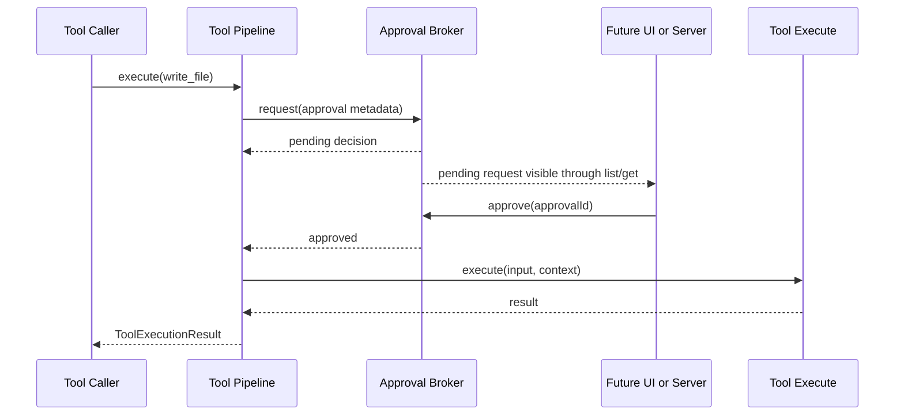

# Weave Approval Service 设计

**日期：** 2026-11-15

**状态：** 已确认，进入实施

**目标阶段：** Runtime 内存型工具审批契约和等待机制

## 1. 目标

本轮为 Runtime 增加最小可用的 Tool Approval 边界，让高风险工具在真正执行
前可以暂停，等待外部调用方批准或拒绝。

本轮完成后应满足：

1. 定义稳定的 Approval Request、Decision 和状态类型；
2. 提供内存型 `ApprovalBroker`，管理 pending 请求和终态决策；
3. `ToolDefinition` 可以声明自己是否需要 Approval；
4. `ToolPipeline` 在调用工具实现前创建请求并等待决策；
5. `approve`、`reject`、`cancel`、`expire` 都是幂等边界；
6. Approval 等待支持 Pipeline 的 `AbortSignal`；
7. `write_file` 默认声明为需要 Approval；
8. 拒绝、取消、过期和重复决策映射为稳定错误码；
9. Approval 运行态暂存内存，不写入 Session Event Store；
10. 不实现 HTTP/SSE、前端 UI、角色权限、持久化恢复和完整 Sandbox。

## 2. 为什么先实现内存型 Broker

Approval 同时涉及工具执行和用户交互，但当前 Runtime 还没有 HTTP/SSE
控制面，也没有 Session Tool Event 契约。如果本轮直接把审批写入 Session
持久化，会同时改变 `@weave/session` 的事件类型、Projection 和恢复流程，
导致一个功能跨越多个尚未稳定的边界。

因此本轮将 Approval 视为 transient live-control state：

```text
ToolPipeline
  -> ApprovalBroker
    -> pending Promise
      -> approve / reject / cancel / expire
```

后续可以在不改变工具执行 API 的前提下，增加 Approval Event Store 或
Session audit events。当前内存实现的主要目标是先固定等待、终态和并发决策
语义。

## 3. 数据流



拒绝、取消和过期都不会调用工具的 `execute`。这一点是 Approval 的核心
安全边界：Approval 必须发生在真实副作用之前。

## 4. 公共类型

### 4.1 Approval 状态

```ts
type ApprovalStatus =
  | 'pending'
  | 'approved'
  | 'rejected'
  | 'cancelled'
  | 'expired';
```

`pending` 是唯一可等待状态，其他状态都是终态。

### 4.2 Approval 请求

```ts
interface ApprovalRequest {
  readonly approvalId: string;
  readonly toolCallId: string;
  readonly toolName: string;
  readonly operation: string;
  readonly summary: string;
  readonly risk: 'low' | 'medium' | 'high';
  readonly inputSummary: unknown;
  readonly status: ApprovalStatus;
  readonly createdAt: string;
  readonly resolvedAt?: string;
  readonly expiresAt?: string;
  readonly decisionReason?: string;
}
```

`inputSummary` 只用于展示和审计，不应该默认包含完整文件内容、API Key 或
其他敏感值。`write_file` 的摘要只展示相对路径、字节数和是否覆盖，不展示
完整文本内容。

### 4.3 Approval Decision

```ts
type ApprovalDecision =
  | {
      readonly status: 'approved';
      readonly reason?: string;
    }
  | {
      readonly status: 'rejected' | 'cancelled' | 'expired';
      readonly reason?: string;
    };
```

Approval Broker 负责补齐 `resolvedAt` 和最终请求快照，调用方不能直接修改
请求对象。

## 5. Approval Broker

公共接口：

```ts
interface ApprovalBroker {
  request(input: CreateApprovalRequestInput): Promise<ApprovalDecision>;
  get(approvalId: string): ApprovalRequest | undefined;
  list(): readonly ApprovalRequest[];
  approve(approvalId: string, reason?: string): ApprovalRequest;
  reject(approvalId: string, reason?: string): ApprovalRequest;
  cancel(approvalId: string, reason?: string): ApprovalRequest;
  expire(approvalId: string, reason?: string): ApprovalRequest;
}
```

创建输入不包含系统生成字段：

```ts
interface CreateApprovalRequestInput {
  readonly toolCallId: string;
  readonly toolName: string;
  readonly operation: string;
  readonly summary: string;
  readonly risk: 'low' | 'medium' | 'high';
  readonly inputSummary: unknown;
  readonly signal?: AbortSignal;
  readonly timeoutMs?: number;
}
```

`request()` 返回一个 Promise，但会立即将请求放入 `pending` 状态。外部调用
方通过 `list()` 或 `get()` 发现请求，再调用 `approve()` 或 `reject()`。

每个请求都生成不可预测的 `approvalId`。实现可以使用 Node `randomUUID()`，
但上层不能依赖 ID 的具体格式。

## 6. 状态机和重复决策

允许的状态转换：

```text
pending -> approved
pending -> rejected
pending -> cancelled
pending -> expired
```

终态不能再次转换。对已经完成的请求执行任何第二次决策都抛出：

```text
approval-already-resolved
```

对未知 ID 的操作抛出：

```text
approval-not-found
```

`get()` 和 `list()` 返回不可变快照，避免调用方直接修改 Broker 内部状态。

同一请求的并发 `approve()` 和 `reject()` 由 JavaScript 同步临界区中的
Map 更新决定先后，只有第一个决策成功，后续决策得到
`approval-already-resolved`。

## 7. 取消和过期

### 7.1 外部取消

如果 `CreateApprovalRequestInput.signal` 被取消：

1. pending 请求转换为 `cancelled`；
2. `request()` Promise 以 `ApprovalError('approval-cancelled')` 拒绝；
3. Pipeline 将该错误转换为 `ToolExecutionError('tool-approval-cancelled')`；
4. 工具实现不会被调用。

如果请求在创建前已经取消，不能进入工具执行，也不应留下 pending 请求。

### 7.2 超时

如果 `timeoutMs` 到期：

1. pending 请求转换为 `expired`；
2. `request()` Promise 以 `ApprovalError('approval-expired')` 拒绝；
3. Pipeline 返回 `tool-approval-expired`；
4. 工具实现不会被调用。

`timeoutMs` 必须是有限、非负数。`0` 表示立即过期。

### 7.3 决策后清理

Broker 默认保留终态快照，直到显式销毁或 Broker 生命周期结束。这样外部
调用方可以在审批完成后查询结果，也便于后续接入审计事件。当前不增加自动
垃圾回收策略，避免在第一版引入难以解释的时间语义。

## 8. ToolDefinition 接入

在 `ToolDefinition` 上增加可选的 Approval 声明：

```ts
interface ToolApprovalRequirement<TInput = unknown> {
  readonly operation: string;
  readonly risk: 'low' | 'medium' | 'high';
  readonly summarize: (input: TInput) => {
    readonly summary: string;
    readonly inputSummary: unknown;
  };
}

interface ToolDefinition<TInput = unknown, TOutput = unknown> {
  // existing fields...
  readonly approval?: ToolApprovalRequirement<TInput>;
}
```

没有 `approval` 字段的工具保持现有行为，不会创建 Approval Request。

`ToolPipelineOptions` 增加可选的 `approvalBroker`：

```ts
interface ToolPipelineOptions {
  readonly registry: ToolRegistry;
  readonly approvalBroker?: ApprovalBroker;
  readonly timeoutMs?: number;
  readonly maxResultBytes?: number;
}
```

如果工具声明需要审批但 Pipeline 没有提供 Broker，Pipeline 必须在执行前
失败，返回：

```text
tool-approval-required
```

这样不能通过漏配 Approval 依赖而静默放行高风险工具。

## 9. `write_file` 的审批摘要

`write_file` 需要审批，摘要示例：

```ts
{
  operation: 'workspace.write_file',
  risk: 'high',
  summary: '写入 Workspace 文件 src/app.ts',
  inputSummary: {
    path: 'src/app.ts',
    bytes: 1024,
    overwrite: false,
  },
}
```

不包含完整 `content`。工具本身仍然负责 Workspace Policy、realpath、大小
限制和文件类型检查；Approval 只决定“是否允许进入工具实现”，不替代文件
安全边界。

## 10. 错误分类

新增 `ApprovalErrorCode`：

```ts
type ApprovalErrorCode =
  | 'approval-invalid-input'
  | 'approval-not-found'
  | 'approval-already-resolved'
  | 'approval-cancelled'
  | 'approval-expired';
```

新增 `ToolExecutionErrorCode`：

```text
tool-approval-required
tool-approval-rejected
tool-approval-cancelled
tool-approval-expired
```

Approval Broker 保留 `ApprovalError`，Pipeline 将其包装为
`ToolExecutionError`，原始错误放在 `cause`。

## 11. 并发和生命周期边界

本轮保证：

- 单个 Broker 内同一个 Approval ID 只能产生一个终态；
- 同一 Tool Call 的审批决定不会重复执行工具；
- Pipeline 在 Approval 决策前不会调用工具；
- Pipeline 取消会取消等待中的 Approval。

本轮不保证：

- 多进程共享审批状态；
- 进程重启后恢复 pending 请求；
- 多个 Broker 实例之间去重；
- 任何 UI 级别的权限认证。

这些能力需要持久化 Approval Store、身份系统和 Server 控制面，不能通过
内存 Map 假装实现。

## 12. 测试策略

测试应覆盖：

- Broker 创建 pending 请求；
- approve、reject、cancel、expire；
- 终态快照和 `resolvedAt`；
- 未知 ID；
- 重复决策；
- 外部 AbortSignal；
- `timeoutMs`；
- 没有 Broker 时拒绝执行审批工具；
- 没有 Approval 声明的工具保持原行为；
- `write_file` 生成不包含完整内容的摘要；
- 批准后工具只执行一次；
- 拒绝、取消和过期时工具执行次数为零；
- Pipeline 原有工具测试不回归。

## 13. 明确不实现

本轮不实现：

- Approval HTTP/SSE API；
- Studio Approval UI；
- Session durable approval events；
- 用户、角色、团队和权限系统；
- 跨进程 Approval Store；
- Shell 工具；
- 自动批准策略；
- 完整 Sandbox；
- 文件 Diff 展示。

## 14. 面试解释

可以这样解释 Approval 与 Tool 的关系：

> Approval 是工具执行前的控制面，Workspace File Tool 是执行面。Pipeline
> 先根据工具声明创建 Approval Request，只有外部批准后才调用工具实现。
> Approval 不替代 WorkspacePolicy、realpath 或文件类型检查，因为批准解决
> 的是“用户是否允许这次操作”，而路径策略解决的是“这次操作是否仍在安全
> 的 Workspace 边界内”。

关于内存状态：

> 第一版 Approval 是 Runtime 内的 transient live-control state，因为当前
> 还没有 HTTP/SSE 和审批事件持久化契约。它先稳定等待、终态和取消语义，
> 后续再通过独立 Store 或 Session audit events 支持重启恢复和审计。

## 15. 实施结果

本轮已完成以下 Runtime 能力：

- `ApprovalBroker` 提供 pending、approved、rejected、cancelled、expired
  状态和稳定错误码；
- `ToolDefinition.approval` 支持工具声明操作名、风险等级和脱敏摘要；
- `ToolPipeline` 在工具执行前等待 Approval，并复用请求取消和超时信号；
- 没有配置 Broker 时，受保护工具 fail closed，返回
  `tool-approval-required`；
- `write_file` 默认要求 high-risk Approval，摘要不包含完整文件内容；
- 注册时校验 Approval 声明结构，防止非法 operation、risk 或 summarize
  进入 Registry；
- 拒绝、取消、过期时工具实现不会被调用，已有读文件和 Workspace 安全
  检查保持不变。

验证记录：

```text
pnpm format:check
pnpm --filter @weave/runtime lint
pnpm --filter @weave/runtime typecheck
pnpm --filter @weave/runtime test
pnpm --filter @weave/runtime build
```

以上命令均通过；Runtime 测试共 17 个测试文件、186 个测试用例通过。

当前仍然明确不实现 HTTP/SSE 控制面、Studio 审批 UI、Session durable
approval events、角色权限、多进程共享、进程重启恢复和完整 Sandbox。
