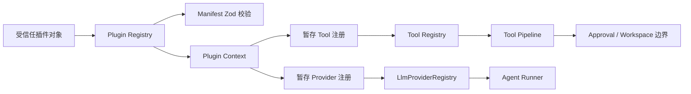

# Weave Plugin Manifest 与受控插件注册设计

**日期：** 2026-11-16
**状态：** 待审阅
**目标阶段：** Weave Runtime 的 Plugin 基础契约

## 1. 背景

Weave 当前已经具备一组可以独立运行的基础能力：

- `@weave/llm` 提供统一的 `LlmClient` 和 `LlmProviderRegistry`；
- `@weave/runtime` 提供 Agent Runner、Tool Registry、Tool Pipeline、
  Approval Broker 和 Workspace Policy；
- `apps/server` 负责把这些能力装配成 HTTP 控制面；
- Studio 通过 HTTP/SSE 使用 Server，不直接依赖 Runtime。

当前的缺口是：这些能力还没有统一的插件注册边界。以后如果每个功能
都直接修改 Server 组合根，或者让插件直接拿到 Runtime 内部对象，插件
会逐渐变成一组没有约束的初始化脚本，难以支持 CLI、Desktop、Crew、
MCP 和第三方扩展。

Weave 的长期目标是让“工具、模型 Provider、命令、Skills 和 Crew
参与者”都可以通过插件扩展，但插件必须继续遵守 Workspace、Approval、
Tool Pipeline 和安全边界。本轮先建立最小、可测试的 Plugin Manifest 和
受控注册契约。

## 2. 目标

本轮建立一条受信任进程内插件的注册链路：

```text
Plugin Manifest
  -> Zod 校验
  -> Plugin Registry
  -> Plugin Context
  -> 受控注册 Tool / Provider
  -> Runtime / Server 使用
```

具体目标如下：

1. 新增独立的 `@weave/plugin` 包，隔离插件契约和生命周期；
2. 定义可校验的 `PluginManifest`，包含稳定 id、版本、API 版本和能力声明；
3. 定义 `WeavePlugin` 和受限的 `PluginContext`；
4. 允许受信任插件注册 Tool 和 LLM Provider；
5. 所有注册的 Tool 继续通过现有 `ToolRegistry` 和 `ToolPipeline` 执行；
6. 所有注册的 Provider 继续通过现有 `LlmProviderRegistry` 路由；
7. 插件初始化失败时不留下部分注册结果；
8. 插件 id、Tool 名称和 Provider id 重复时，在注册阶段明确失败；
9. 为后续动态加载、独立进程、MCP、Skills 和沙箱适配器保留稳定边界；
10. 增加包级测试、架构说明和面向学习的文档。

## 3. 非目标

本轮不实现以下能力：

- 从任意目录自动扫描插件；
- 远程下载、安装或更新插件；
- `npm install`、动态 `import()` 或执行不可信代码；
- 独立进程插件和 RPC；
- 插件沙箱、权限沙箱或容器执行；
- 插件市场、签名验证和供应链安全；
- 插件 UI 动态加载；
- Plugin 配置持久化和密钥管理；
- MCP、Skills 或 Crew 的具体适配器；
- 让插件直接执行文件、Shell、网络或数据库操作；
- 修改现有 Agent Loop、Session Event Store 或 Tool Pipeline 生命周期。

本轮的插件是宿主代码显式创建并注册的受信任对象。Manifest 负责描述
和校验插件身份，不能被误解为“拿到 Manifest 就能执行任意代码”。

## 4. 方案比较

### 方案 A：把 Plugin Registry 放进 `@weave/runtime`

Runtime 直接管理 Manifest、插件加载、能力注册和插件生命周期。

优点：

- 初始调用路径较短；
- Server 可以直接从 Runtime 取到插件能力。

缺点：

- Runtime 会同时承担 Agent 执行、工具执行、Provider 路由和插件管理；
- CLI、Desktop 和 Crew 需要复用插件时，Runtime 会持续膨胀；
- 动态加载、进程插件和沙箱边界容易污染 Runtime 核心；
- 插件与宿主的依赖关系不够清晰。

不采用该方案。

### 方案 B：独立的 `@weave/plugin`，由组合根装配

新增 `@weave/plugin`，它依赖已经稳定的 Runtime 和 LLM 注册契约。
插件包负责 Manifest、Plugin Context、注册校验和插件生命周期；Runtime
只负责执行已经注册的 Tool 和 Provider。

依赖方向为：

```text
protocol
  ↑
llm
  ↑
runtime
  ↑
plugin
  ↑
server / studio / cli / desktop
```

优点：

- Runtime 保持执行边界，不负责插件发现和加载；
- 插件契约可以被 Server、CLI、Desktop 和 Crew 复用；
- 后续可以替换 In-Process、Process、MCP 和 Sandbox Adapter；
- Tool Pipeline、Approval 和 Workspace 边界继续由宿主统一掌控；
- 适合逐步扩展，而不需要一开始实现完整插件市场。

这是本轮采用的方案。

### 方案 C：先在 `apps/server` 中实现插件

在 Server 中直接定义 Manifest 和插件初始化逻辑。

优点：

- 改动最少；
- 可以快速验证一个 Server 插件示例。

缺点：

- 插件只能服务于 HTTP Server；
- CLI、Desktop 和 Crew 以后需要重复实现；
- Server 会同时承担 HTTP、Runtime 装配和插件加载；
- 插件契约无法成为独立 SDK。

不采用该方案。

## 5. 总体架构



插件注册发生在组合根。以 Server 为例，装配关系如下：

```text
Server Composition Root
  -> createToolRegistry()
  -> createLlmProviderRegistry()
  -> createPluginRegistry(...)
  -> register(trustedPlugin)
  -> createToolPipeline(...)
  -> createAgentRunner(...)
  -> createApp(...)
```

插件不能反向导入 `apps/server`，不能创建第二个 HTTP 控制面，也不能把
自己的工具实现直接交给 Agent Runner。Agent Runner 只消费宿主组装好的
Registry 和 Pipeline。

## 6. 包边界

新增包：

```text
packages/plugin/
  src/
    manifest.ts
    plugin-types.ts
    plugin-errors.ts
    plugin-registry.ts
    index.ts
  test/
    manifest.test.ts
    plugin-registry.test.ts
```

职责划分如下：

- `manifest.ts`：Manifest 类型、Zod Schema 和 API 版本常量；
- `plugin-types.ts`：`WeavePlugin`、`PluginContext` 和插件快照类型；
- `plugin-errors.ts`：稳定的插件错误码和错误类型；
- `plugin-registry.ts`：插件校验、初始化、暂存注册、提交和销毁；
- `index.ts`：公开包 API；
- `test/`：只验证插件边界和注册行为，不把测试放入 `src/`。

依赖规则：

- `@weave/plugin` 可以依赖 `@weave/protocol`、`@weave/llm` 和
  `@weave/runtime`；
- `@weave/plugin` 不依赖 `apps/server`、Hono、React 或浏览器 API；
- `@weave/runtime` 不反向依赖 `@weave/plugin`；
- Server 或未来其他宿主负责同时创建 Runtime Registry 和 Plugin Registry；
- 插件实现可以依赖 `@weave/plugin` 以及它需要的公共包，但不能依赖宿主
  应用内部文件。

## 7. Manifest 设计

第一版 Manifest 只描述插件身份和能力，不描述入口文件，也不承担动态
加载任务：

```ts
type PluginCapability = 'tool' | 'llm-provider';

interface PluginManifest {
  readonly id: string;
  readonly name: string;
  readonly version: string;
  readonly apiVersion: string;
  readonly description?: string;
  readonly capabilities: readonly PluginCapability[];
}
```

字段含义：

| 字段 | 作用 |
| --- | --- |
| `id` | 机器使用的稳定插件标识，整个宿主内唯一 |
| `name` | 人类可读的插件名称 |
| `version` | 插件自身版本，用于诊断和未来兼容判断 |
| `apiVersion` | 插件依赖的 Weave Plugin API 版本 |
| `description` | 展示和诊断用说明 |
| `capabilities` | 插件声明会注册的能力类型 |

第一版校验规则：

- `id`、`name`、`version`、`apiVersion` 不能为空；
- `id` 使用小写字母、数字和连字符，首尾不能是连字符；
- `version` 和 `apiVersion` 使用三段数字版本格式；
- `capabilities` 至少包含一项；
- `capabilities` 不允许重复；
- Manifest 使用严格对象校验，未知字段直接拒绝；
- `apiVersion` 必须等于当前宿主支持的 API 版本 `1.0.0`。

Manifest 是声明性元数据。它不会因为声明了 `tool` 或
`llm-provider` 就自动获得对应权限。实际注册内容必须和声明一致：

- 插件声明 `tool`，但没有注册 Tool：允许，表示插件能力暂时未启用；
- 插件注册 Tool，但没有声明 `tool`：拒绝注册；
- 插件注册 Provider，但没有声明 `llm-provider`：拒绝注册；
- 插件没有声明某能力，却试图通过 Context 注册该能力：失败并回滚。

第一版不引入完整 SemVer 范围解析。宿主只检查 API 主版本和当前精确
兼容版本，避免在没有真实兼容矩阵之前制造复杂的版本推导。

## 8. Plugin 与 Context

插件对外提供一个 Manifest 和一个初始化函数：

```ts
interface WeavePlugin {
  readonly manifest: PluginManifest;
  setup(context: PluginContext): void | Promise<void>;
  dispose?(): void | Promise<void>;
}
```

`PluginContext` 只暴露受控的注册方法：

```ts
interface PluginContext {
  registerTool<TInput, TOutput>(tool: ToolDefinition<TInput, TOutput>): void;
  registerProvider(provider: LlmProviderRegistration): void;
}
```

Context 不暴露：

- `Runtime` 实例；
- `ServiceContainer`；
- `SessionEventStore`；
- `ApprovalBroker` 的内部 Map；
- Workspace 根目录；
- Node `fs`、`child_process` 或原始网络客户端；
- Server 的 Hono App；
- 浏览器对象和 Studio 状态。

这不是为了限制插件的表达能力，而是把副作用集中在宿主已经验证过的
边界内。插件可以实现工具逻辑，但工具执行时仍然必须收到
`ToolExecutionContext`，并由 Tool Pipeline 负责参数校验、审批、超时、
取消和结果序列化。

## 9. Plugin Registry 生命周期

`PluginRegistry` 负责插件注册和状态查询：

```ts
interface PluginRegistry {
  register(plugin: WeavePlugin): Promise<PluginSnapshot>;
  get(pluginId: string): PluginSnapshot | undefined;
  list(): readonly PluginSnapshot[];
  dispose(): Promise<void>;
}
```

创建 Registry 时注入宿主已有的能力注册表：

```ts
interface PluginRegistryOptions {
  readonly toolRegistry: ToolRegistry;
  readonly providerRegistry: LlmProviderRegistry;
  readonly apiVersion?: string;
}
```

注册过程分为五步：

1. 使用 Zod 校验 Manifest 和插件对象；
2. 校验 API 版本、插件 id 和能力声明；
3. 创建本次注册专用的暂存 Context；
4. 执行 `plugin.setup(context)`，收集 Tool 和 Provider；
5. 预检查所有名称冲突后，一次性提交到宿主 Registry。

只有第五步完成后，插件才会出现在 `PluginRegistry.list()` 中。`setup`
抛错、能力声明不匹配、名称冲突或宿主 Registry 校验失败时，本次插件
不会留下已经注册一半的 Tool 或 Provider。

在同一个宿主中：

- 插件 id 必须唯一；
- Tool 名称必须遵守现有 Tool Registry 的全局唯一规则；
- Provider id 必须遵守现有 LLM Provider Registry 的全局唯一规则；
- Plugin Registry 的 `register()` 调用按顺序完成，避免两个异步初始化
  同时提交导致检查和提交之间出现竞态；
- `dispose()` 按注册逆序调用插件的 `dispose`；
- 一个插件销毁失败时，其他插件仍然继续销毁，最后用
  `AggregateError` 暴露所有失败。

第一版不支持卸载后重新提交已占用的 Tool 或 Provider。由于当前 Registry
没有删除能力，插件生命周期只支持“注册一次、Runtime 停止时销毁”。
真正的热插拔需要独立的所有权、引用计数和动态路由设计，应放到后续主题。

## 10. Tool 与 Provider 的边界

插件注册 Tool 后，实际调用路径是：

```text
Agent Runner
  -> Tool Registry
  -> Tool Pipeline
  -> inputSchema
  -> Approval Broker（如果声明）
  -> ToolExecutionContext
  -> plugin tool.execute()
```

插件注册 Provider 后，实际调用路径是：

```text
Agent Request.provider
  -> LlmProviderRegistry
  -> plugin-owned LlmClient
  -> Agent Runner
  -> HTTP/SSE
```

Provider 的 API Key、Base URL 和客户端内部状态不会出现在
`PluginSnapshot`、Session Event、SSE 事件或 Studio API 响应中。插件可以
注册一个带私有配置的 `LlmClient`，但公开信息仍然只能来自现有的
`LlmProviderDescriptor`。

插件不能通过自定义 Tool 绕过 Pipeline。宿主不向插件提供“直接执行工具”
的快捷方法，也不允许 Agent Runner 读取插件内部的 `execute` 函数。

## 11. 错误模型

新增稳定错误码：

```ts
type PluginErrorCode =
  | 'plugin-invalid-manifest'
  | 'plugin-invalid-definition'
  | 'plugin-api-version-unsupported'
  | 'plugin-duplicate-id'
  | 'plugin-capability-not-declared'
  | 'plugin-setup-failed'
  | 'plugin-registration-conflict'
  | 'plugin-dispose-failed';
```

错误要求：

- 错误码稳定，宿主可以据此决定启动失败还是记录诊断；
- 错误消息包含插件 id 和失败阶段，但不包含 API Key、完整 Provider
  配置或工具输入；
- Manifest 校验错误保留 Zod 错误作为 `cause`；
- `setup()` 原始错误作为 `cause` 暴露，不包装成无法定位的通用错误；
- 部分注册失败必须以 `plugin-registration-conflict` 或明确的下层
  Registry 错误结束；
- 插件启动失败不能让已经成功注册的其他插件回滚。

当前 Server 组合根中，内置插件注册失败应阻止 Server 启动，因为这表示
宿主代码和部署配置不一致。未来外部插件可以有“跳过失败插件、继续启动”
的策略，但这需要插件来源可信度和配置级别，暂不提前加入。

## 12. 安全边界

第一版的安全模型是“受信任代码 + 受控能力注册”，不是沙箱：

- 插件代码本身必须被宿主显式导入，因此宿主信任插件包；
- Manifest 只负责身份、能力和 API 兼容检查；
- Plugin Context 不暴露宿主内部服务；
- Tool 执行继续经过 Tool Pipeline；
- 文件访问继续经过 Workspace Policy 和 Workspace File Tools；
- 高风险操作继续经过 Approval Broker；
- Provider 元数据继续经过脱敏接口；
- 插件不能自行修改 Session Event Store；
- 插件不能自己创建 Server 路由或绕过 HTTP 控制面。

必须明确：进程内插件无法防止恶意代码直接调用 Node API。真正的不可信
插件支持需要独立进程、权限代理、资源限制和通信协议，不能仅靠
TypeScript 类型或 Manifest 解决。因此本轮不对第三方代码宣称沙箱能力。

## 13. 测试策略

### Manifest 测试

- 合法 Manifest 可以通过校验；
- 缺少必填字段被拒绝；
- 非法 id、版本和空能力列表被拒绝；
- 重复能力被拒绝；
- 未知字段被拒绝；
- 不匹配 API 版本被拒绝。

### Registry 测试

- 可以注册并查询插件；
- `list()` 返回公开、冻结的插件快照；
- 重复插件 id 被拒绝；
- 未声明的 Tool 能力被拒绝；
- 未声明的 Provider 能力被拒绝；
- `setup()` 失败时不留下任何 Tool 或 Provider；
- Tool 名称冲突时不留下部分注册结果；
- Provider id 冲突时不留下部分注册结果；
- Tool 通过宿主 Pipeline 执行；
- Provider 通过宿主 Provider Registry 查询；
- API Key 不出现在插件快照中；
- `dispose()` 按逆序执行；
- 多个销毁失败会聚合。

### 边界测试

- Plugin 包不导入 Server 或 React；
- Server 组合根可以显式装配插件；
- 不配置插件时现有 Mock Provider、Agent 和 Studio 流程不受影响。

测试只验证 Plugin 契约和注册行为。Workspace、Approval、Agent Loop
的已有行为继续由各自包的测试负责，避免复制测试。

## 14. 实施顺序

实现阶段拆成一个独立功能分支，但按以下顺序推进：

1. 创建 `@weave/plugin` 包和基础构建配置；
2. 实现 Manifest Schema、API 版本和错误类型；
3. 实现 `PluginContext` 的暂存注册；
4. 实现 Plugin Registry 的校验、预检查、提交和查询；
5. 增加 Manifest 和 Registry 测试；
6. 在 Server 组合根注册一个最小内置示例插件；
7. 让示例 Tool 继续通过现有 Tool Pipeline；
8. 让示例 Provider 继续通过现有 Provider Registry；
9. 补充架构文档、README 和学习文档；
10. 执行 `pnpm check`，创建 PR 并使用自动 squash merge 合入 `main`。

第 6 到第 8 步是否放入同一个实现分支，取决于实现时对 Server 组合根
的改动大小。如果示例插件会同时改变 Server、Runtime 和 Studio 契约，
应拆成后续独立分支，保持一个分支只解决一个主题。

## 15. 后续演进

本轮完成后，插件能力可以沿着同一个 Manifest 和宿主 Context 演进：

```text
受信任进程内插件
        ↓
独立进程插件 / RPC
        ↓
MCP Plugin Adapter
        ↓
Skills Plugin Adapter
        ↓
Sandbox Plugin Adapter
        ↓
Crew Provider / Agent Plugin
```

后续每一种执行方式都应实现独立 Adapter，而不是把进程管理、协议转换
和安全策略塞进 Plugin Registry。Registry 负责“这个插件是什么、声明了
什么、是否被宿主接受”；Adapter 负责“这个插件如何运行”。

面试时可以这样解释本轮边界：

> Weave 没有把插件做成任意代码加载器，而是先定义 Manifest 和受控
> Context。插件只能向宿主登记 Tool 或 Provider，执行仍然走共享的
> Tool Pipeline、Approval、Workspace 和 Provider Registry。这样先验证
> 插件化的核心契约，再为进程插件和沙箱留下替换 Adapter 的位置。
