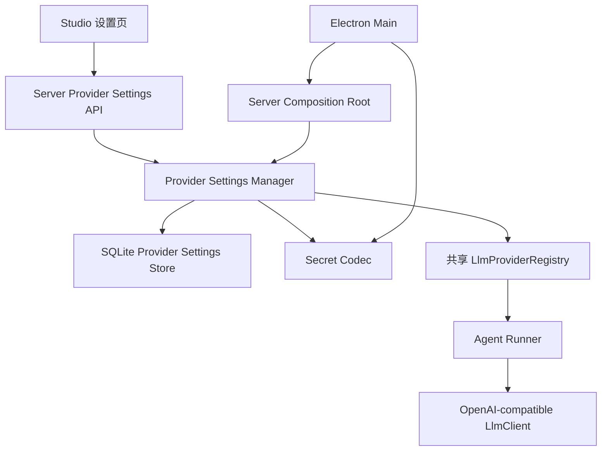
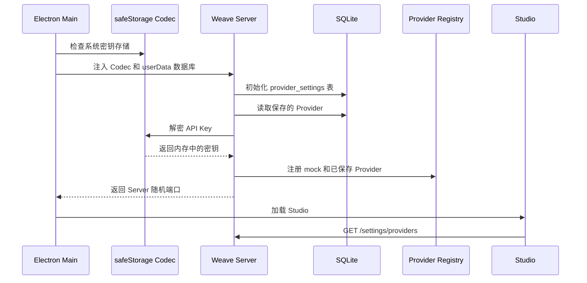

# Weave Provider Settings Design

**日期：** 2026-11-17
**功能分支：** `feat/provider-settings`
**状态：** 已实现

## 1. 背景

Weave 当前通过根目录 `.env` 中的 `WEAVE_LLM_PROVIDERS` 配置 DeepSeek 等
OpenAI-compatible Provider。Server 可以读取配置，Studio 也可以选择 Provider
和模型，但用户不能在应用内维护配置。

这会带来三个问题：

1. 用户需要手动编辑 `.env`，桌面应用没有真正的配置入口；
2. 修改 Provider 后需要重新启动 Server；
3. 多个 AI 服务和多个模型配置不适合长期依赖环境变量维护。

本功能为 Desktop 增加 Provider 设置面板。用户可以在设置中添加、编辑、删除
OpenAI-compatible Provider，填写 API 地址、API Key 和默认模型，并选择默认
Provider。浏览器模式继续使用 `.env`，暂不开放写入密钥。

## 2. 目标与非目标

### 2.1 目标

- Desktop 设置页可以管理多个 Provider；
- 支持 DeepSeek、OpenAI、Moonshot、SiliconFlow 等 OpenAI-compatible 服务；
- API Key 在 Desktop 本地应用数据目录中加密保存；
- Server 启动时恢复已保存的 Provider；
- 保存、编辑、删除和切换默认 Provider 后立即影响后续 Agent 请求；
- 设置页只显示 API Key 是否已配置，不返回真实密钥；
- Provider 配置错误使用稳定错误码返回；
- 配置 API 不把密钥写入 Session、SSE、日志和错误消息；
- 浏览器模式保持环境变量只读配置；
- 不破坏现有的 Mock Provider 和受信任插件 Provider。

### 2.2 非目标

- 本轮不实现模型列表自动发现；
- 本轮不实现每个 Provider 的多个模型实体管理；
- 本轮不实现远程账号同步；
- 本轮不实现云端密钥托管；
- 本轮不实现 GitHub 插件安装；
- 本轮不实现 API Key 分享或导出；
- 本轮不自动迁移旧的 `.env` 配置到数据库。

## 3. 设计决策

### 3.1 Desktop 可写，浏览器只读

配置写入能力只在 Desktop Server 中启用。Electron Main 启动 Server 时注入
Provider Settings Store 和 Secret Codec；普通 `pnpm dev` 启动的浏览器模式没有
这两个依赖。

浏览器模式仍然可以：

- 读取通过 `WEAVE_LLM_PROVIDERS` 配置的 Provider；
- 在 Studio 中选择 Provider 和模型；
- 运行 Agent。

浏览器模式不能：

- 创建 Provider；
- 修改 API Key；
- 删除 Provider；
- 修改默认 Provider。

浏览器模式的设置页显示只读提示，避免用户以为网页可以安全管理本机密钥。

### 3.2 密钥只在本地边界内短暂传输

设置页提交时，API Key 会随本地请求发送给 Server。这个请求只允许发往当前
loopback Server，并且只在保存时存在于请求体和 Server 的内存中。

Server 处理密钥的顺序是：

```text
Studio 设置表单
  -> loopback 配置 API
  -> Zod 校验
  -> Secret Codec 加密
  -> SQLite 保存密文
  -> 内存 Provider Registry 保存 LlmClient
```

API 响应只返回：

```json
{
  "id": "deepseek",
  "label": "DeepSeek",
  "type": "openai-compatible",
  "baseUrl": "https://api.deepseek.com",
  "defaultModel": "deepseek-chat",
  "hasApiKey": true
}
```

真实 API Key 不会返回给 Studio，不会保存到浏览器状态，不会写入 Session 事件，
不会通过 SSE 传输，也不会包含在错误信息中。

这是一条本地应用边界，不代表 API Key 可以被远程网页安全管理。Server 仍然只
监听 `127.0.0.1`，CORS 继续使用精确的 Studio Origin。

### 3.3 使用 Electron safeStorage 加密

Desktop 的 Secret Codec 使用 Electron `safeStorage`：

- `encrypt(value)` 将 API Key 转换为密文；
- `decrypt(value)` 只在 Server 启动恢复 Provider 时调用；
- `isEncryptionAvailable()` 为 false 时拒绝保存，并向设置页返回可读错误；
- 不提供明文文件回退；
- 不把加密密钥暴露给 Renderer。

Server 和测试不依赖 Electron，而是依赖一个很小的接口：

```ts
interface SecretCodec {
  isAvailable(): boolean;
  encrypt(value: string): string;
  decrypt(value: string): string;
}
```

生产桌面端由 Electron 注入实现，Server 单元测试使用确定性的 fake codec。
浏览器模式不创建可写 Store，因此不需要在普通 Node Server 中伪造桌面密钥存储。

### 3.4 Provider Registry 保持同一个实例

当前 Agent Runner 在启动时拿到一个 `LlmProviderRegistry`。为了让配置保存后
立即生效，不能每次修改都重新创建 Runtime 或 Agent Runner。

本轮扩展 Registry，使它可以在保留同一对象引用的情况下：

- 注册 Provider；
- 移除由 Provider Settings Manager 管理的 Provider；
- 重新注册保存后的 Provider；
- 保留 Mock Provider；
- 保留受信任插件注册的 Provider。

Provider Settings Manager 只记录自己创建的 Provider id。删除或刷新配置时，
只移除它管理的 Provider，不调用全量清空，因此不会误删插件 Provider。

## 4. 分层结构



### Electron Main

- 创建 `safeStorage` Secret Codec；
- 将 Codec 注入 Server；
- 继续负责 Server 生命周期和数据库路径；
- 不读取或显示 API Key；
- 不直接实现 Provider 路由。

### Server

- 创建 Provider Settings Store；
- 创建 Provider Settings Manager；
- 挂载配置 API；
- 在启动时恢复保存的 Provider；
- 将 Manager 管理的 Provider 注册到共享 Registry；
- 把配置变更后的 Registry 继续提供给 Agent Runner。

### Runtime

- 继续通过 Registry 按 Provider id 获取 LlmClient；
- 不知道 API Key 来自环境变量还是 SQLite；
- 不负责设置页面、加密和配置 API。

### Studio

- 展示 Provider 列表和脱敏状态；
- 维护表单输入状态；
- 提交配置并展示成功或失败结果；
- 聊天请求仍然只提交 `provider` 和 `model`；
- 不保存 API Key 到 localStorage、Session 或全局 Provider 状态。

## 5. 数据模型

在现有应用 SQLite 文件中增加 Provider 配置表：

```sql
CREATE TABLE IF NOT EXISTS provider_settings (
  id TEXT PRIMARY KEY,
  label TEXT NOT NULL,
  type TEXT NOT NULL,
  base_url TEXT NOT NULL,
  encrypted_api_key TEXT,
  default_model TEXT NOT NULL,
  is_default INTEGER NOT NULL DEFAULT 0,
  created_at TEXT NOT NULL,
  updated_at TEXT NOT NULL
);
```

约束：

- `id` 是稳定的 Provider 标识；
- `type` 当前只接受 `openai-compatible`；
- `encrypted_api_key` 只保存 Secret Codec 输出；清除密钥时为 `NULL`；
- `is_default` 最多有一条为 1；
- `created_at` 和 `updated_at` 使用 ISO 8601；
- 表结构创建必须是幂等的；
- 删除最后一个外部 Provider 时，默认 Provider 回退到内置 `mock`；
- 现有 Project、Session 和事件表不受影响。

没有 API Key 的 Provider 仍然保留在设置列表中，并显示为“未配置密钥”，但不会
注册到可调用的 Provider Registry。用户重新保存 API Key 后，Provider 才会恢复到
Registry；这样“保留配置”和“允许模型调用”不会混为一谈。

环境变量 Provider 和数据库 Provider 的优先级：

1. Desktop 数据库配置；
2. 如果数据库没有对应配置，再使用环境变量配置；
3. 内置 `mock` 始终存在；
4. 同一 Provider id 不能同时由多个来源注册。

为了减少行为歧义，第一版实现中如果数据库存在可写配置，则数据库配置作为
Desktop 的外部 Provider 来源；`.env` 仍可用于首次启动和迁移前的开发验证，但
不会自动覆盖用户已经保存的同名配置。

## 6. HTTP API

### 6.1 查询 Provider

```http
GET /settings/providers
```

返回：

```json
{
  "providers": [
    {
      "id": "mock",
      "label": "本地演示",
      "type": "mock",
      "defaultModel": "weave-local-demo",
      "hasApiKey": false,
      "editable": false
    },
    {
      "id": "deepseek",
      "label": "DeepSeek",
      "type": "openai-compatible",
      "baseUrl": "https://api.deepseek.com",
      "defaultModel": "deepseek-chat",
      "hasApiKey": true,
      "editable": true
    }
  ],
  "defaultProvider": "deepseek",
  "canManage": true
}
```

`baseUrl` 可以返回，因为它不是凭据；`apiKey` 永远不返回。

### 6.2 创建 Provider

```http
POST /settings/providers
Content-Type: application/json

{
  "id": "deepseek",
  "label": "DeepSeek",
  "type": "openai-compatible",
  "baseUrl": "https://api.deepseek.com",
  "apiKey": "secret",
  "defaultModel": "deepseek-chat",
  "makeDefault": true
}
```

创建时 API Key 必填。成功响应返回脱敏后的 Provider 描述。

### 6.3 编辑 Provider

```http
PATCH /settings/providers/deepseek
Content-Type: application/json

{
  "label": "DeepSeek",
  "baseUrl": "https://api.deepseek.com",
  "apiKey": "",
  "defaultModel": "deepseek-chat"
}
```

编辑时空 API Key 表示保留旧密钥，不能用空字符串覆盖已有密钥。用户需要清除
密钥时，使用明确的 `clearApiKey: true` 字段，避免把“未填写”和“删除密钥”混为
一谈。

### 6.4 删除 Provider

```http
DELETE /settings/providers/deepseek
```

不能删除内置 `mock`，不能删除插件注册的 Provider。删除默认 Provider 后，
系统自动将 `mock` 设为默认。

### 6.5 设置默认 Provider

```http
POST /settings/providers/deepseek/default
```

设置默认 Provider 必须保证该 Provider 当前可用，并且配置已经通过 Zod 校验。

### 6.6 错误码

| 错误码 | 含义 |
| --- | --- |
| `provider-settings-desktop-only` | 当前 Server 未启用可写配置 |
| `provider-settings-invalid` | 请求字段校验失败 |
| `provider-settings-not-found` | Provider 不存在 |
| `provider-settings-duplicate` | Provider id 已存在 |
| `provider-settings-protected` | 内置或插件 Provider 不可修改 |
| `provider-settings-secret-unavailable` | 系统密钥存储不可用 |
| `provider-settings-secret-invalid` | 密钥解密失败 |
| `provider-settings-storage` | SQLite 配置存储失败 |
| `provider-settings-provider-invalid` | Provider 客户端创建失败 |

错误消息可以告诉用户失败阶段，但不能包含 API Key、完整 Authorization Header
或上游响应中的密钥内容。

## 7. 设置页交互

设置页分为三部分：

### Provider 列表

- 显示名称、Provider id、接口类型、默认模型；
- 显示“已配置密钥”或“未配置密钥”；
- 显示默认标记；
- 只对可编辑 Provider 显示编辑和删除按钮；
- API Key 始终显示为脱敏状态。

### 新增/编辑表单

- Provider 名称；
- Provider id；
- API Base URL；
- API Key；
- 默认模型；
- 设为默认；
- 保存；
- 取消。

编辑已配置 Provider 时，API Key 输入框默认为空，旁边显示“留空表示保持当前
密钥”。这样不会把真实密钥重新填回页面。

### 浏览器模式提示

浏览器模式的设置页仍然可以查看 Provider 元数据，但显示：

```text
当前为浏览器开发模式。Provider 密钥请通过根目录 .env 配置。
启动 Desktop 后，可以在设置中管理本地密钥。
```

## 8. 启动与恢复

Desktop 启动顺序调整为：



如果某个 Provider 的密钥解密失败，Server 不应把整个应用打挂。该 Provider
仍保留在设置列表中并显示为已配置密钥，但不会注册到可调用 Registry，默认
Provider 回退到可用的 Mock。用户可以在设置页重新保存密钥，让它恢复可调用状态。

## 9. 测试策略

### Server

- Zod 拒绝空 id、非法 URL、空模型和未知字段；
- 创建 Provider 后可以通过公开列表看到元数据；
- API Key 不出现在响应、序列化结果和错误消息；
- 编辑时空 API Key 保留旧密钥；
- `clearApiKey` 可以明确清除密钥；
- 删除 Provider 后不能再路由请求；
- 删除默认 Provider 后回退到 mock；
- 浏览器模式写接口返回 `provider-settings-desktop-only`；
- 配置重启后可以从 SQLite 恢复；
- 密钥解密失败不会导致 Mock Provider 失效；
- 插件 Provider 不会被设置页刷新和删除逻辑误删。

### LLM Registry / Runtime

- Registry 在原对象引用不变的情况下刷新外部 Provider；
- 新的 Agent Run 使用更新后的 LlmClient；
- 已经运行中的 Agent Run 不被配置变更中断；
- 未知 Provider 继续返回 `agent-provider-unavailable`。

### Studio

- 设置页可以加载脱敏 Provider；
- Desktop 模式显示新增、编辑、删除和设为默认操作；
- 保存后刷新列表和聊天 Provider 选择；
- 编辑时不把旧密钥写入输入框；
- 保存失败显示稳定错误提示；
- 浏览器模式隐藏写操作并显示 `.env` 提示。

### Desktop

- `safeStorage` 可用时能够创建 Secret Codec；
- `safeStorage` 不可用时阻止保存；
- Server 启动时收到正确的应用数据目录和 Codec；
- Preload 不暴露原始 `safeStorage`、Node API 或任意 IPC。

## 10. 验收标准

完成后，用户可以：

1. 执行 `pnpm desktop:dev`；
2. 打开“设置”；
3. 添加 DeepSeek Provider；
4. 填写 Base URL、API Key 和 `deepseek-chat`；
5. 将 DeepSeek 设置为默认；
6. 返回工作台发送消息；
7. 不重启应用直接完成真实模型对话；
8. 重启 Desktop 后 Provider 仍然存在；
9. 在页面上看不到完整 API Key；
10. 删除 Provider 后，聊天不会再把请求路由到该 Provider。

## 11. 后续演进

完成本功能后，下一阶段再考虑：

- “测试连接”按钮；
- Provider 的模型下拉发现；
- 系统密钥链迁移和密钥轮换；
- GitHub 插件中的 Provider 安装；
- 插件 Provider 的独立配置页；
- 多账号和账号别名；
- 导入已有 `.env` 配置的显式迁移向导。
